# Reel Lives: dev log (Epic AI MegaJam 2026)

Solo developer directing AI agents. Theme: Director's Cut.
This log records what I asked the agents to do, what they did, what made the cut and what didn't.
Times are South Africa time (UTC+2). Screenshots are in `devlog-shots/`.

---

## Pre-jam (declared material)

### 2026-11-11: Concept
- Theme revealed: "Director's Cut".
- Brainstormed with Claude and agreed on **Reel Lives**: an isometric runner across parallel film strips, each one a different life of the same person. Gremlins wreck the reels, a clapperboard knocks them off, and the Cut chews up the film from behind.
- Wrote `DESIGN-BRIEF.md`. No code, assets or levels. Declared as pre-jam material.
- Tried an agent-driven overnight download of UE 5.9 Preview with a scheduled task. It got too fiddly, so I cancelled it and started the download by hand.

---

## Day 1: 2026-11-12

### 08:26: Setting up MCP
- Asked Claude for the full UE 5.9 MCP setup. It found the engine installed and the Unreal MCP already connected, but **All Toolsets** was off. Only PCG, UMG, Sequencer and Fab tools were showing, with nothing for actors, levels or Blueprints.

### ~08:40: First setback: the compiler
- My first C++ project failed to build. UE 5.9 bans MSVC 14.51 (the only one I had) and wants 14.50.
- The agent had flagged this risk the night before ("first C++ class will tell") but never checked it before the jam. Lesson: a setup isn't ready until an empty C++ project has built.
- **Director's call:** no download mid-jam. Dropped C++ and started a new **Blueprint-only** project. Blueprint-only projects package without Visual Studio.

### ~09:00: Full theme text
- Read the full brief. "Build the feature that didn't make it" fits Reel Lives as it stands. "You're directing the agents too" became this log.
- Rule for all agents from now on: log every meaningful step, screenshot the key moments, and keep the cutting room floor below.

### 09:14: Idea refinement pass (no build work)
- Asked Claude to review the brief and a side chat I'd had with another LLM (Meta AI) about a similar "jump between film-strip timelines" runner, and make the visuals less vague.
- Added a "Refinement pass" section to `DESIGN-BRIEF.md`: an ASCII mock of one screen, the player taking on the look of whichever strip they're on, one material per life, the childhood section as the tutorial, and locked rules (three inputs; the clap hits only your strip; no clapping mid-hop; hit-stop).
- **Kept from the Meta chat:** one mesh with a different tint per lane, the order it teaches things in, the "commit to a lane to attack" rule, and deliberately taking a debuff as a puzzle.
- **Cut:** its Past/Present/Future framing and its enemy roster (ours carry the theme better). Proposed cutting 5 strips down to 3 for the build.
- **Director's call:** locked 3 strips (1 → 3 → 1). Five is a stretch goal.

### 09:25: Art direction and asset pipeline (draft)
- Asked Claude how to build the look with the jam's text-to-3D tokens and Blender MCP. My brief: semi steampunk / dieselpunk, old paper, old film, vintage, not real but close to it.
- Claude drafted `docs/ART-DIRECTION.md`: a style called "Nitratepunk" (1900-1940 film-industry machinery: brass, celluloid, card, halftone paper), the scene in layers (supply spools on the right, the Cut on the left), one house material plus a projector post-process to unify everything, where each asset comes from, and a HUD made of studio objects (slate, footage counter, film cans, gauge, ticket stub, intertitles).
- Key idea kept: throw away the text-to-3D textures and apply our own material. Pop-up life scenes are text-to-3D models rendered flat in Blender with ink lines, so they match without Midjourney.
- Not decided yet: the style name, which text-to-3D service and how many tokens.

### 09:29: Concept art prompts and a juice bible
- Asked for a descriptive concept-art prompt with the UI and as many elements as possible, and stressed that the game needs tons of game, audio and excitement juice.
- Claude wrote `docs/CONCEPT-PROMPT.md`: a master in-game screenshot prompt with the full HUD, a negative prompt, five short variant prompts (title screen, the Cut, gremlin sheet, hero sheet, end montage), and a juice table that gives every action visual, audio and excitement feedback.
- Biggest new idea: an unseen **live accompanist** (ragtime piano and organ that react to play), a **cinema audience** (gasps, laughs, applause) and a **megaphone director** ("ACTION!" / "CUT!" / "THAT'S A WRAP!"). Hops are jump cuts. Combos are counted as "Takes".
- Rule: juice goes in from the grey box and is part of the kill test.

### 12:06: Jam API credits wired up for delegated workers
- Anthropic's jam API credits (first tranche $25) landed on the Claude Console org for my normal account. Asked whether a second, credit-billed Claude could take on side work like modelling.
- Claude wrote `setup/delegate.ps1`. It runs a headless `claude -p` job with the API key set only for that one process, so jobs bill the credits and my subscription sessions stay on the subscription. Each job writes its result and cost to `setup/logs/delegate/`.
- Kept: an API key over a separate Claude Code login, because a separate config folder would leave the workers without the Blender, Unreal and fal MCP servers. Also skipped the `ant` CLI (it's a raw API client, not an agent).
- Test: a Haiku job answered "CREDITS OK" for $0.0015.
- Rule: workers don't touch DEVLOG or drive Unreal unless told; the lead session logs their work.

### Text-to-3D service settled: Tripo3D
- Tripo3D gave us 3000 credits for the jam. That answers the open question in `ART-DIRECTION.md` about which text-to-3D service to use.
- Plan unchanged: generate shapes in Tripo, discard its textures, apply our house material in Blender, then import to Unreal.

### 12:38: Concept review: renders, Rive and a robot hero (no build work)
- I generated two concept renders from Claude's prompt and liked the feel: [Sample-screen.png](Sample-screen.png) (pop-up cards on the strips) and [sample-screen_GPT.png](sample-screen_GPT.png) (scenes painted inside the frames). Asked Claude how close the build can get, whether Rive can do the UI, and whether a small clockwork robot should replace the human runner.
- **How close:** Claude's estimate is HUD about 90%, strips and cards about 85%, the Cut and reels about 70%, the hero about 60% as a human. The first render is the target because it is built from flat cards, one beam and a 2D HUD, which are all cheap in Unreal. The second render is prettier but harder to read at speed.
- **New rule proposed:** art printed flat in a frame is flavour; anything that stands up is gameplay.
- **Rive:** the Unreal plugin lists UE 5.6 to 5.8 (release 0.4.26), with no mention of 5.9 Preview. It is a C++ plugin and we cannot compile one (MSVC ban). Proposal: do not depend on it. Build the HUD in UMG. Rive stays possible as a design tool only if it exports image sequences.
- **Robot hero:** Claude backs it. Rigid parts need no skinning and can be animated in Blueprint (spinning key, bobbing body, snapping clapper). Proposed design: a wind-up robot whose head is the clapperboard. Proposed story: the reels are the possible lives of the robot's maker, and he builds the robot in only one of them, so the final cut can erase the player.
- Written into `DESIGN-BRIEF.md` as a proposal. **Waiting on my call.**

### 12:42: Director's call: the robot is the hero
- **Locked:** a wind-up robot with a clapperboard head replaces the human runner. The strips are now the lives of its Maker (Tinkerer, Sailor, Musician), and he builds the robot in only one of them.
- Claude updated `DESIGN-BRIEF.md` (one-liner and the robot section, now marked locked), the player row in `ART-DIRECTION.md`, and the hero text in `CONCEPT-PROMPT.md`, with a full robot design-sheet prompt and its own negative prompt.
- **Cut:** the human hero, the hat swap and the time-travel framing (see the table below). Rive in-engine is also cut.
- Claude priced a robot concept sheet on fal: Nano Banana 2 lists $0.08 per image, so four sheets are about $0.32. The newer Nano Banana 2.1 only reports "$1 per unit" with no unit size, so it was passed over. Nothing rendered yet; waiting on my go-ahead.
- I said I still want the parts left behind to come back as a boss, but could not see how in this version. Claude proposed **the Outtake**: a paper-collage Maker spliced from the lives I cut, waiting at the end of the last strip, throwing the hazards of those lives; clap them back three times to beat it. It reuses the flat cards, the hazards and the clap. Written into the brief as a stretch goal with a no-boss fallback. Not locked.

### 12:51: "Where did the sailor come from?" Story made cohesive (proposal)
- I asked where the Sailor and the other lives came from and how they tie to the robot. Honest answer from Claude: they were example lives from the first brainstorm, and it carried them into the art and prompt docs as if I had chosen them. They have no link to a man who builds a robot. A small setback: an agent's placeholder became canon because nobody questioned it.
- Claude proposed one spine where everything comes out of a projection booth. The Maker is a boy who grows up in a small-town picture house. His three lives are three answers to one fork: **the Booth** (he stays as projectionist and builds the robot because he is alone), **the Studio** (he leaves and becomes a director) and **the Home** (he stays for her and leaves film). Each life is a film stock: 35mm sepia, silver-screen black-and-white, 8mm home movie.
- Keepsakes become robot parts. In the Studio and the Home the robot is only a sketch he never built, which is the jam theme said directly. The robot stays alive only if it keeps its maker in the lonely life.
- The seed would now give a new cut of the same Maker, not a new person. Less to build.
- Written into `DESIGN-BRIEF.md` as a proposal. **Waiting on my call.**

### 13:06: Director's call: Booth, Studio, Home locked, and it is a multiverse
- **Locked:** the Maker's three lives are the Booth, the Studio and the Home.
- I reminded Claude that my first idea was a multiverse: choices branch, and each version of the person carries on in its own universe while the robot hops between them. I floated wider versions (a soldier, a scientist) but was not sure they were worth it.
- Claude's answer: the structure already is that. The strips run at the same moment in three universes. What was missing was showing it. Added to the brief: strips labelled TAKE 1 / 2 / 3, the same year card on all three strips in line, and forks that split on screen.
- **Kept for later:** wider lives are one data row each (cards, film stock, hazards, a robot trace). The Soldier is the first candidate for strip 4 in the five-strip stretch goal.
- Claude updated the colour rule and asset table in `ART-DIRECTION.md`, and the master prompt, fork signs and music motifs in `CONCEPT-PROMPT.md`.
- The concept is now settled enough to build. No grey box exists yet.

### 13:27: First playable grey box, with juice from the first minute
- I told Claude that Blender and the Unreal tools were ready, to build juice in from the start, and to use the Disney animators' 12 principles as the guide for all motion.
- Claude added a 12-principles table to `CONCEPT-PROMPT.md`, one row per principle, each mapped to something a rigid robot can do (scale, rotation, timing, loose parts).
- **Built through the Unreal MCP, all Blueprint, no hand edits** (in `/Game/ReelLives`):
  - `L_GreyBox`: a new empty level. The project's default `Level_1` is an open-world landscape and is not used.
  - `BP_Slab`: one film frame. 54 of them make three strips that scroll right to left at 700 (Studio), 300 (Booth) and 480 (Home) units a second, tinted per film stock.
  - `BP_Robot`: the hero, made of cubes: brass body, lens eye, spinning wind-up key and a two-piece clapperboard head on a hinge. It stands still; the film moves under it, as planned in the brief.
  - `BP_Gremlin`: a red cube that rides a strip toward the robot.
  - `BP_Director`: lays the strips, spawns gremlins, moves the Cut wall and runs the rules.
  - `M_Flat`: one material with a Color parameter, used by everything.
- **Controls:** W/S or Up/Down hop between strips. Space claps.
- **Juice that is already in:** hop on an arc with ease in and out (0.2 s); stretch in the air; squash on landing; lean into the hop; run bob; key always spinning; clap with 0.06 s anticipation, 0.03 s snap and a bounce back; white shock ring; camera shake on landing, clap, hit and hurt; 0.08 s hit-stop on every clap that connects; knocked gremlins fly off on an arc, spinning.
- **Rules in:** the clap only hits gremlins on your own strip, and you cannot clap in mid-hop. The Cut gains on the slow strip and falls back on the fast one. A gremlin that reaches you costs 160 units of distance. If the Cut reaches you it prints "CUT!" and resets.
- **Checked by Claude in the running game:** the hop changes lane, the landing squash shows, the clap fires and its ring shows, and the hurt and CUT rules fire. 
- **Not checked:** how it feels. The editor runs at about 3 frames a second when its window is not in front, so Claude could only test in slow motion. I have to play it.
- **Setbacks:** the cube mesh's default material has no colour parameter, so nothing took its tint on the first run ([shot](devlog-shots/2026-11-12_1327_greybox-first-run-no-colour.png)). After the material fix, the robot and the wall were still grey, because they were placed in the level before the material existed and had to be placed again. Two script syntax errors, each fixed on the next try.
- Shots: [colour working](devlog-shots/2026-11-12_1327_greybox-colour.png), [landing squash](devlog-shots/2026-11-12_1327_greybox-landing-squash.png), [clap ring](devlog-shots/2026-11-12_1327_greybox-clap-ring.png).
- **Not in yet:** sound, HUD (messages are debug text), lives, forks, burns, keepsakes, the X mark, falling between strips, combo display.

### Kill test passed (day 1, a day early)
- I played `L_GreyBox`. **The hop feels good.** The kill test in the brief was due by the end of day 2, so the core is safe and features can go on top.
- Next call: placeholder sounds first, because sound is the biggest piece of juice still missing.

### 16:32: Fast Forward burst, pickups, and a first (rejected) sound pass
- While Claude was adding sounds, I asked for a burst: a pickup or a one-use ability that boosts the player forward.
- **Fast Forward (kept):** press Shift or E. For 0.6 s the film runs up to 3.5 times faster, the robot lunges and stretches, the camera pulls back, and the Cut falls back about 420 units. The robot is safe during the burst and bowls over any gremlin on its strip, which counts as Takes. You start a run with one charge and hold one at most.
- **Pickup (kept):** a glowing gold cube (`BP_Pickup`) rides in every 9 to 14 seconds and refills the charge. It stands in for the mainspring keepsake.
- **Charge indicator with no HUD:** the wind-up key spins fast when a burst is ready and slow when it is spent.
- This adds a fourth input. The brief's "three inputs only" rule is now four: hop up, hop down, clap, burst.
- **Checked by Claude in the running game:** the burst fires and spends the charge, the strip speed and Cut distance follow it, a pickup spawns, and collecting it restores the charge. No runtime errors. [Burst shot](devlog-shots/2026-11-12_1632_fast-forward-burst.png). Not checked: knocking gremlins over during a burst, and the feel at full speed.
- **Sound, first pass:** Claude synthesised eight placeholder sounds in Python inside the editor (clack, hop, knock, hurt, Cut slam, projector loop, burst, pickup) and wired them in. The projector loop's pitch follows the strip speed, and each Take pitches the knock higher.
- **Director's call on sound:** they sound too "beedy-boppy" and need more punch. No more time on audio for now. The sounds stay in as placeholders; the real pass comes later with proper samples.
- **Setback:** I hit my usage limit in the middle of this step and had to wait for it to reset.

### 16:42: Character direction, the slate as HUD, and a plan to split work across models
- I played the build again: the game and the feel are really good already.
- I gave Claude three references (saved in `docs/character-refs/`): [my rough sketch](character-refs/robot-shane-rough-sketch.png), [a generated image that is almost there](character-refs/robot-generated-almost-there.webp) and [a real clapperboard](character-refs/real-clapperboard-reference.jpg). My notes: much cuter; the head must read as a real clapperboard; a friendly, cute tyrannosaur more than a duck, but neither.
- **My idea:** draw the character's expressions on the clapperboard, and put lives and other details there too, so the game needs almost no UI.
- **Claude's answer:** this is the cheap route, not the hard one. The slate is flat, so a face is one texture with eight chalk expressions and a material value that picks one. Lives become chalk tally marks, the combo goes in the TAKE box. One warning: the robot is small on screen, so numbers on its head will not be readable. Fix: draw the same slate large in a screen corner as a close-up of its head.
- **Kept:** chalk face on the slate, slate as HUD, the clapperboard turned over so the hinged stick is the jaw. **Cut:** the glass lens eye, and most of the brass HUD objects (footage counter, film cans, gauge) unless the slate cannot carry them.
- I asked if the work can be split across Claude models. Yes: Fable leads and integrates, Opus takes the Blender modelling and the heavy Blueprint logic, Sonnet takes the routine jobs. Only one agent may drive Unreal at a time and one may drive Blender. Claude wrote a commencing prompt for the next session in `docs/NEXT-SESSION-PROMPT.md`.

### 16:54: I overruled the slate HUD; roadmap written
- **Director's call:** no large slate in a screen corner. A clapperboard as the UI would look terrible. The HUD stays like the concept renders. The chalk face on the robot's own slate stays. An earlier line in this log said the brass HUD objects were cut; that is reversed, and they are back.
- I asked for a comprehensive roadmap and checklist. Claude (Fable) wrote `docs/ROADMAP.md` while it still held the whole day's context: a must-ship list, a day-by-day checklist with checkpoints for me, stretch goals, a cut order and a submission list. The next lead session reviews it and owns it.
- Two risks it put at the top of tomorrow: the project has **no version control**, and we have **never packaged a build** on this preview engine.
- **Change of plan for the models:** I will run the next session on Opus as the lead, with Sonnet subagents for routine jobs. The commencing prompt was rewritten for that.

### 17:05: New lead session (Opus): roadmap review, first backup, packaging fights, robot v1
- I started a new lead session on Opus with Sonnet subagents for routine jobs, and gave it the order: roadmap, safety, robot model, then into the game.
- **Roadmap review (Opus):** added the map settings step (the project still opened the engine's OpenWorld template map by default, so a packaged build would have shown the wrong level), the robot's walk, its per-strip tint (in the brief, missing from the list), a play-size silhouette check, the knocked-out face on game over, a face "pop" when it changes, and a rule that the Cut is pushed back after a lost life. Backups are git now, not zips.
- **Backup:** `git init` in the jam folder with Unreal's generated folders ignored; the first commit holds the day 1 grey box and all docs (44 MB).
- **Packaging, attempt 1, failed:** the enabled MetaHuman plugins pull in a "CaptureData" plugin, which makes Unreal treat the project as C++ and try to compile it, which our banned compiler cannot do. Fix: every extra plugin (MetaHuman, Avalanche, the agent toolsets) is now limited to the Editor target, so the editor and its MCP tools still work but the game build ignores them.
- **Attempt 2, failed:** compile passed, but the cook tried to cook a MetaHuman engine asset and failed. Fix: cook only our map, and never cook the MetaHuman folders.
- **Attempts 3 and 4, failed:** a "never cook these folders" rule for MetaHuman crashed the cook (the folder counted as two things at once), and without it the MetaHuman asset was cooked again. Fix: the game uses no MetaHuman, so those plugins are switched off in the project file.
- **Attempt 5 (17:10), works:** the packaged game opens `L_GreyBox`, the strips scroll, gremlins come, and the Cut rules fire ([shot](devlog-shots/2026-11-12_1710_packaged-test1-running.png)). First launch shows a black window for about 30 seconds while shaders compile. The build is 985 MB, mostly a Development debug file; the final build will be Shipping without it. Not checked: playing it with the keyboard.
- **Robot v1 in Blender (Opus, by script, so it can be rebuilt):** 12 rigid parts with pivots at their joints: body, neck spring, slate (head, with the fixed stick), hinge plate, jaw stick, wind-up key, two arms, two legs, two boots. 1.10 m tall (110 Unreal units), faces +X, origin at the feet; the head is 43 percent of the height. The slate carries a chalk texture: ruled lines, SCENE / TAKE / ROLL boxes and a chalk eye, readable from both sides.
- **First render was wrong, and fixed:** the head sat straight up on the body like a television on a stick, the text read backwards on one side, and the stripes were too dense. Fix: the neck now leans forward and the head is carried in front of the body (the tyrannosaur read), the slate is deeper, each side has its own mirror-correct half of the texture, and there are fewer, bigger stripes.
- Renders for my approval: [side](devlog-shots/2026-11-12_1700_robot-v1-side.png), [front](devlog-shots/2026-11-12_1700_robot-v1-front.png), [three-quarter](devlog-shots/2026-11-12_1700_robot-v1-threequarter.png). Files: `art/robot/build_robot.py`, `make_textures.py`, `render_robot.py`, `robot.blend`.
- **Waiting on my call** before it goes into Unreal.

### 17:20: Robot v2: neck fixed
- I looked at the model in Blender: it's great, but the neck went into the head, and I could only see it grey. The grey was Blender's Solid view, which hides the textures; the viewport is now on Material Preview.
- The neck really was wrong: the jaw stick ran under the whole slate, so the spring went straight through it, and the jaw could not have opened. Now the neck plugs into the back of the head, behind the jaw hinge, the jaw runs from the hinge to the front, and the head still juts forward. [Side](devlog-shots/2026-11-12_1720_robot-v2-side.png), [three-quarter](devlog-shots/2026-11-12_1720_robot-v2-threequarter.png).
- I also said the test build is fine and not to package again until there is something new in it. Agreed: packaging costs time and tokens.

### 17:25: Robot v3: springy neck and wear
- I asked for a slightly longer neck that works like a spring: bob and bounce with the run, zap forward on the attack, then bounce back. And more wear and patina. "This is only v1, we iterate as we go."
- **Neck:** now a real coil spring, 0.20 m long (was 0.12), built straight along its own axis so Unreal can stretch and squash it with one scale value. The head now sits on the tip of the spring. The robot is 1.165 m (116 Unreal units) tall.
- **Wear:** one tileable grunge texture (grime blotches, fine scratches, mottling), projected on the brass and iron from all sides, the same way an Unreal material will do it. The sticks have chipped, yellowed paint with wood showing, and the slate has chalk dust and scuffs. The first pass made the slate's edges look like camouflage, so I toned them down.
- Renders: [side](devlog-shots/2026-11-12_1725_robot-v3-side.png), [front](devlog-shots/2026-11-12_1725_robot-v3-front.png), [three-quarter](devlog-shots/2026-11-12_1725_robot-v3-threequarter.png).
- I offered to download Fab and Quixel materials after midnight. Claude: not needed for the robot; worth it for the day 3 look pass (worn metal for the Cut machine, wood, card for the pop-ups).

### 17:32: Robot v4: character pass (greebles, lights, markings)
- I showed Claude the generated "almost there" robot again: the little hands are hard to see, and it is "just gold with a clapperboard". Asked for greebles, lights and markings like that body, still readable.
- **Added:** a two-tone body (aged cream enamel with brass trim bands, an iron belt and rivets); a lit star badge in a brass frame on the chest; a pressure gauge with a red needle on the belly; a film reel on each side (so the game camera always sees one); three amber indicator lights and a vent grille on the back; knee joints and enamel shins; brass trim and rivets on the boots.
- **Hands:** bigger palms, three chunky fingers and a thumb, on enamel cuffs with a brass ring. The shoulders moved forward so the arms no longer sit on top of the reel.
- **Setbacks:** the first enamel read as clean white (Blender colours are linear, so my "cream" was too light); toned to an aged cream. The star and lights glow but look pale in Blender's view; in Unreal they get their own emissive value. A shell quoting error ate one patch, so it was rerun from a file.
- Renders: [side](devlog-shots/2026-11-12_1732_robot-v4-side.png), [front](devlog-shots/2026-11-12_1732_robot-v4-front.png), [three-quarter](devlog-shots/2026-11-12_1732_robot-v4-threequarter.png), [back](devlog-shots/2026-11-12_1732_robot-v4-back.png). About 9,200 polygons in all.

### 17:36: Belt cut through the reels (fixed)
- I spotted the iron belt running straight through the side film reels. The reels sat at belt height. They are now raised above the belt and its rivets and made a little smaller, so they sit clear between the belt and the shoulders. [Side](devlog-shots/2026-11-12_1736_robot-v4b-side.png), [back](devlog-shots/2026-11-12_1736_robot-v4b-back.png).

### 17:42: The robot is in the game, with a springy neck and a walk
- I said yes to the import.
- **Export (Blender, by script):** 12 FBX files, one per part, each with its pivot at the origin, plus box-projected UVs so the grime texture has something to land on. A test import of the key confirmed the axes and the centimetre scale before the rest went in.
- **Unreal:** meshes in `/Game/ReelLives/Meshes/Robot`, textures in `/Game/ReelLives/Textures/Robot`. One master material `M_RobotPart` (base colour, grime and scratches from the grunge texture, roughness, glow, and a `Tint` value ready for the per-strip colour), one `M_RobotTextured` for the slate and sticks, and nine instances. All written through the Unreal MCP with Python.
- **BP_Robot:** the body and key cubes now carry the real meshes; the eye and the two head cubes are gone. New parts: neck pivot and spring, head root with slate and hinge plate, the jaw on the existing clap hinge (so the clap keeps its exact 0.06 / 0.03 s timing, now opening the jaw downward), legs with boots, arms. Hop, squash, lean, key spin, clap and burst code is untouched.
- **New motion (Blueprint):**
  - Springy neck: the head rides a damped spring (stiffness 320, damping 10). Any change in the body's speed (hop take-off, landing, run bob, burst) kicks it, so the head lags and bounces. The neck aims at the head and stretches to reach it.
  - Clap: the head pulls back during the wind-up, then shoots forward about 33 cm on the snap, nods down, and wobbles back.
  - Walk: the legs scissor in two poses with the boots kept nearly flat, and the arms swing against the legs.
- **Checked by Claude in slow motion:** every part sits in place and the chalk slate reads the right way round from the game camera ([game camera](devlog-shots/2026-11-12_1742_robot-in-game-camera.png), [close-up walking](devlog-shots/2026-11-12_1742_robot-in-game-closeup-walk.png)). A clap at 2% speed measured the head going back 4.6 cm, then forward 33 cm ([clap lunge](devlog-shots/2026-11-12_1742_robot-clap-lunge.png)).
- **Not checked:** how the spring feels at full speed (the editor runs at about 3 fps when it is not in front), the hop and the burst with the new parts, and whether the robot is big enough on screen. From the game camera it is about 70 pixels tall.
- **Setbacks:** one Python call failed on a property name halfway through, so the step was rerun. And my dev log times for the last three steps had drifted ahead of the clock (I wrote 17:45, 18:15 and 18:35 when it was not yet 17:42). Fixed to the real order, screenshots renamed.

### 17:45: I played it; robot 20% bigger
- I played the new robot. My only note: it needs to be a little bigger, perhaps 20%.
- Claude added a `RobotScale` value to `BP_Robot` (default 1.2), applied on the body pivot on top of the squash and stretch. The lanes, the hop distance, the camera and the shock ring stay exactly as they were. The value can be changed in the Details panel. [Game camera at 1.2](devlog-shots/2026-11-12_1745_robot-scale-1.2.png).

### 17:50: A bit bigger again; the next session takes the film strips
- I asked for the robot a little larger still: `RobotScale` is now 1.35.
- The chalk face can wait. The next session builds the things on the strips that the player interacts with: gremlin models and two more types, keepsakes as robot parts (the mainspring first), burn frames, the grease-pencil X, and the robot taking each strip's tint. Claude wrote the commencing prompt in `docs/NEXT-SESSION-PROMPT.md` (version 3) and updated the brain notes.

### 17:54: Change of plan: a visual pass first, and fal as the main asset source
- I asked what Claude recommends next. I want the visuals semi set up first, so I can see how things work and feel before the mechanics, and how it all ties together at the end.
- Claude's recommendation, which I took: a first visual pass of everything on screen, ordered by screen area and how often it is seen: the film strip, the gremlin, the mainspring (checkpoint), the Cut machine, the beam and void, the robot's strip tint, then the burn frame and grease-pencil X as looks only (checkpoint). Mechanics come after I have played that.
- I pointed out that fal has image (with alpha), 3D and audio models and will be where we make most of our assets, but I cannot refill the credit. The prompt now says: check the balance and propose a budget split first, ask before every paid call, use fal only where it beats a script, one cheap draft before variants, and log every cost and licence.
- `docs/NEXT-SESSION-PROMPT.md` is now version 4.

### 17:58: Visual pass begins (new lead session, Opus): fal budget, a "before" shot
- A new lead session started the visual pass from prompt v4. [Before the pass](devlog-shots/2026-11-12_1758_before-visual-pass.png): flat coloured slabs, a red wall, red and gold cubes.
- **fal budget:** the fal tools report the account as ready but do not show the remaining balance. Proposed split of the ~$30: visuals now ~$10, HUD and intertitles ~$8, sound ~$8, reserve ~$4. Rates checked for free: Flux schnell about $0.003 a draft, Nano Banana 2 $0.08 an image, Trellis image-to-3D $0.02, Hunyuan3D $0.16. Nothing spent yet.

### 18:03: Film strip v1: black celluloid, sprockets, frame lines, three film stocks
- **Textures (Sonnet subagent, free, PIL):** a one-frame mask (R sprocket holes, 4 per frame per edge like real 35mm; G the picture area with rounded corners; B edge-print marks and a frame marker) and a tiling grain texture (R grain, G scratches along the film, B dust and curly hairs). Script `art/film/make_film_textures.py`. Checked by Claude: the frames tile with no seam.
- **Material (Claude):** `M_Film`, built by script (`art/film/ue_make_film_material.py`): celluloid edges with edge print, glowing sprocket holes (as if the projector lamp shines through), a picture area with a top-to-bottom exposure gradient, vignette, grain that jumps 24 times a second, scratches and dust. A per-frame `FrameSeed` gives each frame its own exposure, so the strip flickers frame to frame like real film.
- **Three stocks as material instances:** `MI_Film_Booth` (35mm nitrate, warm sepia, heavy grain, amber holes), `MI_Film_Studio` (silver black and white; the red accent is in the sprocket glow and edge print), `MI_Film_Home` (8mm, faded green to pink, soft).
- **Blueprints:** each slab is now 200 units long, so the frames butt together and the frame line comes from the texture rather than a gap. `BP_Slab.Init` takes the lane and picks its stock; `BP_Director` passes it. Hop, Cut and spawn rules untouched.
- [v1](devlog-shots/2026-11-12_1802_film-v1.png): read as film at once, but the frames were too bright and flat, the robot got lost on the sepia, and Home looked grey. [v2](devlog-shots/2026-11-12_1803_film-v2.png): darker, more vignette, Home now faded green to pink.
- **Setback:** the first compile failed silently (the strips showed Unreal's grey default) because mask textures need a "Masks" sampler. Fixed in the script.
- **Not checked:** how the sprockets read in motion at 700 units a second (the editor runs at about 3 fps in the background). Shane to judge at the checkpoint.

### 18:04: Gremlin: first fal spend, four drafts
- I approved about $0.11 for the gremlin: four cheap drafts, one clean image, one image-to-3D model.
- Four Flux schnell drafts (~$0.012): [sheet](devlog-shots/2026-11-12_1804_gremlin-drafts.png). Claude's catch: all four put the moth wings where ears go, which drifts toward the 1984 film's creatures the brief says to stay clear of. I picked draft 3 with Claude's changes: no ears, moth wings on its back, eyes like two glowing sprocket holes.
- (Work stopped here for about three and a half hours: I hit my usage limit.)

### 21:41: Gremlin in the game: image, 3D model, wobble and knock-off
- **Clean image (Nano Banana 2 edit from draft 3, $0.08):** [the gremlin](devlog-shots/2026-11-12_2136_gremlin-clean-image.png). A round ball of film dust with curly hairs, tattered moth wings, sprocket-hole eyes and a scorched film curl. It reads as ours.
- **3D (Trellis, $0.02):** a textured model in 30 seconds. The face and shape hold up; the back is invented and paler ([four views](devlog-shots/2026-11-12_2137_gremlin-trellis-views.png)).
- **Blender clean-up by script** (`art/gremlin/build_gremlin.py`): turned to face +X, pivot at the feet, 100 cm tall, decimated, texture saved, FBX out. **Unreal:** `SM_Gremlin` with `M_Gremlin` (its own texture, a warm dust tint, the amber parts glow like embers, a white hit flash).
- **Juice in `BP_Gremlin`:** an idle scuttle (a little hop with squash on each landing, a side-to-side rock and a head turn, each gremlin on its own phase), and on the knock-off a white flash and a stretch before the existing spin and arc. Hit rules untouched.
- **Setbacks:** the first import showed its back to the camera and the fur broke into black-and-white shards ([v1](devlog-shots/2026-11-12_2139_gremlin-v1-closeup.png)). Trellis builds fur from thin cards: the fix was a two-sided material, less decimation (16,000 triangles, not 6,000) and a 180° turn ([v2 close-up](devlog-shots/2026-11-12_2140_gremlin-v2-closeup.png)). At play size it was small and pale, so it is now 25% bigger and tinted toward brown dust ([in game](devlog-shots/2026-11-12_2140_gremlin-v3-game.png), [knock-off at 5% speed](devlog-shots/2026-11-12_2140_gremlin-knockoff.png)).
- **Noticed:** Unreal shows "Video memory has been exhausted (460,000 MB over budget)" over the game. The number is impossible for this scene, so it is probably a 5.9 Preview reporting fault; to be checked in the packaged build.
- **fal so far: $0.112.** Every AI asset is now listed with model, cost and licence in `docs/AI-ASSETS.md`.

### 21:43: Mainspring pickup (free, by script); CHECKPOINT 1
- **Blender by script** (`art/mainspring/build_mainspring.py`): a brass barrel with 20 chunky gear teeth, a blued-steel spiral spring of five and a half turns, a brass arbor and the hook tab. About 3,800 triangles, an upright disc facing the game camera. [Render](devlog-shots/2026-11-12_2142_mainspring-blender.png). No fal: a script does a clockwork part better.
- **Unreal:** `SM_Mainspring` with two instances of the robot's own worn-metal material (`MI_Keepsake_Brass`, `MI_Keepsake_Steel`), so the keepsake looks as if it came off the robot. `BP_Pickup` keeps its rules; the gold cube is gone.
- **Juice:** it spins on its own axis like a spring letting go, rocks, bobs, breathes a little in size, and its glow pulses.
- **Setback:** the first glow blew out to flat yellow and the part was about 30 pixels on screen ([v1](devlog-shots/2026-11-12_2143_mainspring-closeup.png)). The glow peak is now about a quarter as strong and the part 1.6 times bigger ([v2 close-up](devlog-shots/2026-11-12_2143_mainspring-v2-closeup.png), [in game](devlog-shots/2026-11-12_2143_mainspring-v2-game.png)).
- **Not done:** a pop or punch when it is collected. The collect happens in `BP_Director`, which destroys the actor at once; that juice belongs with the keepsake mechanics.
- **CHECKPOINT 1:** film strip, gremlin and mainspring in. Waiting for me to play.

### 21:55: My notes at checkpoint 1
- The gremlins look great, but they don't face the robot and should be a little larger. They also need more animation: they only bob on the strip, so it isn't clear whether they are good or bad.
- I asked whether they will still chew the film as planned, or are just standard enemies sitting on the strip. Claude: yes, the plan stands (Chewers eat sprocket holes, Scratchers gouge a lane, Burners light frames, Thieves steal keepsakes). That is the mechanics pass; for now their look should say they are wrecking the film.
- The robot needs real knee and elbow joints. Its run is boring and rigid, not the bouncy cartoon we wanted.
- The frames look nice; more work on them next session.

### 22:02: Gremlins menace the film; the robot gets knees and elbows
- **Gremlin facing, found by measurement:** a top-down capture ([calibration](devlog-shots/2026-11-12_2156_calib-gremlin-topdown.png)) showed the mesh's face points along Unreal +Y, not +X (the FBX import turned the axes). At the old angle the gremlins faced the camera but turned slightly away from the robot. Now they face the robot and still show their face to the camera.
- **25% larger** (125 cm).
- **Menace, not just a bob:** each gremlin now gnaws the film: head down into the frame, quick biting with a squash on every bite, a scuttle hop now and then, and eyes pulsing like embers. When the robot is on its strip and closer than 650 units it rears up tall, shakes in a hiss, and its eyes blaze. The change blends smoothly. [Gnaw vs threat](devlog-shots/2026-11-12_2157_gremlin-gnaw-vs-threat.png), [in game](devlog-shots/2026-11-12_2157_gremlin-v4-game.png).
- **Robot joints (Blender script):** the legs are split into thigh and shin, and the arms into upper arm and forearm with the hand, each with its pivot at the joint. Exported by a new reusable `art/robot/export_parts.py`. In `BP_Robot` the hierarchy is now thigh → shin → boot and upper arm → forearm, with the same materials as before.
- **Cartoon run cycle (`BP_Robot`):** a long stride, knees that lift high on the swing and straighten on the plant, boots kept nearly flat with a toe flick, elbows pumping against the legs, a run bob almost twice as big (6 to 11 cm, which also kicks the springy neck harder), a squash on each footfall and a stretch at the top, and a side-to-side torso sway. On a hop the knees tuck and the arms fly up. Hop, clap and burst timings untouched.
- First pass too small ([v1 frames](devlog-shots/2026-11-12_2201_robot-run-cycle.png)): the robot's legs are short (it is a cute, stubby design), so the bends barely showed. Pushed further: [v2 frames, 20 fps of game time](devlog-shots/2026-11-12_2202_robot-run-cycle-v2.png), [game camera](devlog-shots/2026-11-12_2202_robot-joints-game.png).
- **Not checked:** the feel at full speed, the hop tuck (my capture missed it) and how the 125 cm gremlins sit next to the robot. I judge those in play.

### 22:11: End of the session; prompt v5 for a fresh one
- I said it is looking great and asked for a fresh session. Claude updated the brain notes (state, fal rates and pipeline, Unreal capture and Blueprint tips) and wrote `docs/NEXT-SESSION-PROMPT.md` version 5: finish the visual pass (the Cut machine, beam and void, robot tint, burn and X looks, a collect pop, a little more on the frames), then a checkpoint.

### 22:16: New session (Opus): the open checks from checkpoint 1
- A fresh lead session started from prompt v5 to finish the visual pass.
- **Hop tuck, finally captured** at 3% speed ([six frames, side camera](devlog-shots/2026-11-12_2216_hop-tuck-frames.png)): the knees tuck and the arms fly up, but the stretch at the top of the hop (1.45 times taller) throws the head and neck high, so mid-hop the robot looks long and loose. Hop timings untouched. Claude's suggestion for me to judge in play: a smaller stretch (1.3).
- **Gremlin size:** from the side the 125 cm gremlin is as bulky as the robot's whole body under its head, and from the game camera they read the same size as the robot ([game camera](devlog-shots/2026-11-12_2216_hoptuck-game.png)). Claude proposes 110 cm: still bigger than the 100 cm I called too small, but clearly smaller than the hero. Not changed until I say.

### 22:24: The Cut is a machine now
- **Asked:** a brass and iron guillotine splicer with teeth, sparks and film shreds in place of the red wall, strong silhouette first, same position and rule.
- **Blender by script** (`art/cut/build_cut.py`, free): an iron gantry with brass face plates and rivets, a raked brass crown on the beam so it reads as a press and not a wall, two piston housings, a toothed iron anvil at film level (the bottom jaw), and a separate blade: a slanted steel plate with saw teeth along its edge, a brass rim, piston rods and a "CUT" plate. Two brass gears sit on the camera side. About 4,000 triangles in four meshes (frame, blade, gear, film shred).
- **Unreal:** `BP_CutMachine`, materials made from the robot's own `M_RobotPart` (`MI_Cut_Iron/Brass/Steel/Hot/Shred/Spark`), so the machine and the robot are the same metal. `BP_Director` spawns it and moves it with `CutDist` exactly as it moved the wall; the wall is hidden but still there.
- **Juice:** the blade chomps like a heavy machine: a slow rise with a little extra lift before it drops (anticipation), a hard slam, a small bounce. It bites 0.45 times a second when the Cut is far and twice a second when it is on you. The gears wind up as the blade rises and spin back on the slam, the frame jolts, the saw teeth glow hotter as the Cut closes in and flare on every bite, an orange light flashes in the jaw, sparks spray out, and the camera shakes harder the closer it is. Film shreds fly out of the jaw all the time, more and bigger when it is close. Any gremlin that reaches the blade is flung off.
- **The film now ends at the blade:** a material parameter collection (`MPC_Game.CutX`) tells `M_Film` where the blade is; film to its left is gone, and the last metre before it is scorched dark with a glowing ember line at the cut.
- [v1 from the game camera](devlog-shots/2026-11-12_2222_cut-v1-game.png): the shape read at once, but the iron and steel were black (fully metallic surfaces reflect nothing in a black void) and the film ran on past the blade. [v2](devlog-shots/2026-11-12_2223_cut-v2-bite-game.png) fixed the metal, but **two setbacks:** the strips fell back to Unreal's grey default (a Power node in the new film material was wired with the wrong pin names, so the material failed to compile), and the jaw light came out blue (colour channels swapped). [v3, the Cut on top of the robot, mid-bite](devlog-shots/2026-11-12_2224_cut-v3-close-bite.png) and [closer](devlog-shots/2026-11-12_2224_cut-v3-close-bite-detail.png).
- **Cut by Claude:** a Niagara particle system for the sparks and shreds. Building one by script is slow and fragile; 16 sparks and 12 shreds as plain meshes, moved by maths in the Blueprint, cost nothing and read fine at play size.
- **Not checked:** how the chomp feels at full speed (the editor slows down behind other windows). The near post and its gears cover the far left of the Home strip; that is film that has already been cut, so it should not matter, but I should look.

### 22:30: Projector beam and the void
- **Asked:** one spot light from behind the camera, a fog cone, dust motes, near-black surroundings, strips still readable.
- **Built** (`art/stage/ue_beam.py`, re-runnable): a warm tungsten spot light (`ProjectorBeam`), volumetric fog (`ProjectorHaze`), the old directional light cut to a faint cool fill, and a post-process volume with vignette, a little film grain and bloom. Dust: `BP_DustMotes`, 48 glowing specks that rise slowly, sway and twinkle (`art/stage/bp_dust.dsl`).
- **It took five tries to place the light:**
  - [v1](devlog-shots/2026-11-12_2226_beam-v2-wide.png) from behind the camera: from outside it is a beautiful projector beam. But the game camera sits inside the cone, so the whole game view was brown haze ([game view](devlog-shots/2026-11-12_2226_beam-v2-game.png)) and the stocks washed out to one cream.
  - From the upper left, like the sample screen: still hazy ([v3](devlog-shots/2026-11-12_2227_beam-v3-game.png)). With thinner haze the void went black ([v4](devlog-shots/2026-11-12_2228_beam-v4-game.png)), but the Cut machine now threw its shadow over the robot, and the gremlins were lit from behind.
  - **Kept:** the light high on the upper right, on the camera side, aimed so the camera stays just outside the cone ([v5](devlog-shots/2026-11-12_2228_beam-v5-game.png), [with dust and shreds](devlog-shots/2026-11-12_2230_beam-v8-game.png)). The robot and gremlins are lit from the front, shadows fall toward the Cut, the machine glows brass, and everything outside the beam drops to black.
- **Change from the brief:** the light is not literally behind the camera. Behind the camera the game view is all haze; the camera has to be outside the cone to see the void. The visible shaft therefore shows in wide shots (good for the title and ending shots), and in play the beam reads as the pool of light plus the dust.
- **Setback:** at first the dust was invisible. Unreal's `Fraction` keeps the sign of a negative number, so my random numbers ran from -1 to 1 rather than 0 to 1: half the specks sat under the strips with negative sizes. The Cut's sparks and shreds used the same maths and were half missing too; both fixed. The shreds now show as amber curls flying out of the jaw.
- **Not done:** supply spools on the right (next if time allows). The Studio stock now reads nearly white under the beam; the stocks may need re-balancing for the new light.

### 22:35: The robot takes the stock of the strip it stands on
- **Asked:** a quick job: tint the robot's materials to the stock of its strip, blended over the hop.
- **How:** rather than give each of the robot's 30-odd material slots its own copy, the robot's two master materials now read one shared colour (`MPC_Game.RobotTint`) and a desaturation amount (`RobotDesat`). A `StripTint` switch is on for the robot's own instances only, so the Cut machine, the keepsakes and the dust (which share the material) keep their colours. `BP_Robot` mixes the three stocks by how far it is across the lanes, so the colour changes smoothly through the hop. Script: `art/robot/ue_strip_tint.py`.
- Studio: silver, mostly desaturated and cool. Booth: warm sepia. Home: a faded, slightly green colour. [The four states: Studio, Booth, mid-hop, Home](devlog-shots/2026-11-12_2234_robot-tint-per-strip.png).
- **Setback:** the first version turned the robot and the Cut machine into Unreal's grey checker. The shared colour has four channels and the robot's tint three, so the material failed to compile; a mask fixed it.
- **Not checked:** whether the Home tint is strong enough to read at play size; it is the subtlest of the three.

### 22:38: Burn frame and grease-pencil X (looks only)
- **Asked:** how a burn and a grease-pencil X look on a frame, placed by hand or on a test key, to see if they read at speed. No rules yet.
- **Built:** two shaders written as HLSL in a single Custom node each (`art/frames/ue_make_marks.py`) and `BP_FrameMark`, a flat overlay attached to one film frame, so it rides and wraps with the strip. **Test keys:** `1` lays a burn and `2` a grease-pencil X on the frame about four frames ahead on the robot's strip (`BP_Robot.SpawnMark`).
- **Burn (`M_Burn`):** the frame catches with a little pop, then a ragged hole spreads fast and slows over five seconds. Its edge bubbles, a glowing ember line rims the hole, a scorched ring fades out into the picture, and an orange light flickers on it. The hole is painted black rather than cut out, which reads as the void because the void is black. [Close](devlog-shots/2026-11-12_2237_marks-burn-close.png), [from the game camera](devlog-shots/2026-11-12_2237_marks-1s.png).
- **X (`M_GreaseX`):** two quick strokes of red wax pencil (0.45 s each) draw themselves on, with a little punch as each stroke lands, then the X pulses and casts a red glow as a warning. The first version was thin and broken up ([v1, at play size](devlog-shots/2026-11-12_2237_marks-2s.png)); the strokes are now about 60% wider and less patchy ([drawing itself, close](devlog-shots/2026-11-12_2237_marks-x-stroke2.png), [v2 in game](devlog-shots/2026-11-12_2237_marks-v2-game.png)).
- **Noticed:** on the fast Studio strip an X laid four frames ahead reaches the blade in about two seconds. When the X becomes a rule it needs to appear much further ahead there, or the warning comes too late to act on.
- **Not judged:** the pencil squeak and strip shake from the juice table wait for sound and the X's rules.

### 22:40: Mainspring collect pop
- **Asked:** a quick pop or flash when the mainspring is picked up (the Director destroyed it at once).
- **Done:** the Director now calls `Collect` on the pickup instead of destroying it, and nudges the camera shake. In 0.4 s the spring punches up to 1.8 times its size, spins fast like a spring letting go, rises, flashes its glow and a warm light, then shrinks away and removes itself. It stops riding the strip while it pops, so it stays by the robot. [Five frames at 10% speed](devlog-shots/2026-11-12_2239_mainspring-collect-pop.png).
- **Setback, small:** my first slow-motion capture ran before the spring had reached the robot, so it showed nothing; a longer wait caught it.
- The ticket stub punching into the HUD (from the juice table) waits for the HUD.

### 22:42: Supply spools (the "if time allows" part of the beam item)
- **Blender by script** (`art/cut/build_spool.py`): a classic film reel, brass flanges with five wide spokes (the familiar reel holes), an axle and a dark wound film pack. `BP_Spool` turns each reel so its film peels off the underside at that strip's own speed. One per strip on the right, staggered.
- [Wide shot](devlog-shots/2026-11-12_2241_spools-wide.png): the strips now come off reels.
- **Honest result:** from the game camera they are not seen at all ([game view](devlog-shots/2026-11-12_2241_spools-game.png)). They sit just past the right edge and outside the beam. Pulling them into view would hide the frames coming in, which the player needs to read ahead. Kept for the title, the opening and closing shots down the beam, and the trailer.

### 22:44: A faint picture in every frame; CHECKPOINT 2
- **Asked:** something faint in the picture area per life, so a frame reads as a frame of film and not a blank card. Cheap; the pop-up cards proper come later.
- **Sonnet subagent (free, PIL):** an atlas of 12 bold silhouettes, 4 per life (`art/film/make_frame_pictures.py`, `T_FramePictures`). Booth: a projector, a rack of film cans, a workbench with the little clapperboard robot on it, a ticket booth. Studio: a movie camera, a director's chair and megaphone, a premiere marquee with crossing searchlights, a stage spotlight. Home: a house with a porch and tree, a kitchen table under a lamp, a cradle with a mobile, a garden gate. [The atlas](../art/film/textures/T_FramePictures_preview.png). Checked by Claude before use.
- **Material (Claude):** `M_Film` darkens the picture where the atlas has ink (40%). Each stock picks its own row (`LifeRow`), and each frame picks one of four pictures from the per-frame seed it already had for exposure flicker. [Close](devlog-shots/2026-11-12_2243_frames-pictures-close.png), [from the game camera](devlog-shots/2026-11-12_2243_frames-pictures-game.png): the strips read as three different lives now, and the robot and gremlins still stand out.
- **Known:** the pictures are drawn as tall cells and stretched into wide frames, so they look a little squat. Easy to redraw if it bothers me.
- Note on the workbench picture: the robot sketch only appears on the Booth strip, which happens to fit the story (he built it only in that life). The Studio and Home "sketch in a drawer" is for the pop-up cards.
- **CHECKPOINT 2:** the first visual pass is finished. Waiting for me to play.

### 22:58: Overnight plan: gameplay and frame types, prompt v6
- I asked for a commencing prompt for a session that runs while I sleep. I want the extra frames and gameplay features built, so we are close to the semi-final look with mostly tweaking left, and a longer, more varied test run where more of the variations show.
- `docs/NEXT-SESSION-PROMPT.md` is now version 6. In order: lives, losing and restart; burn and grease-pencil X as rules; two more gremlin types; lens and music-box key keepsakes; Splice, Freeze and Grief frames; a four-minute test run that shows every variation, with test keys; then a morning report and a checkpoint.
- Because I'm asleep: no questions, and every judgement call is logged for me to confirm. No paid fal calls (a wish list instead), no packaging, and a commit after every item.
- Left open from tonight: the gremlin size (110 cm proposed) and the hop stretch (1.3 proposed). Unchanged until I play.

### 23:12: Overnight session starts (Opus); item 1: lives, losing and restart
- I pasted the v5 prompt by mistake (the visual pass, which was already finished at checkpoint 2). **Claude's call, for me to confirm:** the v5 work was done and committed, so it went on with v6, the overnight gameplay build, which was written for exactly this night. Before the session ends, it commits and leaves a "where I stopped" note so a fresh session can carry on.
- **Three lives.** The Cut catching the robot now costs a life instead of resetting the distance. On a loss: a 0.25 s hit-stop, a red full-screen flash, a big shake, "CUT!" stamped in the centre with how many takes are left, the Cut pushed back to 700, and the robot blinks for two seconds while it can't be hurt (by the Cut or by gremlins).
- **Game over:** the frame freezes (time at 2%), the projector winds down, and the picture burns through from the centre (a ragged hole, an ember edge, a brown scorch ring) under "CUT!". Any key after 0.8 s starts the next take: the strips are cleared, the Cut and the robot reset, and "TAKE 2 / ACTION!" stamps in.
- **Read-out:** a bare UMG widget (`WBP_RunHUD`, built by `art/hud/ue_make_hud.py`) with lives as filled and empty dots and the take number top left, plus a centre stamp that punches in oversize and settles with a wobble. The overlay material `M_UIBurn` also draws a red vignette that pulses as the Cut closes in. The real HUD is a later item.
- New test key: `8` loses a life.
- **Verified** by script in play: three losses lead to game over with the right text, and a restart gives three lives, Take 2 and the Cut back at 700. Left alone on the slow strip, the robot was caught three times in under a minute.
- **Not verified:** what the HUD looks like. Unreal's capture tools leave out the UI ("could not be captured"), and a whole-screen grab shows this chat window, not the editor. I have to look at the text, the flash and the burn myself.
- Director code now lives in files: `art/director/bp_director_lives.dsl` and `bp_director_tick.dsl`, applied with a new helper `art/tools/ue_dsl.py`.

### 23:19: Items 2 and 3: the burn and the grease-pencil X are rules now
- **Burn (rule):** a burn laid on a frame ahead (test key `1`, now about five frames ahead) opens its hole over five seconds. Once the hole is a third open, running into it costs a take ("Burnt through."); hop away to dodge it. The burn spreads once to the next frame along the strip (60% chance), so a burn can become a two-frame hole. **Juice:** the frame edge flashes orange as a warning for its first 2.5 s, then keeps a faint pulse; embers rise from the hole; the light flickers. **Claude's call, for me to confirm:** a burn costs a take, not a big Cut gain, because a hole you can see coming and still run into should hurt. [Burn spread to a second frame, and it cost the robot a take](devlog-shots/2026-11-12_2314_rules-burn-and-x-warning.png).
- **Grease-pencil X (rule, test key `2`):** the X now crosses out a long stretch of a whole strip, about 1,500 units around and ahead of the robot, in two slow strokes. It pulses faster and faster, and the strip shakes harder and harder. After **2.6 s** of warning on any strip (the fast Studio strip included) the stretch tears away: a slam, a big shake, a short hit-stop, an orange flash, and shreds burst from the strip. For 2.8 s the strip is gone there, with ragged, glowing, burnt edges, and any gremlin, mark or pickup on it is thrown off. Standing on it costs a take and throws the robot onto the next strip. Then it splices back. [Warning](devlog-shots/2026-11-12_2318_rules-x-warning-v3.png), [torn: the Booth strip is gone around the robot, which was thrown onto the Studio strip](devlog-shots/2026-11-12_2318_rules-x-torn-v3.png).
- **Claude's call, for me to confirm:** the X marks a fixed stretch of the strip around the robot and does not ride the film. On the fast strip, a mark that rode the film would pass the robot before 2.5 s were up, and in the brief the X is a warning about the whole strip ("get off it").
- **How:** `M_Film` can now clip a torn span per slab (`TearA`/`TearB` on each slab's material, set every frame by `BP_Director.UpdateTears`), with a ragged burnt edge. The same mechanism will open and close strips for the 1-3-1 arc.
- **Setbacks:** (1) My first version put the torn spans in the shared parameter collection (`MPC_Game`) as two new vectors. The film shader then failed to compile (array index out of bounds), and every strip turned flat grey. Per-slab parameters fixed it, and the extra vectors were removed again. (2) A failed Blueprint write (a wrong node name) silently removed the Director actor from the open level, so the game ran with no Director. Reloading the level from disk brought it back; the saved level was never touched.
- The frame types from item 6 came along cheaply on the same mark actor; they're written up under item 6.

### 23:21: Item 6 (done early): Splice, Freeze frame and Grief frames
- These ride on the same mark actor as the burn, so they were cheap to add next to it. One new shader, `M_FrameSign` (HLSL in `art/frames/ue_make_marks.py`), draws all three. Test keys lay one about five frames ahead on the robot's strip: `5` splice, `6` freeze, `7` grief.
- **Splice:** a wide strip of amber splicing tape across the frame, perforated, with dark arrows crawling outward toward the other strips. Running onto it flings the robot to the next strip (from the middle, up or down at random), with "SPLICE!", an amber flash and a kick. Seen working: robot from Booth to Home. v1 was a faint outline that did not read ([v1](devlog-shots/2026-11-12_2319_frames-splice-freeze-before.png)); v2 is solid tape ([v2, top strip](devlog-shots/2026-11-12_2320_frames-splice-v2-grief.png)).
- **Freeze frame:** a cold white-blue frame with a frosted rim and a big pause sign. When it reaches the robot's line, its whole strip halts for 1.8 s ("FREEZE FRAME"). On a halted strip the Cut gains fast, so it is a hazard if you stand on it. Seen working.
- **Grief:** a heavy blue-grey frame with rain streaking down it. Stepping on it makes the robot heavy for 3.5 s: its run slows to half, its head droops, and the Cut gains 120 units a second. Seen working ([the dark frame on the middle strip](devlog-shots/2026-11-12_2320_frames-grief-heavy.png)).
- **Claude's call, for me to confirm:** grief does not slow the hop itself, because I said to keep the hop timing. "Heavy and slow" is the slumped robot and the Cut gaining.
- **Not done:** a standing prop for each ("anything that stands up is gameplay"); for now they are flat, bold frames.

### 23:24: Item 4: two new gremlin types, the Burner and the Chewer
- **Burner** (red and charred, a little smaller, a lit match in its claw with its own flickering light): it rides the strip like the others, but once it is on screen (closer than 1,000) the match flares up for 1.1 s (anticipation: the flame and its light grow). Then it lights the frame under it, which starts a burn (the item 2 rule), and bolts off the strip. Clap it before the match flares fully and there's no burn. [Lit and gone; the burn it left on the Home strip](devlog-shots/2026-11-12_2323_gremlin-burner-burn.png).
- **Chewer** (big, 1.5 times the size, sickly green): while it is on screen its strip stutters. The film jerks between 20% and full speed several times a second, as if the sprockets were chewed. On a stuttering strip the Cut gains, so it is worth a clap. [Two Chewers, top and bottom](devlog-shots/2026-11-12_2322_gremlin-types-burner-chewer.png).
- **Claude's calls, for me to confirm:** Burner and Chewer, out of the four in the brief. The Burner ties into the burn rule, and the Chewer needs no new art beyond a size and tint, and changes how a strip moves. The Thief needs keepsakes you hold, and the Scratcher needs a new hazard. For now 15% of gremlins are Burners and 10% Chewers; the run schedule changes that.
- Test key `3` spawns the next type in turn (Burner, Chewer, basic) on the robot's strip. All types are knocked off by the clap as before.
- **Testing note:** my first Burner test failed because the idle robot had already lost all three takes, and the game sat in its game-over freeze at 2% speed. Tests now restart the take first.

### 23:27: Item 5: the lens and the music-box key, keepsakes from two lives
- **Modelled by script in Blender** (`art/mainspring/build_keepsakes.py`, run headless, free), in the same brass and blued steel as the robot and the mainspring:
  - **Lens:** a brass lens barrel with a knurled focus ring, a front bezel and a domed glass front in a new glass instance of the robot's material (`MI_Keepsake_Glass`, faint cyan glow). About 1,500 triangles.
  - **Music-box key:** a butterfly key with two brass loops, a hub, a blued steel shaft and a square bit. About 1,000 triangles.
- `BP_Pickup` now has a type (`SetKind`): it swaps the mesh and materials, and keeps the mainspring's spin, bob and glow pulse. A key turning on its axis reads as being wound.
- **Where:** the lens only turns up on the Studio strip and the music-box key only on the Home strip, each 40% of the pickups there. The mainspring still turns up anywhere.
- **Lens effect:** a white flashbulb pop over the whole screen, "FLASH!", and every gremlin on your strip is knocked flying (they count as hits, so the combo and hit-stop fire). Seen working: two gremlins knocked off at once.
- **Music-box key effect:** a warm flash, "THE MUSIC BOX PLAYS", and for five seconds every strip runs at 55% and the Cut cannot gain. Seen working.
- Test key `4` spawns the next keepsake in turn on the robot's strip.
- **Claude's call, for me to confirm:** the mainspring stays the Fast Forward refill on all strips (as before), not on the Booth strip only. Making it Booth-only would make the burst rare.
- [The three keepsakes on the strips: lens top, mainspring middle, key bottom](devlog-shots/2026-11-12_2325_keepsakes-three.png). **Honest note:** at play size the lens and key are small, and the lens is seen edge-on at times while it spins. Worth a bigger scale or a glow halo in the polish pass. No "collect pop" of their own yet beyond the shared one.
- **Not done:** the robot sketch lying next to them in the Studio and Home lives (pop-up card art, later).

### 23:31: Item 7: a four-minute reel with the 1-3-1 arc, every variation and THAT'S A WRAP
- **The arc (1-3-1), built from the tear mechanism:** for the first 28 s only the Booth strip exists ("CHILDHOOD"). At 26 s "THE FORK: TAKE THE TRAIN / KEEP THE BOOTH / STAY FOR HER", and the Studio and Home strips arrive from the right: their film comes in at its own speed, and you can hop onto a strip once its film has reached you. At 200 s ("THE LAST REEL") the other two strips run out: their film ends at the right and the end sweeps left. When it reaches the robot, the robot is thrown onto the Booth strip without losing a take. [Childhood, one strip](devlog-shots/2026-11-12_2328_run-childhood-one-strip.png), [the fork, three strips](devlog-shots/2026-11-12_2328_run-fork-strips-arrive.png), [the last reel](devlog-shots/2026-11-12_2329_run-last-reel-closing.png).
- **Every variation shows up once on its own first, with a hint line:** a burn at 12 s (one strip, so the hint teaches Fast Forward through it), a mainspring at 20, a Burner at 36, the lens at 48, a splice at 58, an X tear on your strip at 68, a Chewer at 82, a freeze frame at 94, the music-box key at 106, grief at 118, then "MID-LIFE: everything at once" at 128.
- **Ramp:** gremlins come every 1.5 to 2.5 s at the start and every 0.55 to 1 s by 200 s. Burners mix in from 40 s (12% rising to 25%) and Chewers from 85 s (14%). From 130 s to 226 s a random hazard (burn, X tear, splice, freeze, grief, or a Burner or Chewer) comes every 8 s, falling to every 4 s. Nothing spawns after 234 s.
- **THAT'S A WRAP!** at 238 s: a warm flash, the reel freezes, "You kept the Maker's life through TAKE n", any key for the next take. Seen working, along with the restart into childhood.
- The corner read-out now also shows the reel time ("REEL 38 / 240 s"). Test key `9` jumps the reel 30 s ahead.
- **Setback, small:** the wrap first fired on "the moment the clock passes 238 s", and a 30 s skip jumped right over it. It now fires on "past 238 s and not yet wrapped".
- **Claude's calls, for me to confirm:** the timings above; childhood is 28 s. Lives carry across the whole reel, and losing all three restarts the reel from childhood. The brief's softer tutorial rule ("death in the tutorial respawns you at the last fork") is not in yet.
- **Not verified at full speed:** whether four minutes of this is fair or fun. The editor runs at about 3 fps behind other windows, so all of this was checked by script, with slow motion and skips.

## Day 2: 2026-11-13

### 02:41: The whole reel, run unattended; MORNING REPORT and CHECKPOINT
(The session hit a usage limit around 23:32 and carried on after it reset, which is why there's a gap in the times.)
- **Test key `0`: god mode** (no takes lost), so a whole reel can be watched without playing.
- **First unattended run, a bug worth showing:** in god mode the Cut was never pushed back, so it kept going past the robot and clipped away every strip. From 78 s the screen was the robot alone in the void. It could also happen in real play if a loss was skipped while the robot was blinking. **Fix:** the Cut can never pass the robot (`CutDist` is clamped at 40), and god mode still pushes it back.
- **Second run, start to wrap:** [contact sheet, a still every 10 s of reel time](devlog-shots/2026-11-13_0250_reel-contact-sheet.png). One strip, then three, then one; Burners (red), Chewers (green), burns, freeze frames, a splice, and THAT'S A WRAP at 238 s. The robot sits by the Cut the whole time because nobody is playing it.
- **Change from what I saw:** the last reel put the late-game gremlin rate onto one strip, a solid wall of gremlins. In the last reel, gremlins now come at under half that rate (Claude's call).
- **No video:** the editor's MP4 recorder would have captured the editor running at about 3 fps behind other windows, and every tool call times out after about a minute, so the record is a contact sheet of stills.

#### Morning report for me
**What is in (all Blueprint and material work, built by script; nothing paid):**
1. Three lives (takes), CUT! on a loss with a blink, game over with a film burn through the frame, restart on any key with the take number up.
2. Burns that spread and cost a take; Burner gremlins that light them.
3. The grease-pencil X: a stretch of a strip crossed out, 2.6 s of warning, then torn away.
4. Burner and Chewer gremlins.
5. Lens (Studio, a flash that knocks every gremlin off your strip) and music-box key (Home, slows everything for 5 s); the mainspring still refills Fast Forward.
6. Splice, Freeze frame and Grief frames.
7. A four-minute reel: one strip, then three, then one, every variation introduced one at a time with a hint line, a ramp, THAT'S A WRAP.

**Keys:**
| Key | Does |
|---|---|
| W / S or Up / Down | hop strips |
| Space | clap |
| Shift or E | Fast Forward burst |
| any key | next take, after CUT! or THAT'S A WRAP |
| `1` | burn about five frames ahead on your strip |
| `2` | grease-pencil X tear on your strip |
| `3` | next gremlin type on your strip (Burner, Chewer, basic) |
| `4` | next keepsake on your strip (lens, music-box key, mainspring) |
| `5` / `6` / `7` | splice / freeze frame / grief about five frames ahead |
| `8` | lose a take |
| `9` | skip the reel 30 s ahead |
| `0` | god mode on or off (no takes lost) |

**Claude's calls, for me to confirm:**
- Went on with v6 although I pasted v5 (v5 was already done).
- A burn costs a take (not a Cut gain), and it spreads once to the next frame.
- The X marks a fixed stretch of strip around the robot (it does not ride the film), so the 2.6 s warning holds on the fast strip; being on it when it tears costs a take and throws you to the next strip.
- Gremlin types: Burner and Chewer (not Thief or Scratcher).
- The mainspring stays on every strip; the lens is Studio-only and the key Home-only.
- Grief = run slows, head droops, the Cut gains; the hop timing is unchanged.
- Reel timings: childhood 28 s, beats every 10 to 12 s, wrap at 238 s; losing all takes restarts the whole reel; fewer gremlins in the last reel.
- Gremlin size (110 cm proposed) and hop stretch (1.3 proposed) still untouched, waiting on me.

**What I could not verify:**
- **The HUD, flashes and film burn on screen.** Unreal's capture tools leave out UMG, so the lives text, the centre stamps, the red danger vignette, the flashes and the game-over burn were checked only as values, never seen.
- Anything at full speed: the feel, fairness and difficulty of the reel. All tests ran by script, in slow motion or with skips.
- The new sounds are reused placeholders (pitch-shifted clack, slam, pickup); no new audio.

**fal wish list (nothing spent tonight):** none needed for these items. If the lens and key read too small, a bigger scale is free. Pop-up card art per life is the next real fal job (ask first).

**What I would do next:** see the HUD on screen and fix what is off; play the reel at full speed and tune it; bigger lens and key with a glow; standing props for splice, freeze and grief; then the chalk face and the real HUD (roadmap order).

### 08:35: Quick motion and juice pass (about 25 minutes)

**Asked:** Shane: the robot's motion is not enjoyable, the head does not snap forward enough on the attack, the gremlins do not move convincingly and read as blurs; polish motion, ambience and UI as fast as possible.

**Done:**
- **Robot attack:** a wind-up (head and body pull back, arms come forward) and then a fast lunge: body leans and steps forward, the head shoots out on the neck spring, arms sweep back, and the camera pushes in a little. The head now travels about a full film frame ahead of the body. Code: `art/robot/bp_robot_full.dsl`.
- **Robot run:** more bounce, more forward lean, and the torso twists with each stride.
- **Gremlins:** they hop and waddle now (squash on landing, stretch in the air, side-to-side rock, a small forward lurch) instead of sliding. 20% larger, eyes glow about twice as bright. Code: `art/gremlin/bp_gremlin_tick.dsl` (re-exported from the live Blueprint; the old file was out of date).
- **The blur:** motion blur was on at the engine default (0.5). It is now off in the level's post-process volume. Also a little more bloom, contrast and saturation, and slight lens fringing.

**Shots:** [run](devlog-shots/2026-11-13_0834_juice-run.png), [attack snap](devlog-shots/2026-11-13_0834_juice-snap.png).

**Not done:** the UI (Unreal's capture leaves out UMG, so I did not edit it blind), the background (still a black void), the dust motes, and the gremlin design itself (still dark on dark). Checked from two stills in slow motion only; nothing was seen at full speed.

**Claude's calls, for Shane to confirm:** gremlin size 1.25 to 1.5; the head lunge distance (may be too long).

### 10:12: Setback: the real viewport never looked like our screenshots

**Asked:** Shane played it and said it looked nothing like last night: frame pictures gone, gremlins washed out, only one strip.

**Found:** every screenshot since the visual pass came from an offscreen capture, which uses a fixed exposure. The real play window uses auto exposure. With one thin strip in a black void (the new childhood opening) it brightened the picture until the strip burnt out to white. Nobody had looked at the real window, so the overnight "verified" stills were wrong about the look. [Before, real window](devlog-shots/2026-11-13_1006_viewport-exposure-before.png).

**Done:** exposure is now locked in the level's post-process volume (min and max brightness both 1.3). [After, real window](devlog-shots/2026-11-13_1012_viewport-exposure-after.png). From now on, look checks use the real window (`take_high_res_screenshot` in play mode), not the offscreen capture.

**Not a bug:** one strip for the first 28 s is the childhood section of the 1-3-1 arc; three strips arrive after that.

### 10:30: Shane's play notes: three strips from the start, text out of the way, slower lunge

**Asked:** Shane played it. It works, but: open with all three strips and fewer gremlins so the player learns to hop at once; the burn on the single strip could not be avoided; the centre text covers the robot; the head lunge is too fast to read. He also said the strips do not differ and the game still feels like it is missing something.

**Done:**
- The reel opens with all three strips. The first burn lands on the robot's own strip with the hint "hop to another strip". Gremlins come at well under half the rate for the first 30 s. Code: `art/director/bp_director_run.dsl`.
- The centre text (CUT!, hints, chapter cards) sits 270 units higher, above the strips.
- The head lunge is slower and a little shorter (the whole clap takes 0.38 s, was 0.30 s).

**Shot (real play window):** [three strips at 16 s](devlog-shots/2026-11-13_1030_three-strips-from-start.png).

**Not verified:** the text position (this capture leaves out the HUD) and the lunge at full speed. Shane to look.

**Open, raised with Shane:** the three lives differ only in tint, pictures and keepsake. Nothing makes one strip a different choice from another, and there is no score.

### 10:50: Each life gets a rule, and footage is the score

**Asked:** Shane agreed to one rule per strip plus a footage score, so that a hop is a choice.

**Found first:** the strips already ran at different speeds (Studio 700, Booth 300, Home 480) and the Cut already gained on the slow one. Nothing on screen said so, which is why the lives felt the same. So this step is mostly making the rules count and making them visible.

**Done:**
- **Footage (score):** feet of film that ran under the robot. Measured in play: 23 ft/s on the Studio strip, 9.8 on the Booth. Shown in the HUD line and on the THAT'S A WRAP card. Resets with the reel.
- **Studio (top):** fastest film, most footage, and now an extra gremlin every 5 s (2.6 s late in the reel) on that strip only.
- **Booth (middle):** slow film, least footage, the Cut gains on you (rule unchanged).
- **Home (bottom):** steady film, the Cut holds off, and grief frames now always land here.
- **HUD:** the top line names the strip you are on and its rule.

**Different from what I proposed to Shane:** I said the Booth would stay "steady" and the Home would be slowest. In the game the Booth is the slow strip where the Cut gains, and I kept that instead of retuning all the speeds.

**Not verified:** the HUD line was read as text, not seen on screen (it is long and may run wide). The extra Studio gremlins were not counted over a long run. Balance is untested.

### 11:30: Pop-up cards: the three lives now look like three lives

**Asked:** Shane: how should the card art be made? He allowed up to $1 on fal to work out the process, and wants the game closer to the real idea today.

**Process that worked (first try):**
1. One fal render per card with the cheapest model (FLUX schnell): "paper cut-out sticker, antique engraving, die-cut border, on chroma green". Each life has its own ink: sepia for the Booth, black and silver for the Studio, faded pastel for the Home.
2. A small script (`art/fal/cards/make_cards.py`) removes the green and packs all 12 cards into one sheet. No paid background removal.
3. In Unreal: one material that picks a card from the sheet, and `BP_Card`, a flat plane standing at the far edge of a frame. About half the frames get one. The picture cycles along the strip.

**Cost:** about $0.02 for all 12 cards (of the $1 allowed).

**Shots:** [the card sheet](../art/fal/cards/cards_preview.jpg), [first try in game](devlog-shots/2026-11-13_1125_popup-cards-first.png), [fixed](devlog-shots/2026-11-13_1130_popup-cards.png).

**Fixed on the way:** cards floated in the dark behind the Cut (now hidden once the Cut passes them); random picks gave four cameras in a row (now a cycle); green showed between tripod legs (the script now clears enclosed pockets).

**Kept flat, not 3D:** the brief already says cards are flat like a pop-up book. Flat cards cost a fiftieth of a 3D model each and match the sample image.

**Not verified:** cards on a torn strip or in the last reel (the hide rule is written but not seen); nothing at full speed. The marquee card has garbled lettering.

### 11:40: Story re-set with Shane; the Cut's lower jaw dropped

**Shane's notes:** the standing cards make no sense and read as strange backdrops. They are not memories. The strips are the Maker's life paths in a multidimensional world, and the robot travels through them to make sure it gets built.

**Agreed story (replaces the "sacrifice" ending in the brief):** each dimension holds one piece of the robot and none holds all three: the Booth has the mainspring, the Studio the lens, the Home the music-box key. The robot gathers its own parts across its maker's lives before the Cut reaches the end of the film. The gremlins are the un-making. These are the three keepsakes already in the game.

**My mistake, logged:** I put the 12 cards in as decoration. The brief says anything that stands up on a frame must be gameplay. They need a job or they go.

**Done:** the Cut's lower jaw sat at film level and its teeth poked through the strips. Lowered 22 cm in `art/cut/build_cut.py`, rebuilt headless in Blender, re-imported. [Shot](devlog-shots/2026-11-13_1140_cut-jaw-lowered.png).

### 13:05: The robot gets its chalk face

**Asked:** Shane: carry on with the next stage. The next unticked must-ship item on the roadmap was the robot's chalk face.

**Done:**
- **Eight expressions in chalk**, drawn by a script (`art/robot/make_faces.py`), not fal, so no cost: idle, blink, happy, hurt, scared, determined, surprised, knocked out. One eye and a brow per frame, since the robot is always seen side-on. [Atlas](devlog-shots/2026-11-13_1245_chalk-face-atlas.png).
- **Slate material** `M_RobotSlate`: a small shader node places the atlas frame on the face side of the slate (mirrored on the other side) and a `Face` number picks the frame. The chalk glows a little (`ChalkGlow` 0.25) so it reads in the dim beam.
- **The robot sets its own face** (`art/robot/bp_robot_face.dsl`, one call added at the end of its tick). Happy on a clap hit, hurt on a gremlin hit or a lost take, determined on the clap wind-up and the Fast Forward burst, surprised on a pickup, scared while the Cut is close, knocked out at game over, happy at THAT'S A WRAP, and a random blink every 2 to 5 s. It runs on real time, so the face still changes during the CUT! freeze. Each change pops the slate (20% swell with a wobble).

**Setback, first try too small:** at play size the face was about 15 pixels wide and idle and scared looked the same ([before](devlog-shots/2026-11-13_1253_face-small-before.png)). The SCENE / TAKE / ROLL block took more than half the slate. I dropped ROLL, narrowed the block and gave the face about twice the area. [Close-ups in engine](devlog-shots/2026-11-13_1255_chalk-faces-in-engine.png), [six faces at play size, after](devlog-shots/2026-11-13_1305_faces-play-size-v2.png).

**Setback, the level lost its actors again:** my first Blueprint write failed on a missing variable, and the open level dropped the Director and the robot (the known gotcha). Reloaded `L_GreyBox` from disk; nothing was lost.

**Found, not fixed:** three pieces of code from the end of the last session are in the repo but were never applied to the game: the HUD's PARTS counter (`bp_director_hud.dsl`), the cards giving parts (`PartGot` in `bp_director_cards.dsl`), and the robot's fall-through and knock-back (`StartFall`, `StartKnock` in `bp_robot_full.dsl`). The live game has none of them. So the face has no hook for falling or being knocked back.

**Not verified:** the event faces were checked by setting each face by script, and the return to idle, the blink and the scared face were seen in a short run. Hits, pickups and the burst were not played through at full speed. Shane to judge whether the pop is too much.

### 14:00: Two sessions on one editor: what the paused session applied, and what it broke

**What happened:** the morning session (Fable) hit the usage limit mid-task. Shane carried on in a new session (Opus), which added the chalk face. When the limit reset, the old session resumed without knowing and applied its unfinished work to the same editor between 13:50 and 13:58.

**Applied to the live game by the resumed session:**
- **Robot:** falls through a burn hole and drops back in from above (`StartFall`); a gremlin hit throws it back in a flip (`StartKnock`).
- **Film frames:** the faint silhouettes are replaced by the coloured engraving pictures, four per life, printed in every frame (`M_Film` now reads `T_FramePicsColor`).
- **Standing cards:** only three now, the Maker making a part in each life (three new fal renders, under 1 cent). Big, about one frame in seven. Running through one on its strip takes the part.
- **HUD:** a PARTS counter (lens, spring, key).
- [Shot](devlog-shots/2026-11-13_1330_colour-frames-making-scenes.png), [fall mid-drop](devlog-shots/2026-11-13_1330_fall-through-burn.png).

**Broken by this:** the robot's tick was written from an older file, which dropped the chalk face's `FaceTick` call. The face does not update in the live game until that one line is put back. The source file `bp_robot_full.dsl` has it again; the editor does not yet.

**Seen in a short scripted test:** the fall triggered, and the HUD read "PARTS lens 0 spring 2 key 0". Takes went from 2 to 0 during the test and I did not find out why.

**Rule from now on:** one session writes to the editor at a time (already in the notes; this is what ignoring it costs).

### 14:30: The cards get a job: clap a part of yourself free

**Asked:** the standing cards made no sense as scenery. Claude offered three jobs: clap a scribbled-out card to free the part it hides, gremlins eating the cards, or collecting a life's set of four. I picked **clap to free**, but I'm not sure yet that the story reads while you're fighting, so I asked for it to be switchable if it doesn't work.

**First, a fix:** the paused session's tick rewrite had dropped the chalk face's update call. Put back (only the tick was written); the face reacts again. Its edits were committed as a checkpoint first, so this work sits on its own.

**Done:**
- **A part card** is the Maker making that life's part (Booth: the mainspring, Studio: the lens, Home: the music-box key). It arrives **scribbled out**: greyed, ghostly, with a pencil scrub over it, which is the un-making. It jitters a little.
- **Clap it free:** hop onto its strip and clap when it is in reach (the same reach as hitting a gremlin). While a clap would land, the card pulses warm. On the clap: a short hit-stop, a shake, a warm flash, the scribble burns off, the card pops into full colour, the robot looks surprised, and the part rises out of the card and flies into the robot. Then: "THE MAINSPRING IS YOURS", PARTS goes up in the HUD, the face goes happy, and the part's power fires (lens: flash that knocks off gremlins on your strip; mainspring: Fast Forward refill; key: the music box slows everything).
- **Miss it** and it rides into the Cut and is gone.
- **The floating keepsakes are gone.** Every pickup is now a part card on the strip it was meant for (the timer every 9 to 14 s, the reel's beats at 20, 48 and 106 s, test key `4`). So Fast Forward refills only come from the Booth, the slow strip where the Cut gains on you, and that is the reason to hop down there.
- **Teaching:** until you free your first part in a reel, each card that comes on screen says "A PART OF YOU, scribbled out: get on its strip and CLAP it free [SPACE]".
- **Sound:** the first sound made the new way, on fal (sonilo text-to-sound-effects): three 2 s tries for about $0.004 in total. Try A (a paper tear, then a brass spring twang) trimmed to 0.9 s as `S_PartFree`. B was a 2 s drone and C had a dead gap. Chosen by its loudness shape, not by ear, so I should listen. All three are in `audio/`.

**Switchable, as asked:** how a card opens and what it gives are two separate places.
- Opening is the Director's `CardMode`: **key `C`** in play switches between 0 "clap to free" and 1 "run through it", so I can compare them in the same run.
- The reward is one event, `BP_Director.PartGot`. A different job (footage, a checkpoint, a shield) means changing that one event; the cards, the spawning, the look and the HUD stay.
- Code: `art/cards/bp_card.dsl`, `art/director/bp_director_cards.dsl`, `art/robot/bp_robot_keys_cards.dsl`; material and imports in `art/cards/ue_card_clap_setup.py`; scribble from `art/cards/make_scribble.py` (script, free).

**Seen working, in the real play window** (a new capture of just the editor window, `setup/winshot.ps1`, which includes the HUD and works with the editor behind other windows): the hint line, the ghosted card, the freed card in full colour, the spring in flight, "THE MAINSPRING IS YOURS" and "spring 1" in the HUD. Run-through mode, the lens and the key rewards were checked by script. [The hint](devlog-shots/2026-11-13_1416_part-card-hint.png), [ready, clap, flight, reward](devlog-shots/2026-11-13_1425_part-card-clap-free.png), [the open flash, close capture](devlog-shots/2026-11-13_1410_part-card-burst.png).

**Setbacks:**
- The first sealed look was a grey card under a bright warm glow: it washed out to white, and the scribble was too thin to see at play size. The scribble is now bolder, the ready glow much weaker, and the open flash softer.
- A whole-screen capture caught another app instead of the editor. Deleted at once and not logged; that is why the window-only capture exists now.

**Not verified:** nothing played at full speed by a person. Whether you can read which strip a card belongs to (it stands at the far edge of its strip, close to the strip above) and whether the hint is enough while fighting: that's mine to judge. The sound has not been heard.

**Open, not mine to fix here:** the paused session saw a burn fall cost two takes instead of one; not looked at.

### 15:05: Cards develop while you stay; clapping one tears it

**Asked:** I realised clap-to-free is just "hammer the clap button", since that already clears gremlins. I didn't want another button. Claude offered four ways to collect without the clapper. I took two together: the card **develops** while you stay on its strip, and **clapping a part card tears it** (the part is lost). I like how hitting the cards feels now (the burst, the part popping up), so that stays as the payoff when a card finishes developing. Hitting the cards had no challenge, and the cards were far apart.

**Done:**
- **Develop (the new default):** a part card develops like a photo while the robot is on its strip and the card is on screen. The scribble fades, the colour comes in, the glow builds and the card shakes harder. Hop away and it fades back. When it's done, you get the same burst, part flight, "THE ... IS YOURS" and power as before.
- **Clap it and it tears:** a clap that reaches an undeveloped part card rips it. The card keels over grey, the robot looks hurt, "TORN! That was a part of you", and the part is gone. Gremlins near a card now make you decide whether to swing.
- **It gets harder over the reel:** a card needs 1.0 s of you on its strip at the start and 1.6 s by the last reel. Cards come every 9 to 14 s at the start and every 5 to 8 s by 200 s, so late on two can be out at once on different strips. On the fast Studio a card is on screen for only about 2 s, so you have to commit early; a Booth card is easy, but the Booth is where the Cut gains on you.
- **Key C** now cycles develop → clap to free → run through.
- Code: `art/cards/bp_card.dsl` (Tear, develop), `art/director/bp_director_cards.dsl` (default mode, key C), and the pickup timer ramp in `art/director/bp_director_gametick.dsl` (read from the live `GameTick`, one line changed).

**Shots:** [half developed (right, colour coming in) and torn (keeling over grey)](devlog-shots/2026-11-13_1505_part-card-develop-and-torn.png).

**Fixed on the way:** my first ramp went to 2.2 s, which would have made late Studio cards impossible (they are on screen for about 2 s). Now 1.0 to 1.6 s, and a card starts developing a little further right.

**Not verified:** checked by script: develop, open, hop away and fade back, tear. The HUD lines ("TORN!", the new hint) were not seen, because the editor window was minimized and my window capture can't see it then. Nothing played at full speed. The tear sound is a pitched-down knock placeholder.

### 16:40: The robot builds itself: parts bolt on, WHOLE, knocked loose, and the wrap knows

**Asked:** I played the cards and they felt great to hit, but something was still missing. Claude's read was that the parts didn't matter: PARTS was a counter nothing used. I asked for the robot to build itself from them, "with as much juice and pizzazz as possible".

**Done:**
- **The robot wears its parts.** The lens bolts onto the front of its body, the mainspring onto its hip, and the music-box key stands on top of its head like a wind-up toy. When a part is freed it pops on: it grows in a fast spin to about 1.7 times its size and wobbles down. The robot bounces (its landing squash), the camera kicks, and there's a clack under the pickup sound. The mainspring turns all the time and the key sways. [Two parts on](devlog-shots/2026-11-13_1636_robot-wears-parts.png), [all three, close](devlog-shots/2026-11-13_1636_robot-whole-closeup.png), [all three, wide: key on the head](devlog-shots/2026-11-13_1636_robot-whole-wide.png).
- **THE ROBOT IS WHOLE!** When it has all three parts, the reward is big: a gold flash, 0.7 s of slow motion, the Cut thrown back as far as it goes, every gremlin on screen blown off every strip, Fast Forward refilled, the Cut slam and the boost sound together, and all three parts spinning and pulsing on the robot. Until then each part's message says what is still missing ("STILL MISSING: the MUSIC-BOX KEY (Home)").
- **A lost take knocks a part loose.** It flies off the robot, up and ahead, spinning and shrinking, and the robot looks scared. "CUT! ... The MUSIC-BOX KEY was knocked loose: win it back in the Home". A fresh part card for it arrives on that strip, so you chase it. If the robot was whole, it isn't any more, and getting the part back gives you the WHOLE moment again.
- **The wrap knows.** With all three parts: "THE ROBOT IS BUILT! It made itself from his three lives before the Cut reached the end", and the robot celebrates. Without: "THAT'S A WRAP... IN PIECES. The robot never got the MUSIC-BOX KEY (Home)". Footage still shows on both.
- **HUD:** the PARTS counts are now "ROBOT ● LENS ● SPRING ○ key", filled for each part it has.
- Code: `art/robot/bp_robot_parts.dsl` (made by `make_parts_dsl.py`), `art/robot/ue_robot_parts_setup.py` (the three part slots), `art/director/bp_director_parts.dsl` (PartGot, WholeMoment, KnockPartLoose, the wrap verdict), and one-line hooks into the live `HudTick`, `LoseLife` and `FaceTick` (`bp_director_hud.dsl`, `bp_director_loselife.dsl`, `bp_robot_face.dsl`).

**Seen working (by script, in play):** each install pop; WHOLE (the Cut went from 617 to 900, slow motion on, parts pulsing); a knock on a lost take (the key flew off, the robot stopped being whole, a Home card arrived at the right); both wrap verdicts, with the text read from the HUD; parts back to zero on a new reel.

**Setback:** a Blueprint write failed (a new function has to exist before events can use it), and as before the open level dropped the Director. I built the function first, re-applied, and reloaded `L_GreyBox` from disk; nothing was lost.

**Not verified:** nobody has played it at full speed. The HUD wasn't seen on screen (the editor window was minimized); its text was read from the widget instead. At play size the parts are small on the robot; the pop makes the moment read, but I should judge whether they need to be bigger. The WHOLE and knock-loose moments use placeholder sounds.

### 17:00: Three real sounds for the robot building itself

**Asked:** yes to three fal sounds for the new moments.

**Done:** one try each on fal (sonilo text-to-sound-effects), 2 + 2 + 2.5 s, about $0.012 in total:
- **`S_PartClunk`** (a part bolting on): a brass clunk with ratchet clicks. The raw take had three separate hits; I kept the loudest, 0.4 s. It replaces the reused clack.
- **`S_PartLoose`** (a part knocked off): a metal ping and a spring flying away, trimmed to 1.35 s. It replaces the pitched knock.
- **`S_Whole`** (THE ROBOT IS WHOLE): a music-box and brass flourish, trimmed to 2.3 s, with the Cut slam under it. It replaces the boost and part-free layers.
- The raw takes are in `audio/` (`*-raw.wav`).

**Not verified:** the takes were chosen and trimmed by their loudness shape, not by ear. They fire in play without errors. I need to listen.

### 18:00: Workers on the jam API credit while my subscription rested: the projection look and the submission paperwork

**Asked:** I was close to my hourly limit, and the $25 of Anthropic API credit from the jam expires in a few days. How do we use it? Also: keep everything off C:.

**How:** `setup/delegate.ps1` runs a headless Claude worker billed to the jam credit, not my subscription. Two workers ran side by side: Opus on the Unreal editor, and Sonnet on files only. Their briefs and scratch are on X: (`X:\_agent-scratch\2026-11-13\reel-lives\` and the repo's git-ignored `scratch/`).

**Setbacks with the worker script (all fixed and tested):**
- A headless worker in "accept edits" mode is silently refused every MCP and shell call. Added a per-worker tool allowlist. The file worker could only *collect* fal results, so it couldn't pay for anything new.
- The first launch cut every brief off at its first double quote (Windows PowerShell 5.1 breaks quoted arguments). The Opus worker got a fragment with none of the editor rules. Claude stopped it before it changed anything, checked that the editor and repo were clean, and moved the brief to stdin (UTF-8). A Haiku test with quotes and arrows came through whole.
- The allowlist then broke again, because a list of words passed to the script with `-File` landed in the wrong parameters. It's now one `;`-separated string, checked by another Haiku test (git log ran).

**What the workers made:**
- **The projection look (Opus, $1.89, 72 turns):** `M_Projector`, a post-process material on the level's post-process volume. Light film grain at 24 fps, a soft vignette, gate weave (0.12% of the screen), a ±3% flicker, and an occasional scratch or dust speck. All of it is weak, so the robot, gremlins and strips read as before. **Big moments shake the film:** a new `MPC_Projector.HitFlicker` follows the big screen flashes (lost take, WHOLE, wrap), so the weave goes up to 5 times and the flicker to ±15% for a moment. Exposure lock and motion blur are untouched. Rebuild script: `art/postfx/ue_make_projector.py`. [Before](devlog-shots/2026-11-13_1709_projector-before.png), [after](devlog-shots/2026-11-13_1709_projector-after.png), [on a hit](devlog-shots/2026-11-13_1709_projector-hit.png). Its own notes: writing one Blueprint event dropped the comments in the events above it, so it re-applied them word for word. The hit lasts only about 0.1 to 0.25 s; it judged that from stills. Claude checked afterwards that every Blueprint compiles, the parts, WHOLE and knock-loose hooks are intact, and the level has its actors.
- **Music-box takes for WHOLE (Sonnet, $0.28):** the three takes I'd already paid for, collected and trimmed to `audio/S_Whole-mb-a/b/c.wav` for me to pick by ear.
- **itch.io page draft (same worker):** `docs/ITCH-PAGE.md`. Claude fixed four claims that didn't match the game: clapping frees a card (it tears it), a gold Fast Forward pickup (gone), a replayable seed (not built), scratching gremlins (none).
- **Asset list for the submission (Sonnet, $0.21):** `docs/AI-ASSETS.md` now lists every AI-made, scripted and outside asset, the pre-jam design brief, and the fal spend (about $0.15 recorded). It also lists what is still unknown: the model and cost of my projector loop, which old placeholder sounds are still in the mix, the project licence, and fal's terms, which nobody has re-read.

**Spend:** about $2.39 of the $25 API credit (including three Haiku tests at $0.002 each).

**Not verified:** the projection look in motion at full speed, and on screen with the HUD (the editor was minimized, so the worker used the game-view capture). The HitFlicker pulse may be too short to notice.

### 18:15: Music box B is the WHOLE sound; my play notes go on the roadmap

**Asked:** I picked music-box take B for THE ROBOT IS WHOLE. I wrote down a few things I saw while playing.

**Done:**
- `audio/S_Whole.wav` is now take B, re-imported into Unreal; no Blueprint change was needed. The first fanfare is kept as `audio/whole-fanfare-v1.wav`.
- My notes are a new roadmap section before Day 3: the X tear should grow back in, not pop back; the Cut should chew the film into scraps that fly off; the gremlins need a red accent and a skinnier, more goblin-like shape so they read; and later, the frame pictures should show their life more clearly.

**MP3 or WAV:** fal charges per second of sound, so the format doesn't change the price. Unreal re-compresses every sound when the game is cooked, so the source format doesn't change the game's size either. WAV stays the source format: it imports cleanly and is never compressed twice.

### 18:25: My play-through: the mechanics are there, the purpose isn't

**What I saw:** the burn effects and the general feel are great, and we're getting somewhere. But it lacks cohesion and purpose:
- You can see something happen with a card, but not that the robot is building itself. Text all over the screen saying what is happening makes it more confusing, not less.
- I had all three parts almost at the start of the run.
- I can tell which strip and even which frame a card is on. I can't tell which ones to go for, or what they do.
- The strips each have an effect (slow, fast), but the game doesn't show it.
- The scenes feel empty: it's just goblin bashing, and I can't tell whether I'm progressing or doing things right.
- Falling through a burn hole and getting a new take should set me back a chunk, not let me carry on from the same spot.

**Ideas I added:** killing goblins should fill a meter that lets you scoot forward in front of the Cut. The whole thing should feel a bit like a 1930s rubber-hose cartoon (the robot is rigid, but it can bounce like one). Music, later: 1920s to 50s honky-tonk electro swing whose tempo follows the strip and the action.

**Plan agreed for tonight (Claude proposed, I said yes):**
1. Less text, a bigger moment: when a part comes free the game slows, the camera pushes in, the part flies a big arc and clunks on. One short stamp instead of sentences.
2. One part per act (Booth about 0:40, Studio 1:40, Home 2:40), so the parts are the spine of the run.
3. Each strip gets one clear job, labelled at its left edge, and its own common standing pickup so the scenes fill up: kills fill the Fast Forward meter; the Booth's film cans fill it in chunks; the Studio gives double footage; the Home sometimes gives a lost take back.
4. The HUD: a robot outline whose three slots fill in, a reel bar with act marks, the Cut gauge, film cans, and the meter as a ticket stub.
5. A burn fall rewinds the film: the strips run backward fast for a moment and you lose ground.

Saturday morning: the goblin redesign as rigid parts moved by Blueprint (a real skeleton rig is too slow to make without an animator), the Cut chewing the film, the tear growing back.

### 18:32: Fewer words, and the robot visibly builds itself

**Asked:** step 1 of tonight's plan: text everywhere was making things harder to read, and you couldn't tell the robot was building itself.

**Done:**
- **Words cut.** Every message on screen was read from the live Blueprints and cut to a stamp. A part is now "LENS!" with "PART 2 OF 3" under it (it was "THE LENS IS YOURS / From the Studio. FLASH! Gremlins on your strip knocked off / STILL MISSING: ..."). A knock is "CUT! / KEY KNOCKED LOOSE". The tutorial lines are three words each ("BURNER: CLAP IT"). The card hint is "A PART OF THE ROBOT: STAY ON ITS STRIP". "TORN!" says "DON'T CLAP PARTS". The worst offender was the clap combo: every hit printed "TAKE x7" over whatever else was showing. It's gone until the HUD gets a proper combo stamp. The strip description at the bottom of the screen goes too (strip labels replace it in step 3).
- **The part-get moment is big.** When a card develops, the game drops to 30% speed for almost a second and the camera pushes in about 40% on the robot, then eases back. The part rises higher out of the card, starts at three times its size, and shrinks as it flies home. The clunk shakes harder.
- **The robot wears its parts bigger** (about 40%), so the key on its head, the lens and the spring read at play size. [Robot with all three](devlog-shots/2026-11-13_1831_robot-whole-bigger-parts.png).
- Patches are made from the live Blueprints by `art/clarity/make_clarity1.py`, so they can't overwrite newer live code with an old file.

**Shots:** [normal framing](devlog-shots/2026-11-13_1830_cmp-far.png), [mid push-in](devlog-shots/2026-11-13_1830_partget-2-rise-pushin.png), [easing back at the clunk](devlog-shots/2026-11-13_1830_partget-3-clunk.png).

**Setback:** my first captures showed no push-in at all, and I nearly went looking for a bug in working code. Two red herrings: the unattended test run had hit game over, which freezes the game tick, and Unreal's 1600-pixel capture comes out cropped, so every "before" shot already looked zoomed in. Sampling the camera's position frame by frame showed it moving 1500 to 930 and back. At 960 pixels the captures are framed right.

**Not verified:** the new text wasn't seen on screen, because the editor was minimized and the window capture can't see the HUD then. The slow-down's feel at full speed is mine to judge.

### 18:39: One part per act, and every strip gets a job

**Asked:** steps 2 and 3 of tonight's plan: I had all three parts almost at the start; the strips' effects didn't show; the scenes felt empty, just goblin bashing; killing goblins should fill a meter that lets you scoot ahead of the Cut.

**Found first:** every card the pickup timer dropped was a part card for its strip, every 9 to 14 s from the start, plus three scripted ones at 20, 48 and 106 s. That's why the parts came so fast.

**Done:**
- **One part per act.** The Booth's part card comes at 0:40 ("THE BOOTH / ITS PART IS COMING"), the Studio's at 1:40, the Home's at 2:40. If you miss one (torn, or it rides into the Cut) it comes back every 14 s until the robot holds it. A part knocked loose comes back the same way.
- **Life cards** fill the strips: small full-colour cards of each life's things, cut from the card sheet we already had (no new fal spend): a reel shelf on the Booth, the premiere marquee on the Studio, a cradle on the Home. One or two arrive every 2 to 5 s. Run into one to take it. They are clearly not part cards: part cards are big, scribbled out and rare.
- **Each strip's job:** Booth reel shelves fill half the burst meter. Studio marquees pay 100 ft of footage (the Studio already earns the most). Every third Home cradle gives a take back (or 150 ft if you have all three).
- **Kills fill the burst meter:** 0.2 a gremlin, so five kills, or a kill and two reel shelves, give you a Fast Forward burst ("BURST READY [SHIFT]"). The old gold refill is gone for good.
- **Strip labels** at the right of each strip, on a dark plate: "THE STUDIO - FAST FILM - MARQUEES PAY FOOTAGE", "THE BOOTH - SLOW FILM - REELS FILL YOUR BURST", "THE HOME - STEADY FILM - 3 CRADLES = A TAKE BACK".
- New Blueprint `BP_Token` (the life card, made from `BP_Pickup`); code in `art/clarity/make_clarity2.py` with `clarity_lib.py`.

**Shots:** [life cards on all three strips, with the Maker's part card arriving](devlog-shots/2026-11-13_1837_booth-part-card-act.png), [life cards up close](devlog-shots/2026-11-13_1837_life-cards-bigger.png), [the strip labels](devlog-shots/2026-11-13_1845_strip-labels-fixed.png).

**Setback:** the first life cards were small and washed out by their glow; now 1.4 times bigger with a faint glow. The first labels lay flat on the sprocket lights and vanished; now tilted to the camera on a black plate.

**Seen working (scripted run, god mode):** cards on every strip, Booth cards taking the meter 0 → 0.5 → 1.0, footage rising, the Booth part card arriving at 0:40 and developing by 0:43. **Not verified:** the Home take-back and the burst meter filling from kills weren't triggered in the test; the meter isn't on the HUD yet (next step), so for now you only hear it.

### 18:47: A HUD that says where you are, and a burn fall rewinds the take

**Asked:** steps 4 and 5 of tonight's plan: a HUD that shows the robot's parts, progress through the reel, how close the Cut is, and the new burst meter; and falling through a burn should set you back a chunk, not let you carry on from the hole.

**Done, the HUD:** all of it drawn by a Python script (`art/hud/make_hud_art.py`, no fal), built into `WBP_RunHUD` by `art/hud/ue_hud_v2.py`, driven from the Director's `HudTick` (`art/clarity/make_clarity3.py`):
- Top left: **TAKE 2** and three **film cans**, one per take left (spent ones go dark).
- Top right: the **footage counter**.
- Bottom left: a **chalk outline of the robot** with three slots, key on its head, lens on its chest, spring at its hip. Each slot is a dim ghost until the robot holds that part, then it lights up in brass. When it's whole, the outline throbs.
- Bottom centre: **the reel bar.** A little slate head rides along it, showing how far through the reel you are, with the three act marks (spring 0:40, lens 1:40, key 2:40) ahead of it. The Cut's red blade chases the head, closer as the Cut gains, and swells when it's close.
- Bottom right: **the ticket stub.** Its bar is the burst meter: kills and Booth reels fill it. Full, it says **READY! [SHIFT]** and the ticket wobbles.
- Above it: **HOME CRADLES ●○○**.
- The old one-line read-out at the top is gone.

**Done, the rewind:** falling through a burn now rewinds the take. Every strip runs backward for about a second (fast in, ease out, up to 4 times normal speed), and everything riding on the film goes with it: the burn hole, the cards, the gremlins. The reel goes back 12 s, so you replay that stretch. Strips now wrap both ways so the film can run backward without leaving a gap. [The burn hole rewinding away](devlog-shots/2026-11-13_1845_rewind-burn-fall.png).

**Setback:** the label plates from 18:39 never attached to their labels, so all three sat at the middle of the world as a thin black wall through the robot's spot. That was the stray vertical line in the last few shots. They are now placed behind their labels directly. [Fixed labels](devlog-shots/2026-11-13_1845_strip-labels-fixed.png).

**Seen working (by script):** the HUD values, read back from the widgets in play: TAKE 1, the footage, READY, the spring lit and the lens dim, the head moving along the reel. The rewind: strip speed went 1 → -3.9 → 1 over 1.1 s, the slabs wrapped backward, the clock went back. **Not verified:** the HUD layout itself, because the editor is minimized and the window capture can't see it. I need to look at it on screen.

### 19:20: My third play: better by quite a bit; fixes from it

**What I saw:** the game is better, by quite a bit. But:
- I don't like the bands of text explaining each strip. We'll find a more fitting visual cue later (with Fable).
- The zoom when a card fills is disorienting; I didn't know why it happened. The camera zooms in very close out of the blue, the part bounces out of the now-coloured card, and because it's hard to see, the player may not know what just happened. The part should only be collected if the player walks into it, like the other cards.
- The sound for falling into a burning frame is terrible and very loud.
- The burn hole could be bigger, so it's easier to spot.
- The Cut chopping the film isn't convincing: thin wisps of confetti. It should look vicious and dangerous, ripping the strips into lots of bits.
- We need a lot more robot parts to collect.

**Done:**
- **Strip labels hidden** (kept in the level, hidden in game) until we find a better cue.
- **No more zoom.** A developed card pops its part out and the part hovers over the card, spinning and bobbing, riding the strip toward you. Run into it on that strip and it hops onto the robot and clunks on. Miss it (hop away) and the Cut takes it ("THE CUT TOOK IT"); its card comes back later. Cards only develop while they are ahead of the robot, so the part always appears in front of you. [The spring hovering over its card](devlog-shots/2026-11-13_1916_part-hovers-over-card.png).
- **The burn-fall sound** was a pile-up: the full-volume Cut slam, the old synth "hurt" beep, the part-loose ping, and a pitched-down copy of it I'd added for the rewind. Now it's just the slam at half volume and one quieter part-loose ping.
- **Burn holes** spread in 3 s instead of 5 and the mark is 30% bigger, spilling past its frame; the hit area grows with it. [Bigger burn](devlog-shots/2026-11-13_1918_burn-hole-bigger.png).
- **The Cut rips the film.** Every bite tears chunks of real film off all three strips, in each life's own film stock with sprocket holes and pictures. They burst out of the jaw toward you, tumble and fall out of frame. 14 chunks a bite when the Cut is far, 24 when it's on top of you, and bigger. [Film chunks flying](devlog-shots/2026-11-13_1920_cut-rips-film-1.png).

**Setback:** the first chunks flew backward and the machine's own frame hid most of them. They now fly forward over the strips and toward the camera.

**Not verified:** none of this has been played at speed. The new sound mix hasn't been heard. The hover pickup and the Cut-took-it case were checked by script (developed at x 935, collected at x 16).

### 19:33: The robot starts in pieces; pieces fly into the HUD; junk parts; and a bug I made

**Asked:** I chose "the robot starts in pieces" for more parts. Then, mid-build: the pieces should fly into the HUD so I know how many I have, how many I need, and which ones; and wrong-part cards that look different and bolt on bad parts if you take them, to fill the long stretches where nothing happens.

**Done:**
- **The robot starts in pieces.** At the start of a reel it's a body on its boots with a slate head floating over it. Nine pieces, three per life, put it together: the **Booth** gives the left arm, the right arm, then the mainspring; the **Studio** the neck spring (the head stops floating), the wind-up key, then the lens; the **Home** the left leg, the right leg (it stops hopping on bare boots), then the music-box key. Each life's cards come 20 s apart in its act (Booth from 0:15, Studio 1:25, Home 2:35), and the card shows the actual next piece hovering over it. Each new piece pops on with a wobble. "LEFT ARM! / PIECE 4 OF 9". WHOLE means all nine; a lost take knocks the newest piece off one life. [At the start](devlog-shots/2026-11-13_1925_robot-in-pieces-start.png), [four pieces on](devlog-shots/2026-11-13_1925_robot-four-pieces.png).
- **Pieces fly into the HUD.** The HUD robot is now a chalk body on boots plus nine piece layers, each a dim ghost until you have it, so you can see what's missing. When you take a piece, a copy of it flies from the robot up into the outline in an arc and lands in its place, and only then lights up. [The nine layers, ghosted and whole](devlog-shots/2026-11-13_1935_hud-pieces.png).
- **Junk parts.** From 0:20, one every 4 to 7 s on a random strip: a gremlin-made fake robot part, rust red, twice the size, jittering, spinning, with a flickering red light, and no card under it. Run into one and it bolts on: "JUNK! / HEAVY AND SLOW", a red flash, a sour clunk, the robot goes heavy for 3 s and the Cut gains. [Junk parts on the strips](devlog-shots/2026-11-13_1932_junk-part-close.png).

**Setback (my bug):** the 18:46 rewind patch was generated from a copy of the Director taken before the 18:39 life cards went in, so applying it silently put the old game loop back: no life cards, no kill meter, no BURST READY, and the timer dropping part cards again. My third play-through had none of 18:39's work, which explains the "long periods where nothing happens". Found it tonight when a patch failed to match. All of it is back on top of the current loop, and every patch now starts from a fresh read of the live Blueprint.

**Also fixed:** in god mode (test key 0) a burn still triggered the rewind, so an unattended test robot looped on the 0:12 burn forever.

**Seen working (scripted run, god mode):** up to 10 life cards on screen at once, junk parts arriving from 0:29, the burst meter filling from Booth cards, the left arm at 0:21 and the right arm at 0:41, the fly-in path (robot → outline in 0.75 s, then the slot lights), JUNK on contact. **Not verified:** played by a person; the HUD layout on screen; whether junk is too common or reads as "bad" at a glance.

### 20:06: My fourth play: fun, still not clear; the film flies back; a smoky cinema

**What I saw:** [a play-in-editor shot with the HUD](devlog-shots/2026-11-13_1955_shane-pie-hud.webp). The gameplay is fun, even though it's still not 100% clear what I should be doing, and I'm the developer. The HUD layout looks confusing and very uninspiring, and the robot in the HUD looks like a stick figure. The chopped film looks great, but the chunks should fly backward into the void, not forward at the player; a few smaller bits can churn in the chompers. I'd like the UI modelled more in 3D, part of the scene. And cigarette-smoke ambience, a very slight fog like an old smoky cinema, and moodier lighting that sells the old cinema or projection room.

**Done:**
- **The film flies back.** The big chunks now burst out to the left of the chopper and arc away into the void; the small shreds still churn in the jaw. [Chunks behind the chopper](devlog-shots/2026-11-13_2003_cut-chunks-backward.png).
- **A smoky cinema.** A new scripted haze material (`M_Smoke`, curling domain-warped noise, no textures) on four big layers: two below the strips, so smoke curls in the void around the film, and two thin ones above. The key light is dimmer and moonlit-blue, the projector beam warmer and stronger with shafts in the fog, the fog twice as thick, a faint red exit-sign glow back left and a dim cool glow from the screen back right. Code: `art/postfx/ue_smoky_cinema.py`. [The smoky cinema](devlog-shots/2026-11-13_2005_smoky-cinema.png).

**Setback:** the first smoke pass had all four layers over the strips and washed the film out to milky grey; two moved below.

**Next, waiting on me:** a generated UI concept (one image each from GPT Image 2.6 "Sunburst" and Nano Banana Pro, then four variations of the winner), so I can pick the elements that fit.

### 20:48: UI concepts: GPT Image Sunburst against Nano Banana Pro, then four variations

**Asked:** a really good generated image of the game's UI from a well-respected generator or two, then four variations of the winner for me to pick elements from. Prompted as the genuine UI and abilities, and modelled, part of the scene.

**Done (fal, my OK first):** one prompt describing the real game and every HUD element as a physical prop in the projection booth: a TAKE slate and film cans for takes, a brass footage counter, a glass bell jar holding the robot with its nine pieces as ghost outlines (PIECES 4/9), a film-strip timeline with the act posts and THE CUT chasing the robot's head, and the FAST FORWARD ticket stub.
- **GPT Image 2.6 Sunburst:** [concept](devlog-shots/2026-11-13_2010_ui-concept-sunburst.png). Clearest UI; the bell jar shows each piece; each strip ends in a labelled tab, THE STUDIO (FAST), THE BOOTH (SLOW), THE HOME, which may be the visual cue that replaces the text bands. Its output was only 1088 x 608.
- **Nano Banana Pro:** [concept](devlog-shots/2026-11-13_2010_ui-concept-nanobananapro.jpg). Moodier smoke and a great guillotine with SNIP! TEAR!, but the HUD reads less clearly. Kept as a reference for the scene.
- **Four variations of the Sunburst image** (Nano Banana Pro edit): 1 art deco brass and enamel, 2 projectionist's workbench (chalk slates, paper tags), 3 theatre marquee bulbs, 4 lean and cinematic. [All four](devlog-shots/2026-11-13_2012_ui-variations-sheet.jpg). Originals in `art/fal/ui/`.

**Spend:** Nano Banana Pro 5 x $0.15 = $0.75; Sunburst listed at $1 per unit (units not shown, assume about $1). About $1.75 in all.

**Next, mine:** pick the elements I want; Claude models them as real 3D props in the scene or as UMG art.

### 20:59: I pick variation 4

**Decided:** variation 4 (lean and cinematic) is the HUD. Include the REEL LIVES logo. Remove the cigarette and ashtray: keep the smoky room so you sense cigarettes nearby, but never show one. I love the background, the projector, the lighting, the smoke and all the little details. Fake a large background with an image, with some modelled things a little closer, so it feels like a room with space beyond the play area. I'm glad we generated the images first.

**Plan (Claude):** a background plate made from variation 4 with the play area emptied out, hung far back in the fog; the HUD objects laid out separately on black and cut out for UMG; closer props modelled by script in Blender (film-can shelf, reel stand, workbench, second projector body, hanging lamp) between the plate and the strips.

---

### 21:16: The room, the new HUD and plaques on the strips

**Done (Claude):**
- **The backdrop.** Two Nano Banana Pro edits ($0.30): one plate of the empty projection room from variation 4, and one sheet of the HUD objects. The plate hangs 55 m back as an unlit wall square to the camera, behind the fog. Its first rotation faced away from the camera and had to be flipped.
- **HUD v4.** The sheet came back on white rather than black, so I cut the objects out with a flood fill from the cell edges. The bell jar's glass was made see-through by hand. The generated THE CUT label had garbled lettering, so I drew a new one. In the HUD, the slate, film cans, logo, brass counter, bell jar, brass act posts, robot-head token, THE CUT marker and Fast Forward ticket replace the scripted art. The game now writes only the numbers (the slate already says TAKE, the counter has its windows), shows PIECES n/9 on the jar's plate, and flies each new piece into the jar.
- **Strip plaques.** Small enamel plaques sit at the right end of each strip: THE STUDIO (FAST), THE BOOTH (SLOW), THE HOME. This is the visual cue for each strip's job, in place of the text bands. My first try hung them below the strips, and two of the three were hidden under the next strip.
- **Closer props**, modelled by script in Blender: a rack of film cans, a rewind bench with two reels, an older carbon-arc projector on a pedestal, and a hanging lamp. There's no floor, so each prop is placed by where the camera sees it, with its base hidden behind the far strip or the Cut.

**Setbacks:**
- The props came in tiny, because this set is giant (the spool is 4.4 m tall). They're now about three times bigger.
- The can shelf glowed red-hot. I first blamed the materials and then the Cut's glow. It was the red exit-sign light, about 17 m away; the props no longer take that light.
- The editor was minimized, so I couldn't capture the real HUD. The layout shot is a mock-up of the cut-outs at their UMG positions over a scene capture.

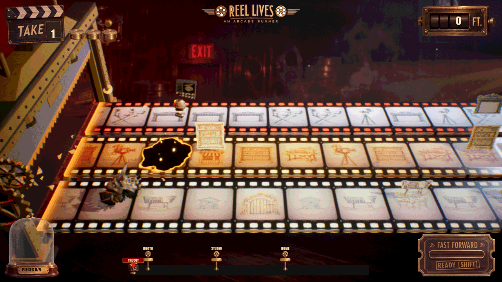
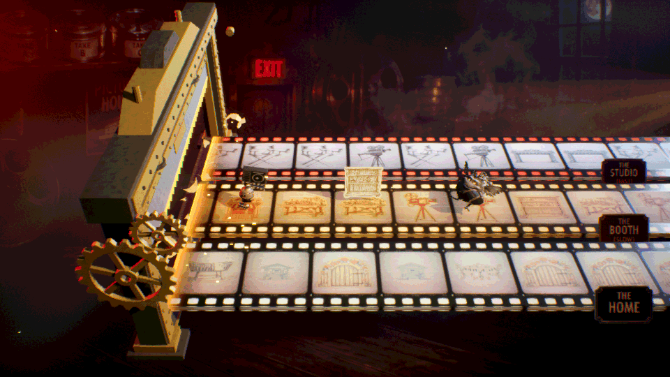
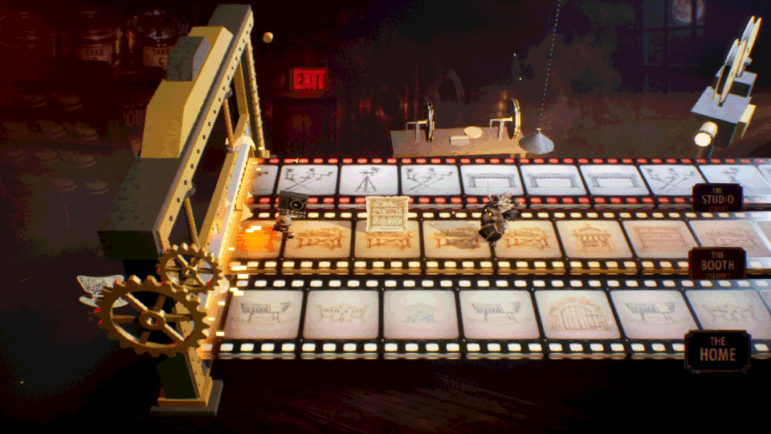

---

### 21:37: While I eat: the real HUD, a title screen and ending cards

**Asked:** I was at dinner and asked for something useful in the meantime. I also said Claude could bring the editor to the front.

**Done (Claude):**
- **First look at the real HUD.** With the editor up, the HUD could finally be captured during play. Two problems showed. The new slate and counter images were drawn on top of their own numbers, so TAKE and FT were blank. On this wider viewport, the HOME plaque slid under the ticket. Both are fixed: numbers now draw over their art, PIECES n/9 is cream (it was lost on the jar's dark base), and the plaques sit further left.
- **Title screen.** The game now opens on an intertitle card over the dimmed, live room: the REEL LIVES logo, one line of premise, and "PRESS ANY KEY" with the controls. The run waits behind it, and any key starts TAKE 1 / ACTION!.
- **Ending cards.** At the end of the reel, the same card says THE ROBOT IS BUILT or THAT'S A WRAP... IN PIECES (with what's missing), plus the footage and "press any key for the next take". The card art (dark card, cream double rule, Art Deco fans) is drawn by script to match the plaques.

**Setbacks:**
- One Blueprint write failed on a misplaced bracket. Afterwards, the Director had silently vanished from the open level: no strips, no HUD, just the robot floating in the room. The saved map still had it, so reloading the level brought it back. Now I check that the Director is still there after each write.
- The first ending heading was too big and wrapped onto the body text.

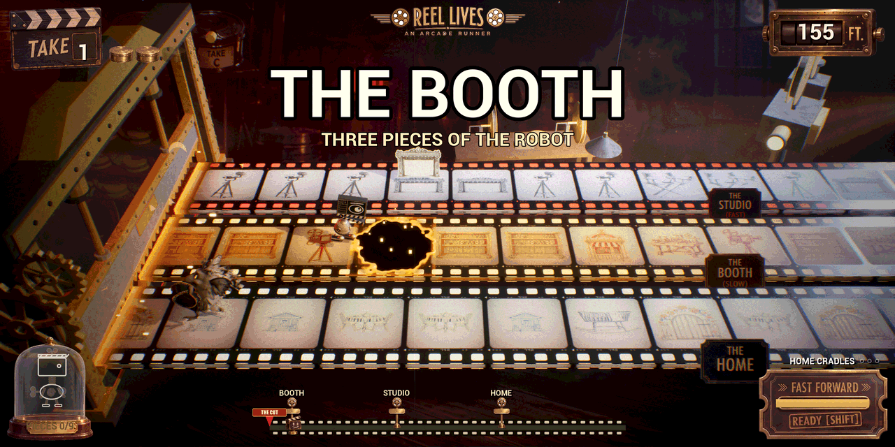
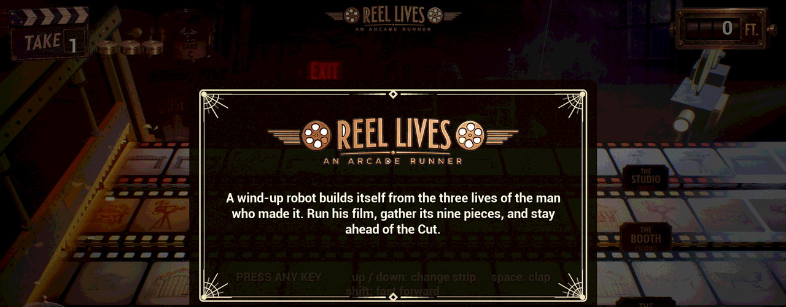
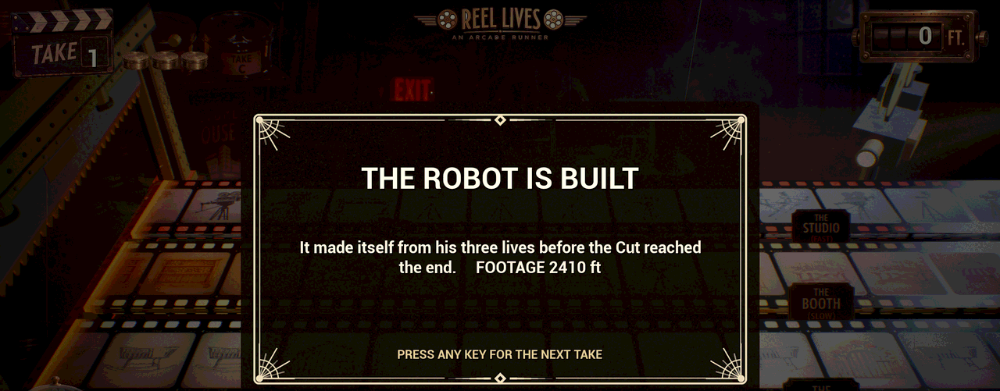

**Still open:** the robot in the bell jar is still the old chalk outline I called a stick figure.

---

### 22:00: My fifth play: getting there

**What I saw:** It's definitely getting there. The background looks great, the intro is great, and the gameplay is coming along. Three problems:
- **The standees (part cards) are a mystery.** Players learn they can collect one after walking through it, but what the cards do is totally unknown.
- **The jar robot looks wrong.** It should look like our robot, not the one in the generated concept.
- **Losing a take looks broken.** When you lose a take in a hole or a burn, the whole game crawls in slow motion until you press a key, so it looks like a half-broken scene.

**Plan:** we're close to the usage limit, so two jobs go to headless workers on the jam credit (briefs in `docs/headless/`): redraw the jar robot from our Blender robot, and three mock-ups of how the cards could explain themselves. Next session: I pick a card option, the new jar art goes in, and a lost take shows the CUT! intertitle card instead of a frozen scene.

---

### 22:10: My sixth play: the fun is gathering

**What I saw:** I played again and the fun is gathering. Now the cards have to mean something, in the story and to the player, so they understand why they're grabbing them. I'm also wondering whether the cards should lie horizontally across the frame instead of standing at the side.

**Decided:**
- Leave the robot in the jar for now; the 2D redraw would waste too much time. Later, maybe, small instances of the real robot part meshes in the jar, filling in as each piece is grabbed.
- There's a hole in the idea: the robot already looks like a full robot doing the tasks, so what is it completing? To solve with the cards next session.

The next-session prompt now leads with this, then the CUT! card for a lost take.

---

### 22:41: Card mock-ups from the headless worker

**Done:** a headless Opus worker on the jam credit ($1.83, 39 turns) drew three directions for making the cards mean something:
- **A:** a standing card with a thread to the bell jar.
- **B:** a flat "memory frame" lying in the film, plus a chalk robot.
- **C:** an iris and an intertitle for the first card only.

**Its recommendation:** B, plus C's slow-down and title card for the first card. In B, one frame of the strip is a photograph. It shows as a cold blue negative until you're on its strip, then it turns positive while the sprocket holes beside it light up one by one as the timer.

**Its answer to the story hole:** the running robot is the Maker's sketch, "the drawing in a drawer". Missing pieces are drawn in chalk; collected pieces turn to brass, and a lost take turns one back to chalk.

Nothing is built yet; I pick next session.

---

### 22:59: I pick the card direction

**Decided:**
- **Direction A:** the card stands at the side, linked to its piece's slot in the bell jar.
- **The chalk robot in the jar** is a fantastic idea: missing pieces in chalk, collected ones in brass.
- **The spotlight on the first card** is excellent for explaining why you grab it.
- **The red toothed junk** looks much better than our red wind key. That key was confusing: it looked like something to pick up, then it damaged you.
- **The developing card stays:** we must keep the card turning full colour while you stay on its strip, which we had right at the start.
- **The other standing cards** must look and act slightly different.

**Cut:** the photo in a photo frame (B). It's a frame too, but it may not fit the movie theme.

**Cost question:** I asked why those four images were so expensive compared with everything else. They weren't image renders. A Claude worker drew them with code, and the $1.83 was Claude tokens: an Opus model, 39 turns, and big screenshots read again and again. For mock-ups like this, one GPT image edit or a Sonnet worker would be much cheaper.

---

### 23:09: A research worker goes online

**Asked:** I wanted us to look online for skills and ideas that carry the concept further, plus some subtle and some explosive Niagara effects for the important moments, and to check whether a cheap Gemini model ("Gemini Hydrogen") is on fal for second opinions on decisions.

**Done:** a headless Sonnet worker on the jam credit searched the web while the lead kept building ($0.45, 28 turns). Report: [research/2026-11-14-juice-and-skills.md](research/2026-11-14-juice-and-skills.md).
- **Do first:** hit-stop and camera shake on CUT!, brass spark burst on a piece, squash and stretch, post-process pulses (vignette, chromatic aberration, flash), a chalk puff when a piece goes back to chalk, film-scrap confetti on the Cut, a slow-mo beat on the first card and the last piece.
- **Skills:** nothing ready-made for Niagara "juice"; Epic's own Unreal MCP (already ours) is the best fit, and the other servers mostly need C++.
- **Story ideas worth stealing the feeling of:** hold-to-keep from *Before Your Eyes*, a silent last shot of the Maker's face, and very few intertitles so each one lands.
- **Gemini:** no "Gemini Hydrogen" on fal (only one unsourced blog mentions it). Gemini text models are on fal through `openrouter/router`, priced per token. Nothing paid was run.

**Found while checking:** our Unreal MCP has a full Niagara toolset (systems, emitters, modules, renderers), so effects can be authored by the agent after all. On day one I'd cut Niagara as "slow and fragile by script".

---

### 23:13: The chalk robot

**Done:** every robot piece is now always on the robot. A piece you haven't collected wears a chalk overlay: a dark blackboard fill with a cream chalk rim whose grain re-rolls 8 times a second, so the line "boils" like hand-drawn animation. Collect it and the overlay clears, and the brass shows. A knocked-off piece still flies away, then comes back as chalk. It's an overlay material (`M_Chalk`, `art/robot/make_chalk_mat.py`), so none of the robot's own materials changed.

**Setback:** the first chalk read as white plaster. Darker fill and a sharper rim fixed it.

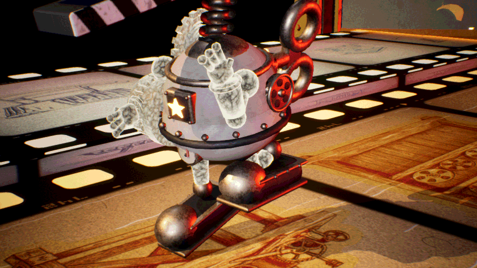
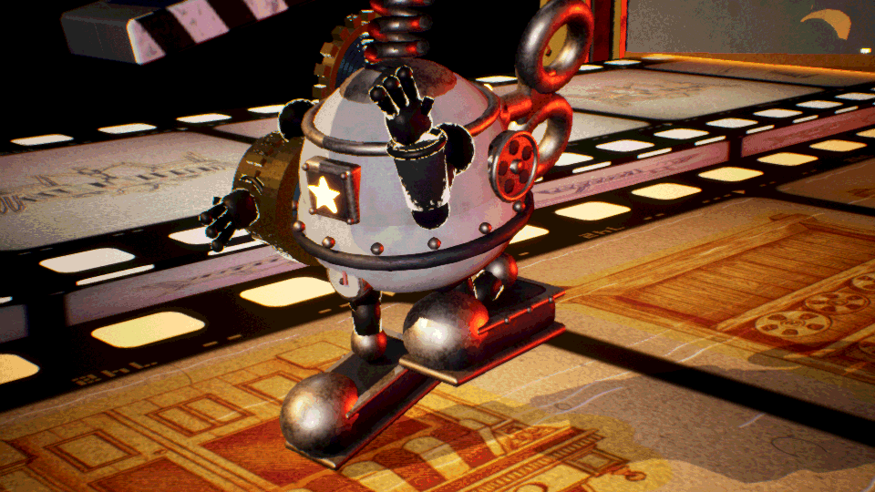

**Also:** losing your last take now shows the intertitle card (CUT!, the reason, PRESS ANY KEY FOR TAKE n) over the frozen frame, instead of a half-stopped scene that looked broken.

---

### 23:17: Junk you can't mistake for a piece

**Done:** junk was a red copy of a real robot piece. It's now a red saw-toothed cog with one broken tooth and a cream X through it, spinning like a blade with a jitter. The mesh is generated by a short Python script as an OBJ (`art/robot/make_junk_cog.py`) and imported, no Blender needed.

**Setbacks:** Unreal's OBJ import split the cog and its X into two meshes (one per OBJ group); writing one object with two materials fixed it. A near-black X caught the spotlight and read grey; cream reads clearly against the red.

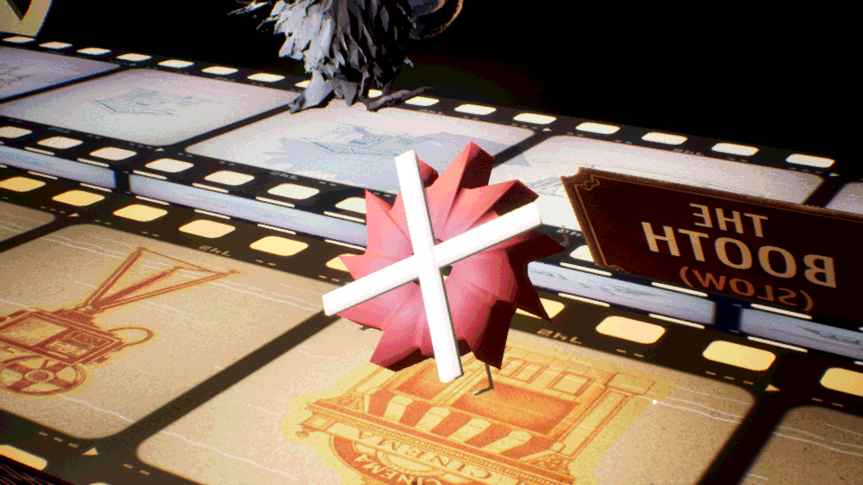

---

### 23:40: The thread and the first-card iris

**Done (card direction A, plus the iris from C):**
- While a part card is on screen and undeveloped, a dotted chalk thread arcs from the card down to the bell jar, and that piece's slot in the jar blinks warm. The dots march toward the jar and brighten as the card develops.
- **The first card of the session only:** the screen irises in like a silent film, with one hole on the card and one on the jar. Time drops to 30%, the intertitle reads **A MEMORY** / *HE MADE A PIECE OF ME HERE: STAY ON HIS FILM*, and after about 2.4 s the iris opens and play carries on. It never happens again that session.

**Setbacks:** the full line "HE MADE A PIECE OF ME HERE." overflowed the big title font, so it moved to the subtitle under A MEMORY. The thread dots first sat under the black iris, exactly when they're needed, so they went on top. Off the iris they were too faint against the cream film, so they're bigger and stronger now.

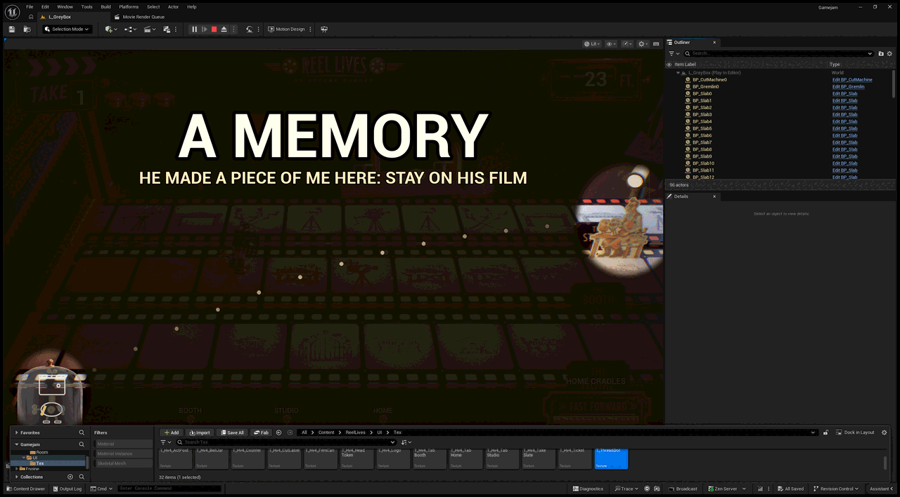

---

### 23:27: First Niagara juice: brass bursts and chalk puffs

**Done:** the agent authored Niagara systems through the Unreal MCP's Niagara toolset, starting from the engine's RadialBurst template and setting module inputs by script (`art/fx/make_fx.py`):
- **NS_BrassBurst:** 80 hot brass sparks plus a dozen brass streaks. It fires where the piece rises out of a developed card, and again on the robot as the piece clunks on and the chalk turns to brass.
- **NS_ChalkPuff:** soft cream dust that hangs in the air. It fires when a lost take knocks a piece back to chalk.

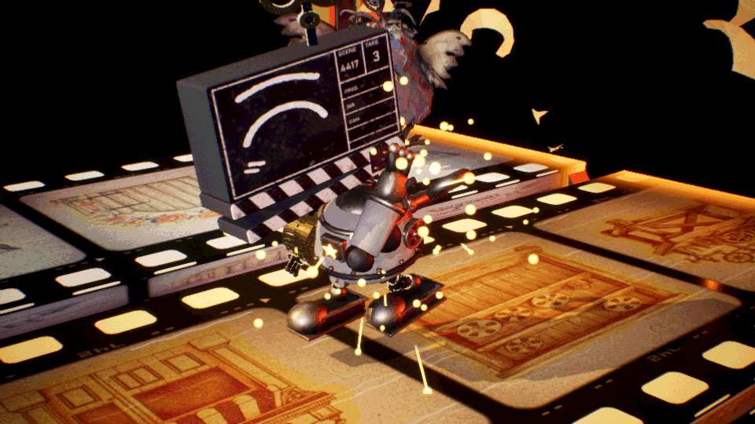
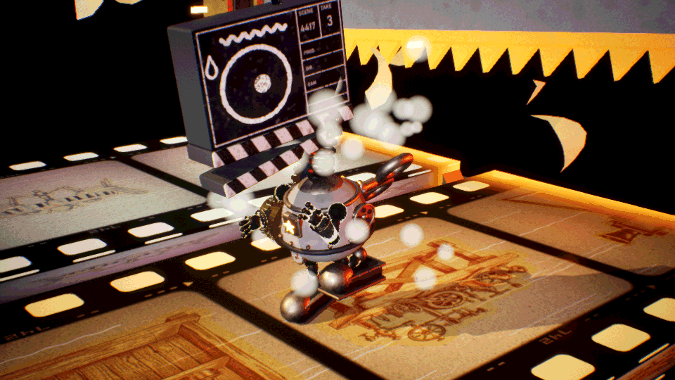

**Cut:** film-scrap confetti for the Cut. The engine's confetti emitter draws tiny meshes with its own rainbow material, so it read as party confetti, not film. The Cut already chews the film into mesh chunks.

**Still to do from the research:** hit-stop and camera shake on CUT!, squash and stretch, post-process pulses, slow-mo on the last piece.

---

### 23:45: Juice part 2: the hit pulse

**Found first:** much of the research's "do first" list was already in: camera jitter on hits (`ShakeAmp`), the landing squash, hit-stops on a lost take, a gremlin kill and the X tear, and a slow-mo when the robot is whole. So part 2 added what was missing instead of doubling up.

**Done:**
- **A hit pulse:** a new post-process (`M_Pulse`, `art/postfx/ue_make_pulse.py`) splits red and blue toward the screen edges and darkens a vignette, driven by one value the Director kicks and lets fade in real time. A lost take kicks it to full, so does THE ROBOT IS WHOLE; junk 0.6, the X tear 0.5, a piece 0.35, a gremlin kill 0.3. It sits apart from the projector shader, so the film look can't break.
- **A piece lands with a 60 ms freeze** on top of its flash and brass burst.
- **THE ROBOT IS WHOLE** now throws three big brass bursts around the robot under the existing slow-mo.

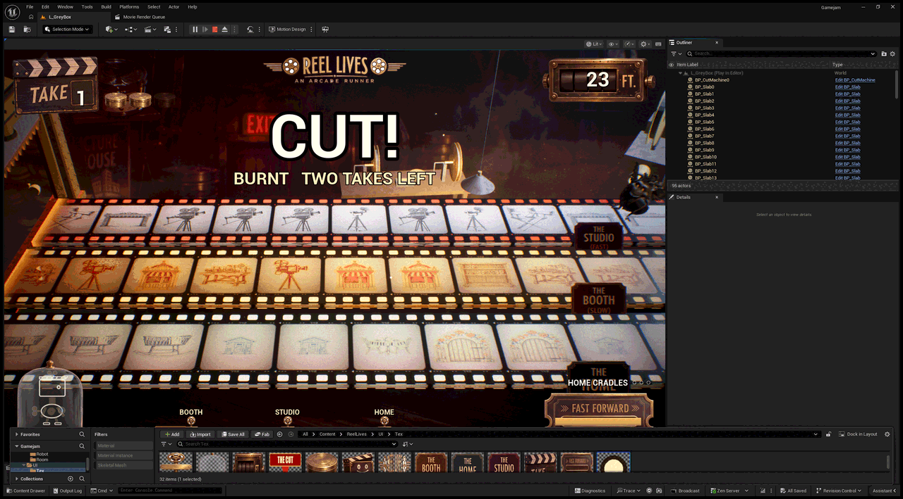
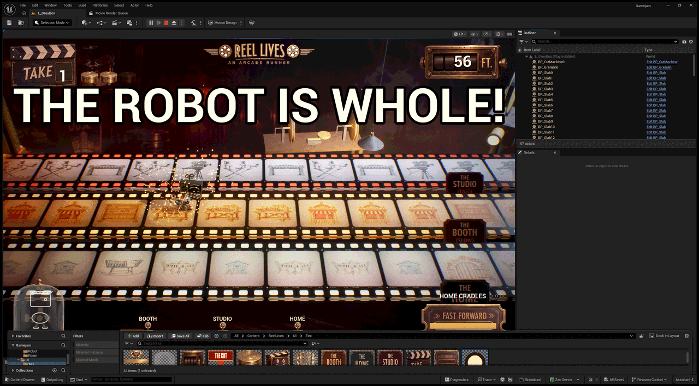

**Setback:** the offscreen capture tool doesn't show late post-process effects, so the pulse looked like it did nothing until checked in the real play window.

**Asked mid-step:** "the goblins could be better too." Planned next.

---

### 23:58: The goblins get rebuilt

**Asked:** the goblins could be better. I chose rigid parts built by script (free) over a fal concept, and described what I wanted from the earlier UI render: a red hat as their visual key, small gremlin ears, a huge almost Cheshire-cat mouth full of teeth, a squat body with little arms and legs, and very animated movement, almost chimp or imp.

**Done:**
- **Blender, by script** (`art/gremlin/build_goblin.py`): one squat potato that is both head and belly, a red fez with a black tassel tipped back at an angle, bat ears poking out under it with red insides, big yellow eyes with slit pupils under a scheming frown, and an ear-to-ear grin with two rows of teeth. Thin chimp arms end in three-clawed hands, and short bowed legs end in big three-toed feet. Each part is its own mesh with its pivot at the joint.
- **Unreal** (`art/gremlin/ue_build_goblin.py`): the parts hang off the old body component, so everything the gremlin already did (chewing squash, rearing up when threatened, the knock-off spin, the Burner's match, the kinds' tints) carries the new goblin. The skin material keeps the old Tint and Flash parameters.
- **Movement** (`art/gremlin/make_imp_tick.py`): it scuttles with the arms swinging big and alternating like a chimp and the legs going against them, ears flicking and the fez wobbling a beat late. When you're close on its strip it throws its arms up shaking, pins its ears back and the fez pops off its head. Knocked off, every limb flails.

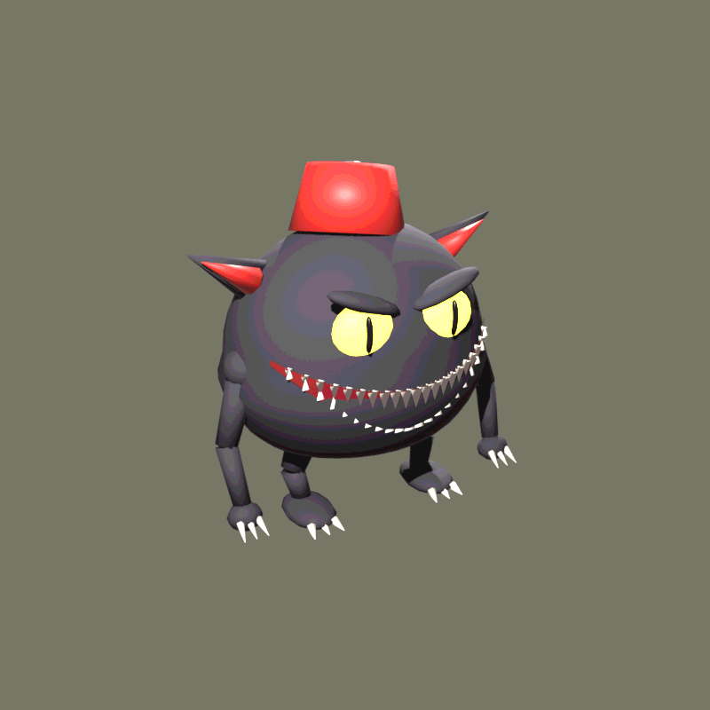
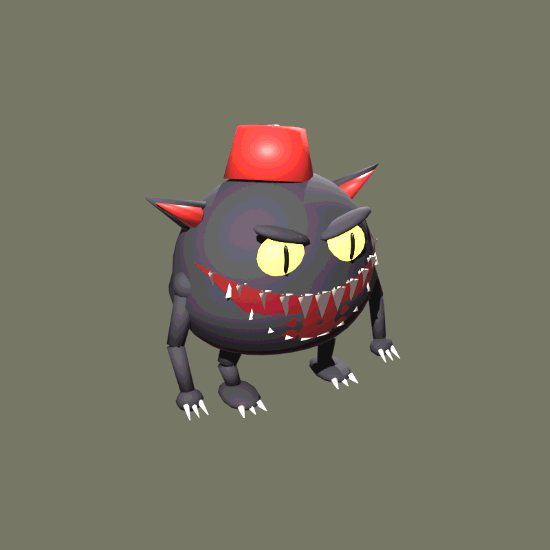
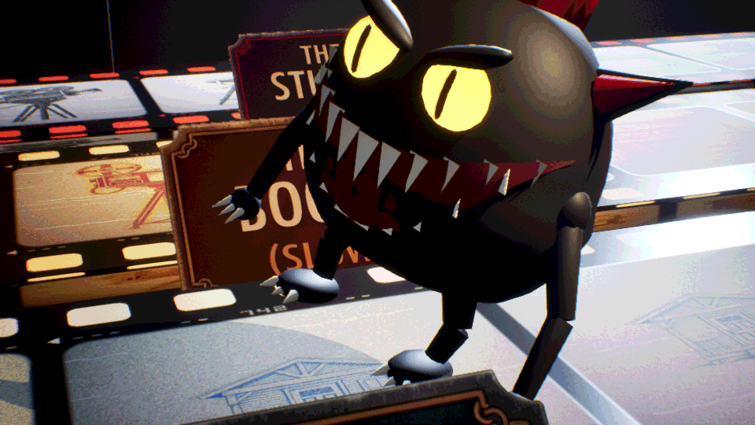
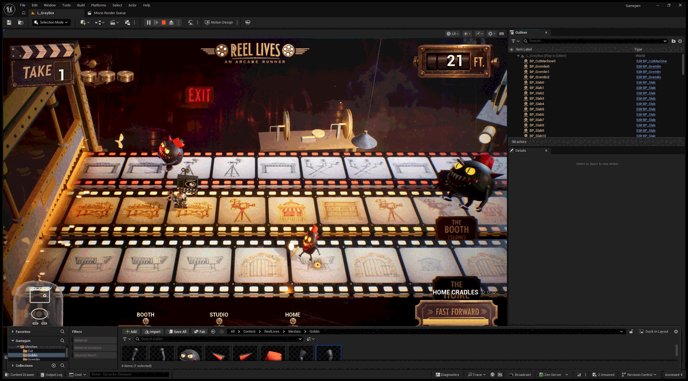

**Setbacks:** the first grin was a thin line. Opened wide, the lower half of the mouth vanished, because each mouth face was one flat quad that dipped inside the round body; laying it in rows on the surface fixed it. In Unreal the fez tilted twice (once baked in Blender, once in the tick) and lolled sideways.

---

### 00:05 (2026-11-14): My play: the goblins

**Verdict:** the goblins are all right, but nothing to write home about and not exciting. They're much more animated, which is good; they just need a better model. I'll get Fable to make them. Good try anyway.

**Kept:** the movement (scuttle, threat, flail) and the part layout. A new model only has to come as the same eight parts with pivots at the joints (Body, Hat, EarL/R, ArmL/R, LegL/R), and it drops onto the same Blueprint.

---

### 00:02: The X tear grows back

**Asked (my play note from Friday):** after the X tears out a stretch of strip, the film should grow back and rejoin, not appear whole again in one frame.

**Done** (`art/clarity/make_clarity21.py`): over the last 1.2 s of a tear, both torn ends grow toward the spot where the X was drawn, their glowing ragged edges closing the gap. When they meet there's a chalk puff and a splice clack. The strip is safe again under the robot once the healing film has passed it, so you can hop back a little early.

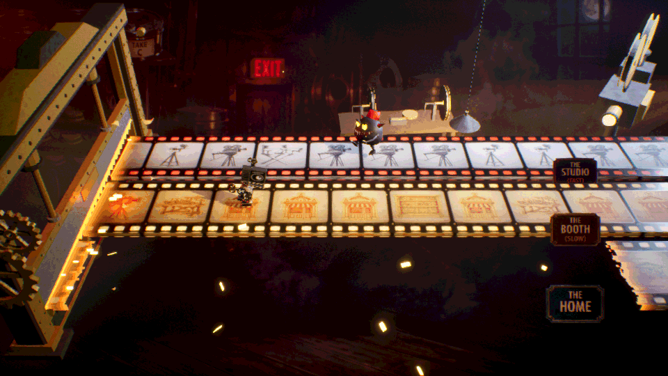
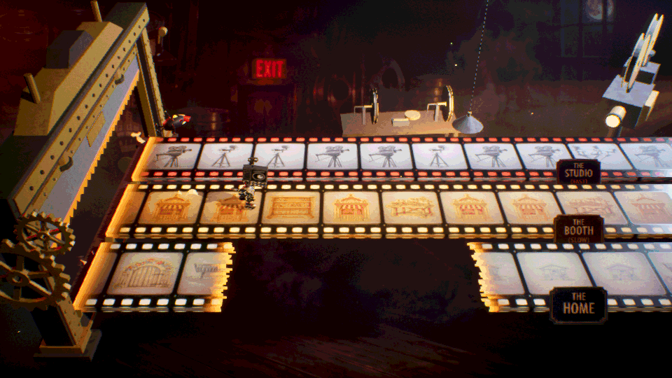

**Checked next:** the life cards (`BP_Token`) are small standing pop-up cards with the same card art and material as the part cards, which is why the two get mixed up. A proposal for how they should differ is with me.

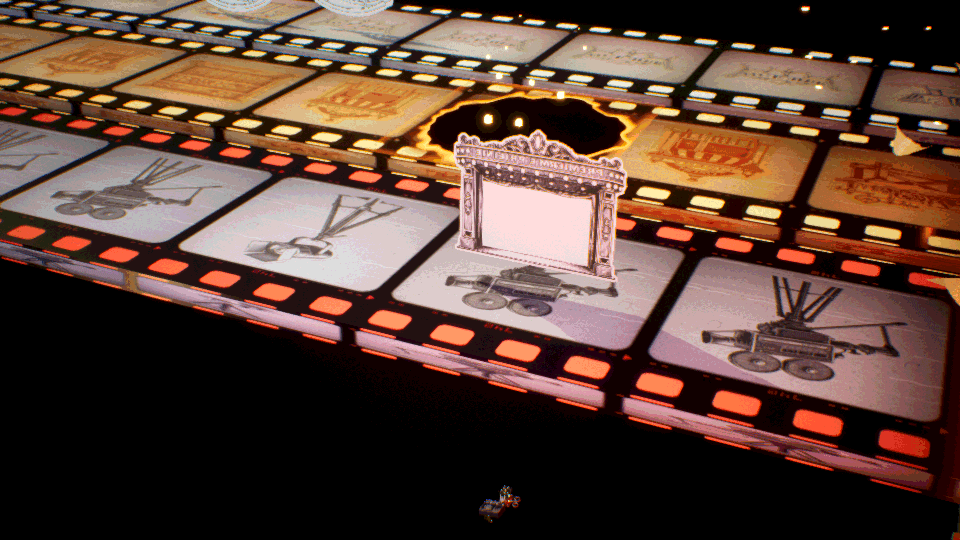

---

### 00:15: The piece hovers over its card, and a simpler story

**My notes:** I liked that the cards were cut-outs that turned to colour and were then grabbed; it added a very nice addition. They may need slight refinement, and the item the robot collects could hover over the card. It's the other, shorter, less colourful cards (the life cards) that need to be better, maybe with new, more vibrant art that fits what they represent. The story is a bit convoluted: maybe the robot travels through his maker's mind and life to learn how to build himself a friend. Good pieces build a friend, bad ones a mean foe that you then fight. Fighting needs thought too; for a boss, could the strips suddenly switch and go any direction, or is that crazy?

**Done:** while a part card develops, a chalk ghost of its piece now hovers above it, turning slowly and growing as the colour comes in. When the card opens, the chalk turns brass with the spark burst and the piece waits for the robot as before.

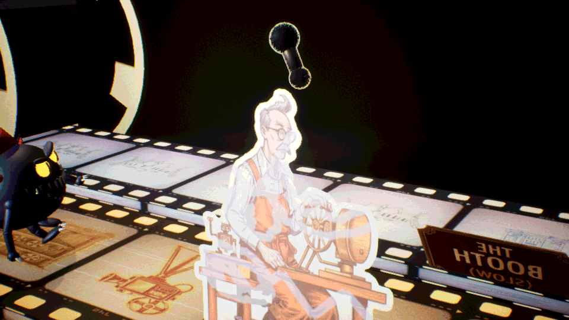

**Setback:** the first ghost hovered inside the card (the cut-out is taller than I'd allowed for), then it was too small to see; it now sits above the card at about twice the size.

**Proposed, not built:** the simpler story, friend or foe endings, and a cheaper boss in the brief ("Proposal 2026-11-14"). Strips running any direction would mean rebuilding spawning, collisions, tears and the camera, so the proposal shuffles the three strips' order instead, with a foe throwing junk cogs you clap back.

---

### 00:25: The story is simpler: build a friend

**Decided:** the bell-jar robot is the friend. The hero is whole from the start, and the chalk sketch in the jar is the friend it's learning to build from its maker's memories.

**Done** (`art/clarity/make_clarity23.py`):
- **The hero is all brass now.** The chalk lives only in the jar and in the ghost pieces over developing cards, so chalk always means "the friend".
- **New words:** the title card ("A wind-up robot runs through its maker's memories to learn how to build itself a friend..."), the first-card intertitle (A MEMORY / A PIECE FOR MY FRIEND), MY FRIEND IS WHOLE!
- **Junk goes into the friend too.** Each hit says so with a running tally: JUNK 2, PIECES 0.
- **Three endings at THAT'S A WRAP:** more junk than pieces gives I BUILT A FOE ("It climbed out of the jar grinning, all teeth and cogs"); all nine gives I BUILT A FRIEND ("We walked off the reel together"); otherwise HALF A FRIEND, with what it never got.

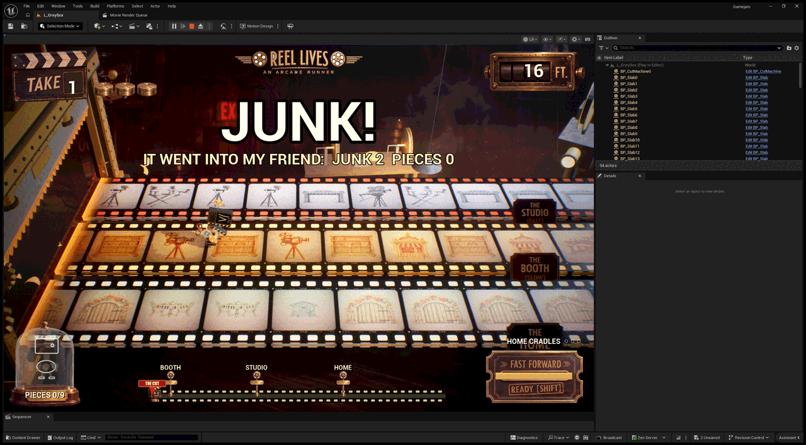
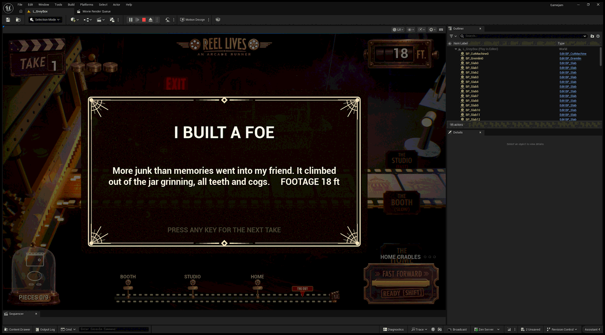

**Next:** the foe should then be fought (the boss proposal in the brief: the strips shuffle while it throws junk cogs you clap back).

---

### 00:20: New art for the life cards

**Asked:** life-card art first. The part cards (the Maker making a piece, developing into colour) are great; the short, pale life cards needed vivid art that fits what they give.

**Done:** three Nano Banana 2 edits ($0.24 in all), using the bench card I liked as the style reference, so they share its hand-tinted engraving look:
- **Studio (+100 ft of footage):** a brass film can bursting open with amber film spooling out.
- **Booth (Fast Forward):** the projector cranking furiously, with speed lines and a golden beam.
- **Home (a take back):** a cradle with a rose quilt and a mobile of brass stars, with a tiny tin robot hanging from it.

They're keyed and packed into the card sheet in the cells the life cards read (`art/fal/cards/make_cards.py`).

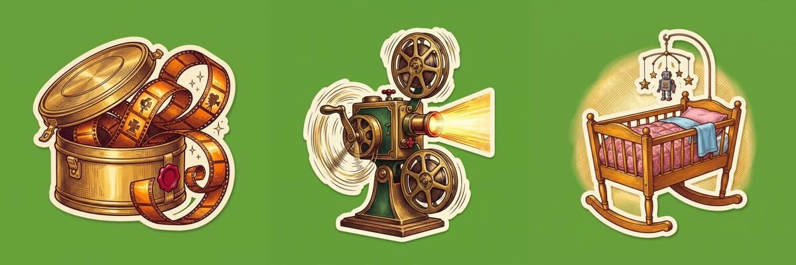
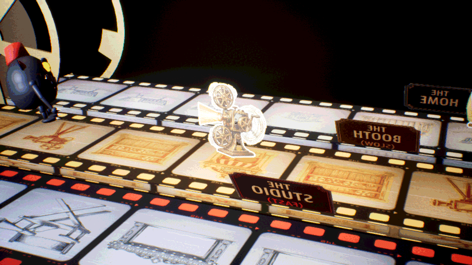

**Note:** in play they read a little washed out under the card lighting; that goes into the look pass.

**Before bed:** I asked for a Fable session to do a beautify, juice, feel and look pass over everything overnight, while the lead carries on with the next logical steps without asking me questions.

---

### 00:29: Overnight look pass, item 1: life cards look like rewards

**Asked (before bed):** a beautify, juice, feel and look pass over everything while I sleep, life cards first: the new art read washed out, and they had to look clearly different from the part cards, like rewards.

**Done** (`art/look/ue_life_card.py`, `art/fx/make_fx2.py`, `art/clarity/make_clarity24-25.py`):
- **The art no longer goes pale under the stage light.** Life cards have their own material (`M_LifeCard`): unlit, saturation lifted, and a gold sheen that sweeps across every couple of seconds.
- **A sunburst in the life's colour turns behind each one** (`M_LifeHalo`, two sets of rays turning against each other): silver-blue for the Studio, amber for the Booth, rose for the Home. A light in the same colour pulses on the film, and gold twinkles (`NS_Sparkle`) hang around the card. The cards are a little bigger and sway like a coin turning.
- **Collect pop:** the card balloons and the sunburst flares out to three times its size and fades, with a spark burst in the life's colour (`NS_LifeBurst0/1/2`). The line under the title now says what you got: +100 FT OF FILM, + FAST FORWARD, CRADLE 2 OF 3.
- Junk cogs share the Blueprint and hide all of it.

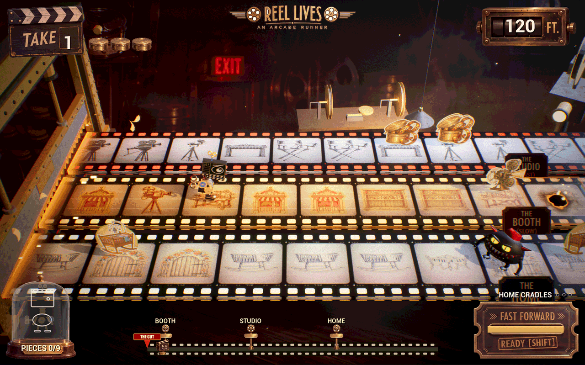
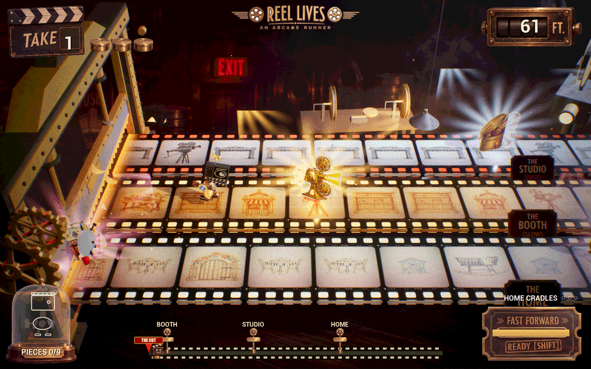
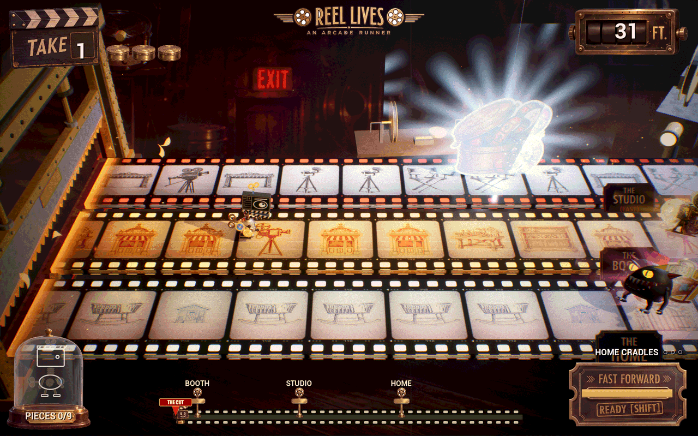

**Setback:** the first captures came back pure white: the editor window had been minimised, so the capture saw nothing. A small script (`setup/winmax.ps1`) now restores it before every check.

---

### 00:38: Look pass, item 2: light leaks, a thump in the jar, embers and sparkle

**Done** (`art/postfx/ue_make_leak.py`, `art/fx/make_fx2.py`, `art/clarity/make_clarity26-28.py`):
- **Light leaks** (`M_Leak`, a post-process next to the hit pulse): three soft blobs of warm light drift along the left, right and top edges, breathing faintly all the time like light spilling round an old projector gate. On big moments they flare: gold for good ones (piece, life card, MY FRIEND IS WHOLE!, I BUILT A FRIEND), red for bad ones (junk, CUT!, the last take, I BUILT A FOE).
- **The piece-to-jar chain:** the HUD piece now spins twice as it arcs to the jar and swells mid-flight. When it lands, the bell jar squashes, the chalk friend thumps bigger, a clunk plays and a small gold leak flares.
- **Ambient:** projector dust drifts over the strips in the beam (`NS_Motes`); Niagara embers rise off burning frames on top of the old mesh embers; gold twinkles hang round a part card once it's a third developed and while its piece waits for you.
- **Robot:** a little chalk-dust puff at its feet on every hop landing and a small brass spark at the clapper on each clap. I'd said the hop feels good, so its motion is untouched.

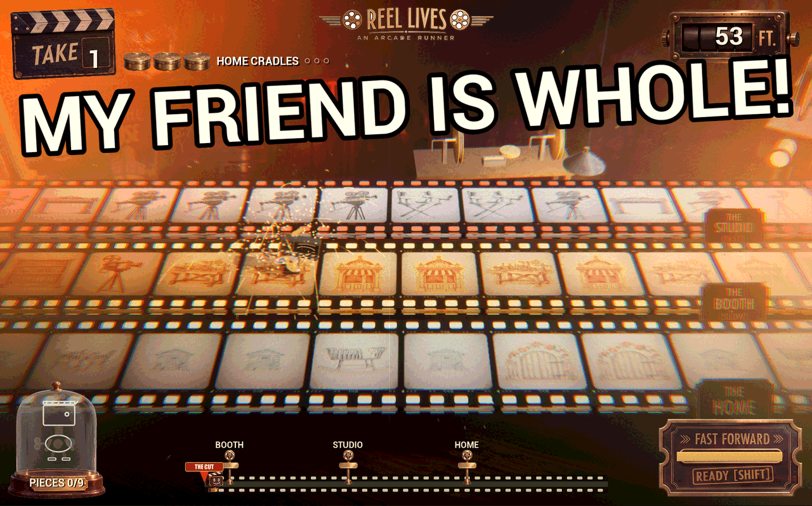

**Setbacks:**
- The first leak was far too much: the whole screen went orange. It's now about a third as strong and stays at the edges.

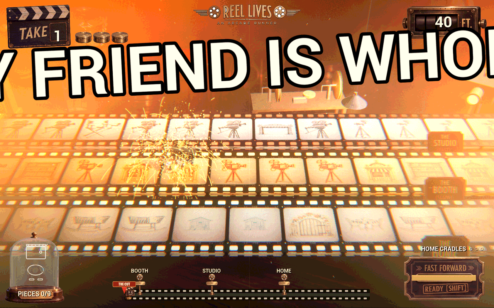

- **Text overflow found:** a stress test (pieces fired every 0.4 s) showed the big title bursting off both edges. It punched in at 1.9x its size, so long lines like MUSIC-BOX KEY! and MY FRIEND IS WHOLE! spilled off screen. It now starts at 1.3x and the font is a little smaller (120 to 100). Ignore the PIECE 16 OF 9 in the shot: that's the stress test.

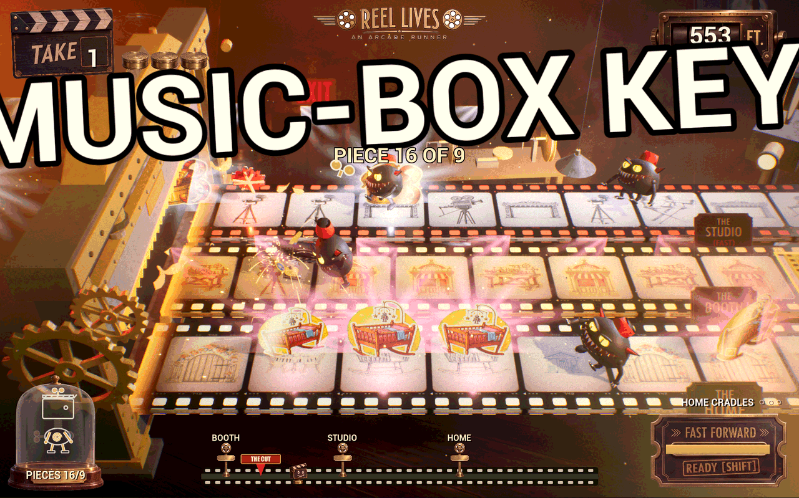

- **HOME CRADLES** sat on top of THE HOME plaque. It now sits beside the film cans top left, which is what three cradles refill.
- **Bug spotted in the log, not yet fixed:** a goblin's limbs are still animated for one frame after it's destroyed, which spams errors. Next on the fix list.

---

### 00:42: Look pass, item 3: ink outlines so the robot and goblins read

**Problem:** at play size the robot is small and its brass melts into the amber Booth strip; the goblins are dark blobs on dark sprocket rows.

**Done** (`art/postfx/ue_make_outline.py`, `art/clarity/make_clarity29-31.py`):
- **An ink line round the characters,** like the inked outlines of a hand-coloured film. The robot's meshes write stencil 1 and the goblins' stencil 2; a post-process (`M_Outline`) draws a dark sepia line round the robot and a deep red line round the goblins. The lines show through anything in front, so a goblin behind a card still reads. (Needed `r.CustomDepth=3`, now in DefaultEngine.ini.)
- **A follow-spot** (a narrow warm spot light) tracks the robot across the strips. It's subtle on the white film and helps on the amber one.

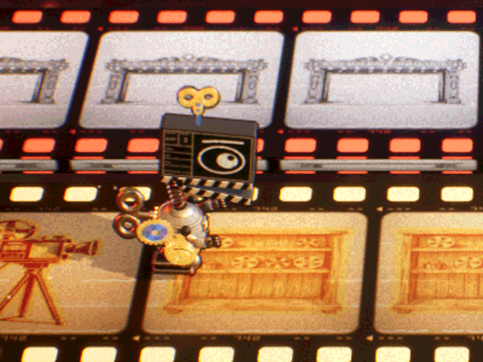
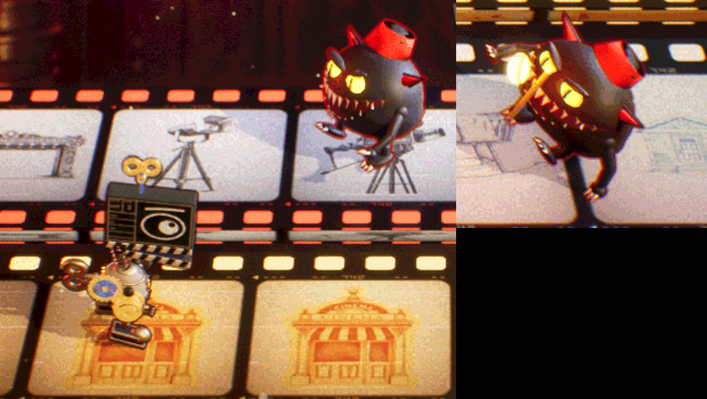
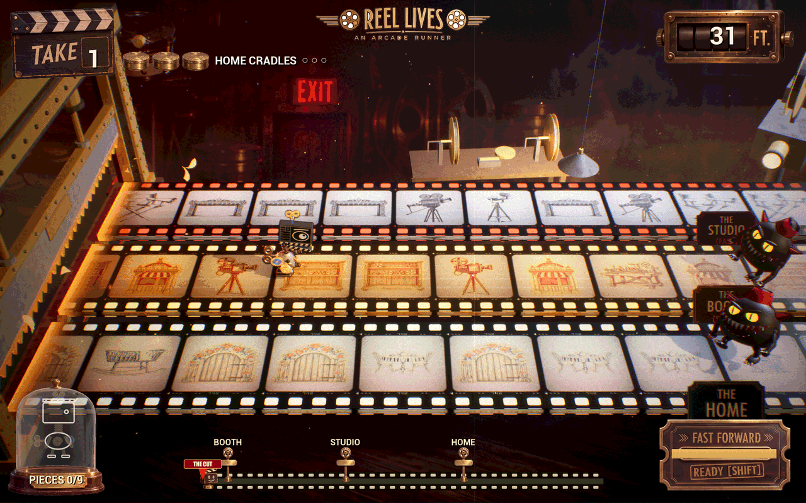

**Setbacks and fixes:**
- The robot got no line at first. It's placed in the level, and placed actors keep their old component settings when the Blueprint changes, so the instance was set too.
- The new hop puff and clap spark appeared on the middle strip whatever strip the robot was on: the robot actor never moves, only its body hops across. They now follow the hop.
- **Fixed the goblin log spam:** a goblin destroyed in its tick still animated its limbs that frame. It now marks itself dead first.
- **Checked:** the longest ending card (THAT'S A WRAP... HALF A FRIEND with four missing pieces) fits its frame.

---

### 00:48: Look pass: the title and ending cards show the friend

**Done** (`art/hud/ue_end_friend.py`, `art/clarity/make_clarity32-34.py`):
- **Every card now shows the friend:** the chalk sketch from the bell jar, standing on a soft glow between the title and the text. Its colour tells you how it went before you read a word: cream chalk on the title card (the friend you're about to build), gold for I BUILT A FRIEND, red for I BUILT A FOE and CUT!, dim cream for HALF A FRIEND. It bobs gently and the glow breathes while the card is up.
- The title card's logo moved up a little to make room.

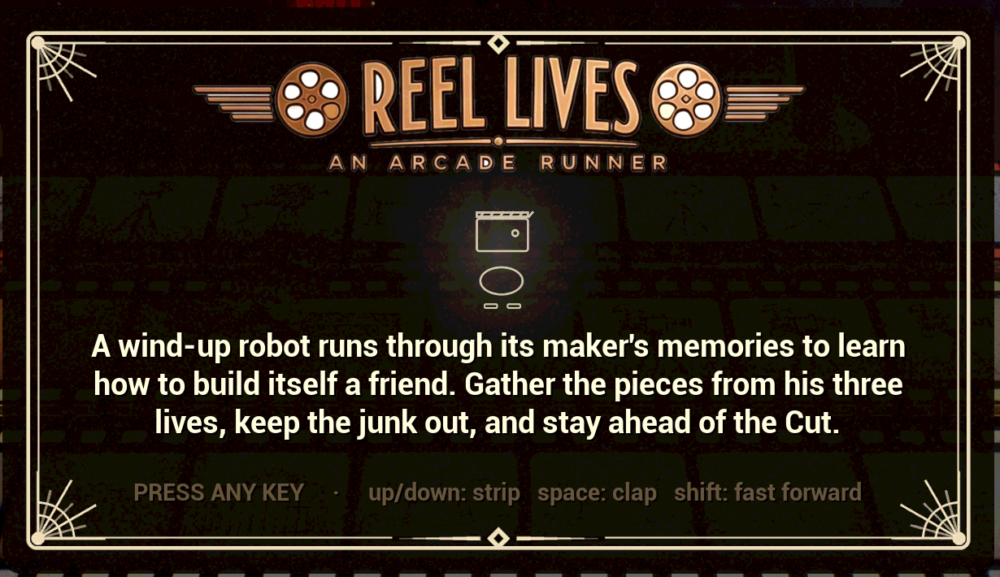
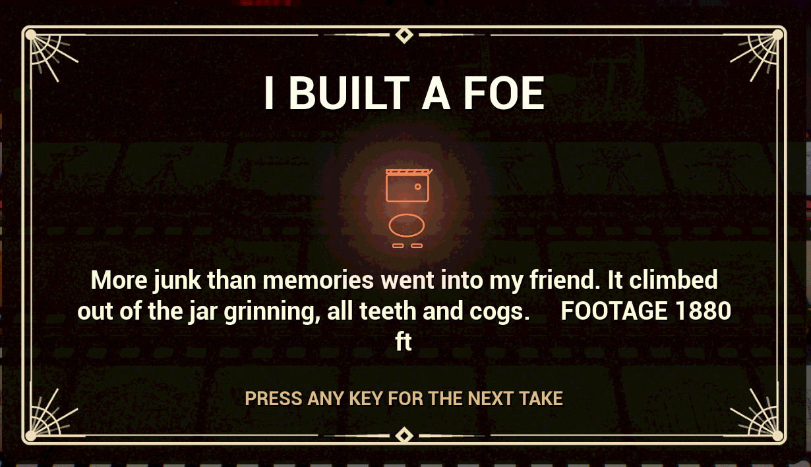
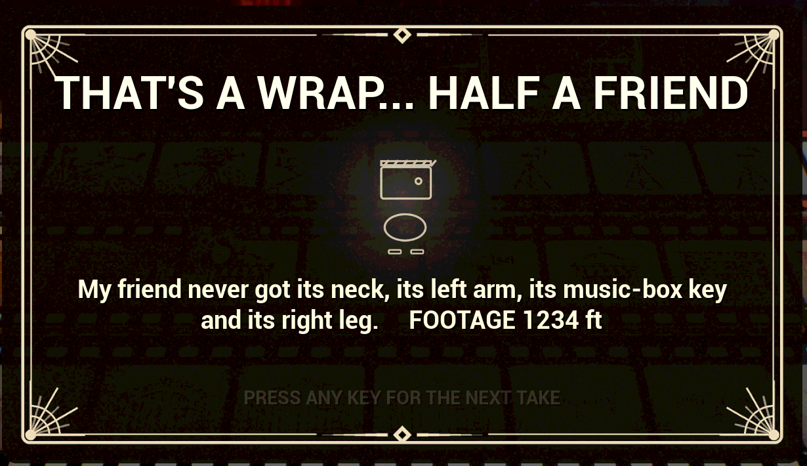

**Setbacks:** the first placement sat on the card's top ornament, and on the title card the friend's head covered AN ARCADE RUNNER. The FOE card wrapped "ft" onto a line of its own; FOOTAGE, the number and ft are now held together with non-breaking spaces (the FOE shot was taken just before that fix).

---

### 00:54: Look pass: an unattended minute of play, and what it showed

**Done:** a script played the game for a minute in god mode, hopping and clapping at random, while I took a frame every 12 seconds and read the log.

**What I saw, and fixed** (`art/clarity/make_clarity35.py`):
- **The life cards were now too loud.** When four or five projector cards stacked up on the Booth strip, their sunbursts crowded the screen. The halos are now smaller and dimmer; the collect flare is as big as before.
- **The follow-spot made a blown-out white disc** under the robot on the white film. It's softer and wider now.
- **My new life-card lines overwrote important text,** like the first-card intertitle and X: GET OFF THAT STRIP!. They now wait if another message is less than 1.5 s old.
- **Part cards had the same bug as the goblins:** a card destroyed itself mid-tick and then touched its own sparkle and piece, spamming errors. Same fix, with a dead flag.
- **146 physics warnings a minute:** the burn's little ember meshes had collision on while scaled to zero. Collision is off on decoration meshes (cards, burns, the Cut). Pickups are collected by distance, so nothing in play depends on it.

**After:** no Blueprint errors in the second minute.

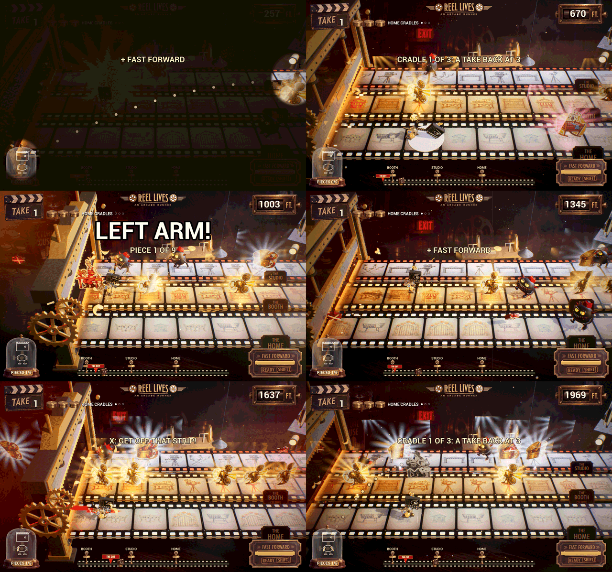
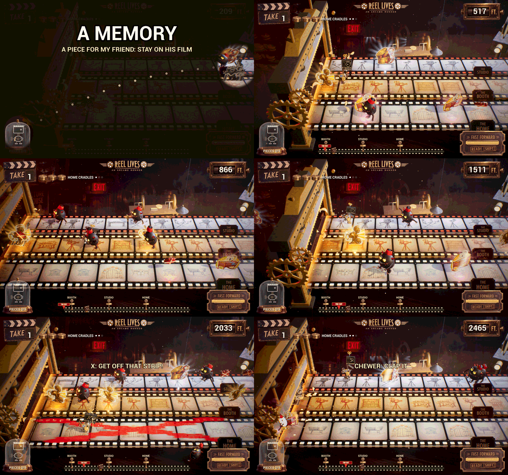

---

### 00:55: End of the overnight look pass

**State:** every item in my brief has had a pass: life cards as rewards; juice (leaks, jar thump, motes, embers, sparkle, puffs and sparks); readability (ink outlines, follow-spot); the title and ending cards; and the bugs and noise found along the way. Losing the last take now gives the CUT! card with the friend in red and red light at the edges.

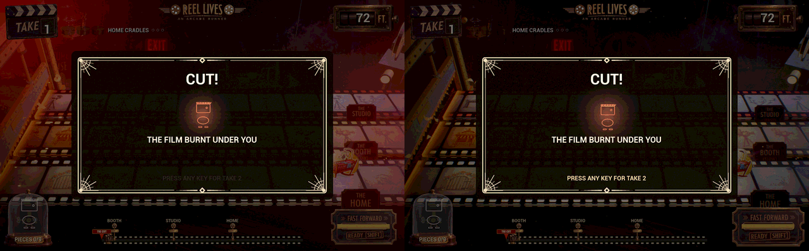

**Not touched, on purpose:** the story and rules, the hop and clap motion, the sound, packaging. No fal spent.

**Still open for me to judge in a real play:** whether the light leaks are too strong on a slow monitor (they decay in real time over about two seconds), and whether the life cards are now loud enough, or too loud, at full speed.

---

### 03:55: The foe fight
**Asked:** last night I asked whether, for a boss, the film strips could "suddenly switch up and go any direction". With the look pass done, the lead built the foe from its spec (`docs/design/boss-foe.md`) while I slept.

**Done:** if more junk than pieces went into the friend by the wrap, the FOE card no longer shows straight away. The foe drops onto the far end of the reel: the goblin rig at 1.7x in rust red. Every 2.8 s it hops to another strip and throws a junk cog down it. The cog rolls at that strip's speed. Clap when it is in front of you on your strip and it flies back glowing. If the foe is still on that strip, that's a hit. Each hit is a hit-stop, a flash, sparks and a chalk puff, and a part flies off (left arm, right arm, then the fez). After hits one and two **the strips switch**: each strip takes another's speed, so the strip you're on can suddenly crawl or race. The robot doesn't move; the world changes under it. On the third hit it falls apart in slow motion and the card reads **I TOOK IT APART**. A cog you miss is ordinary junk (slow, and one more for the tally), not a lost take. If 60 seconds pass without three hits, it gets away and the FOE card shows as before. Test key **B** jumps to the wrap with nine junk.

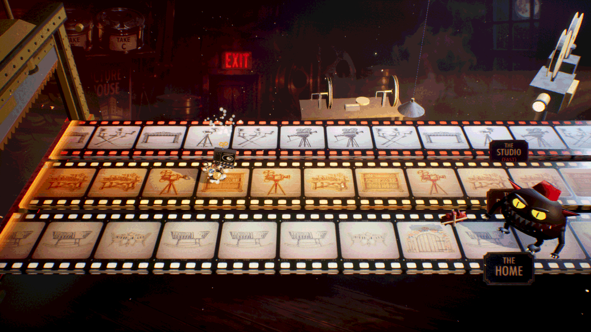
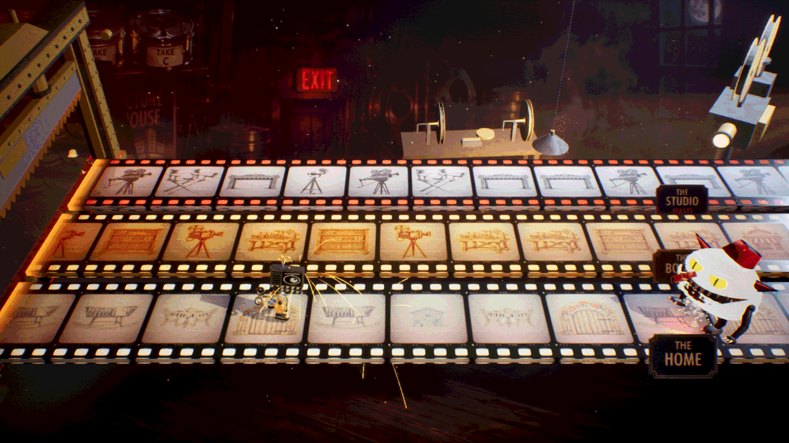
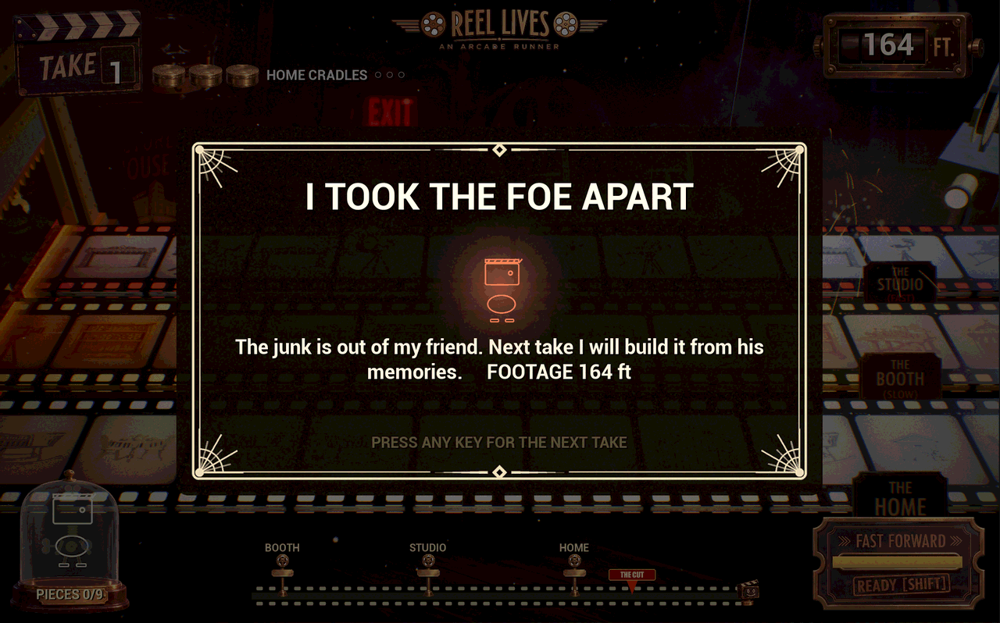

**How it was checked:** a script played the fight in the editor: hop to the foe's strip, clap when a cog is in range. Three hits came at 4.5 s, 7.1 s and 10.0 s, the switches were right, and the card showed. A second run did nothing for 60 s: the foe got away and the FOE card showed. Pressing a key then started Take 2 with everything reset.

**Setbacks:** at x 1400 the foe hid behind the strip name plaques (first screenshot showed an empty reel). It now stands at x 1050, and the cogs were slowed so there's time to react.

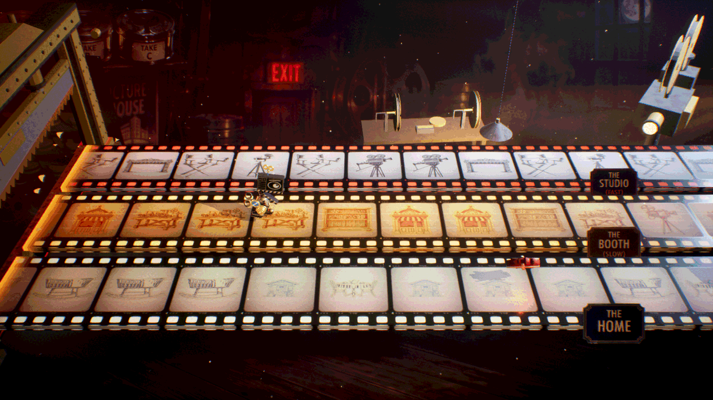

The win card first tinted the friend red because its title contained "FOE". Renamed.

**Cut from the spec, for now:** the plaques sliding and the frame pictures swapping rows when the strips switch. The speeds swap, but the plaques still say FAST and SLOW for their old strips. Also the jar sketch going red and empty. Both are worth doing if there's time.

**Not judged yet:** whether it's fun at human speed. The script's claps were perfect, so 10 seconds is far quicker than a person will manage. I need to play it.

---

### 09:10: Morning review of the overnight work (Fable), and a second pass on the foe

**Asked:** the overnight juice and play pass ran on Opus by mistake. I asked Fable to look over all of it and make it better where it needed it.

**How it was reviewed:** the live Blueprints were dumped and read (not the patch files), then a bot played a normal run and the foe fight while the real window was captured. The normal run is in good shape: no Blueprint errors in the log, the life cards, light leaks and ink outlines all hold up. The foe fight and one old effect did not.

**What was wrong, and is fixed** (`art/clarity/make_boss2.py`, `art/postfx/ue_make_clapring.py`):
- **The foe stood half off the screen** and looked like any other goblin, only bigger and black. It now stands further in (x 900) and its whole body, ears and limbs are rust red.
- **THE STRIPS SWITCHED changed nothing you could see.** Only the speeds swapped; the plaques still said FAST and SLOW over the wrong strips. Now each strip's film stock and its plaque move with the speed, so the Studio really is somewhere else. They go back at the end of the fight and on a restart.
- **No warning before a throw.** The foe now swells for a moment after it lands, then throws.
- **The cogs it throws were small.** They are half as big again.
- **On the last hit, every cog still on the reel pops.**
- **The clap ring was a solid white disc** from the first grey box. At full speed it's a blink, but in every hit-stop and slow-motion beat it hung under the robot as a white blob. It's now a thin gold ring.

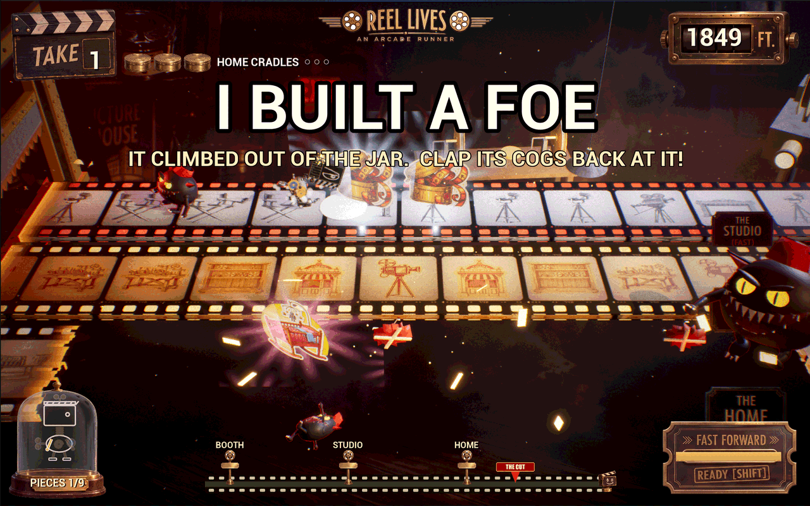
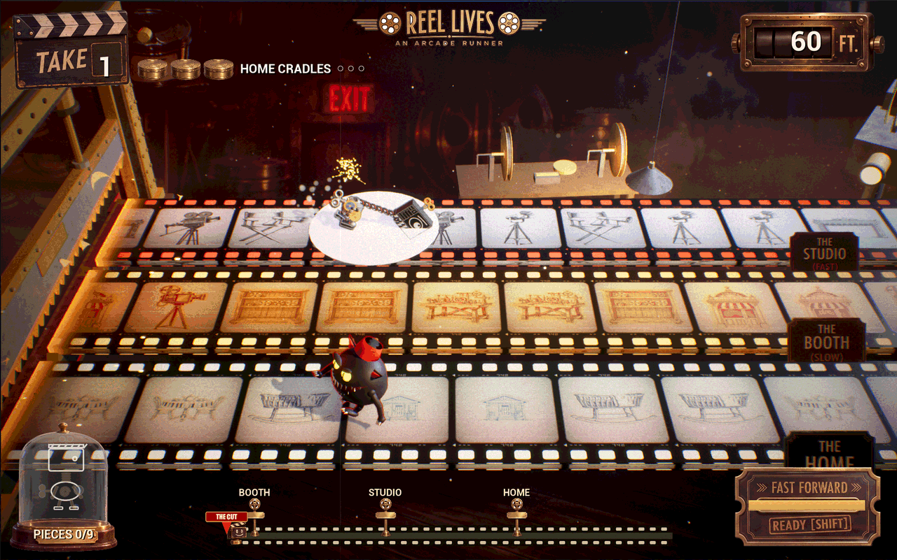
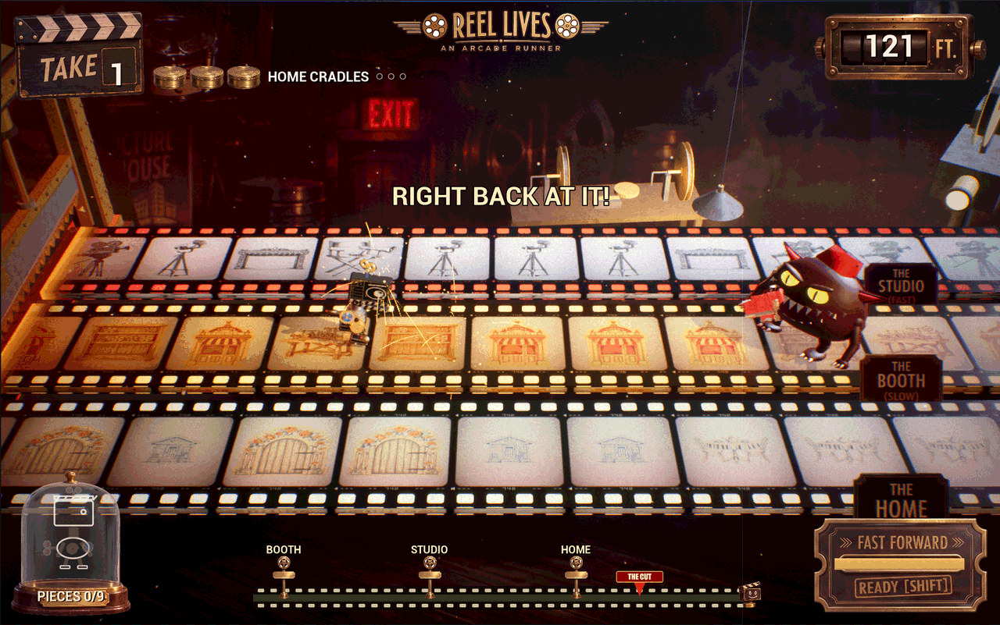
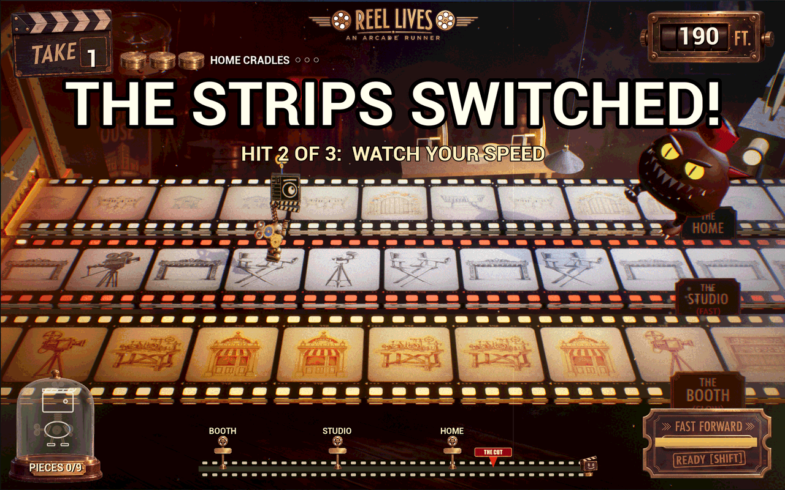
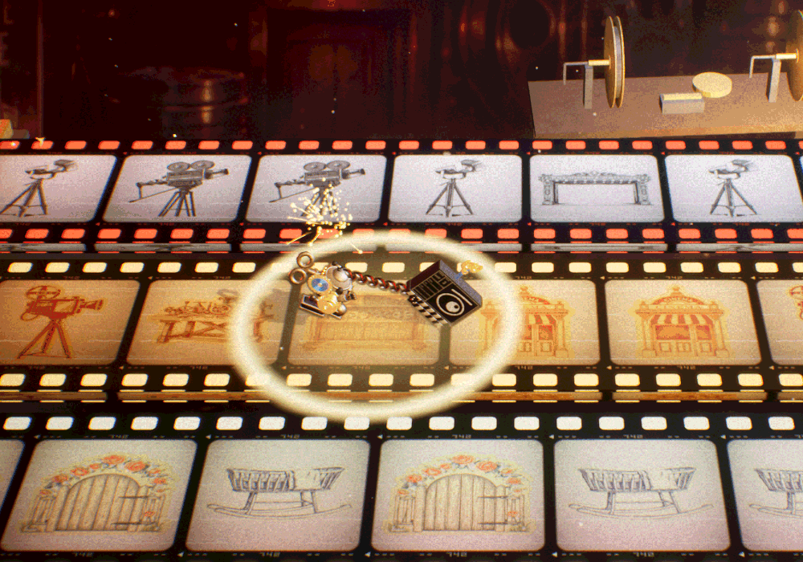

**How it was checked:** a bot waited nine seconds (throws and misses), then fought: three hits, both switches seen, the I TOOK IT APART card, and a key press started Take 2 with the strips back in order. No Blueprint errors.

**Setback:** the foe is still more brown than red; the goblin skin material multiplies a dark base. Good enough to tell it apart, not yet striking.

**Still not judged:** whether the fight is fun at human speed. The cycle is a little longer now (3.1 s) to make room for the wind-up. I need to play it (key B).

**Left alone:** the jar sketch going red, and a hit counter for the foe on the HUD. Noticed, not fixed: the old dust-mote actor logs physics warnings at start (zero-scale meshes with collision).

---

### 10:45: An Opus worker fixes the list, and Fable checks it

**Asked:** fix what the morning review left open, and any other flow and gameplay problems. To save tokens, Fable wrote the method down and handed the work to an Opus worker, then checked the result itself. I was tidying the house for family.

**Done by the worker** (`art/clarity/make_flow1.py`, `art/postfx/ue_make_foeskin.py`, `art/hud/ue_foe_pips.py`, `art/postfx/ue_dustmotes_nocollide.py`, `art/tools/ue_foe_bot.py`):
- **The foe is red.** It has its own rust-red skin material (`M_FoeSkin`) instead of a tint on the dark goblin skin.
- **A hit counter:** THE FOE and three red pips under the logo during the fight. A pip empties and pops on each hit.
- **The chalk friend in the jar turns red** while the foe is out.
- **A take now starts clean.** Life cards, junk and part cards from the last take used to survive a restart (6 life cards and 2 goblins in the test). Restart clears them.
- **Lines that still told the old story:** CHILDHOOD is now BUILD A FRIEND, THREE PIECES OF THE ROBOT is THREE PIECES OF MY FRIEND, MID-LIFE is HALF THE REEL, BURST READY is FAST FORWARD READY. The HALF A FRIEND card said "My friend never got STUDIO PIECES BOOTH PIECES HOME PIECES" and wrapped badly; it now says "My friend still lacks pieces from STUDIO BOOTH HOME".
- **96 physics warnings at every start** from the old dust motes: gone.

**Is the fight fair?** The worker wrote a bot with human limits: it sees everything 0.3 s late and can hop only every 0.35 s. Untuned, it could not win: it timed out at 60 s with two hits, twice, because a returned cog reached the foe's strip just after the foe had hopped away. After tuning (returned cogs fly faster, the cycle is 3.3 / 3.2 / 3.1 s, the first throw waits 3 s so the intro line can be read) it won in 18.7, 21.9 and 22.2 s, taking 2 or 3 cogs on the way.

**What the check found** (`art/clarity/make_flow2.py`): the worker reported that a clap only worked while the cog was still well ahead of the robot. Fable tested it with a bot that claps late: 0 hits in 47 seconds, 13 cogs taken. A cog touching the robot was collected as junk before the clap landed. Now a cog is not collected while the robot is winding up a clap, so a late clap still sends it back. The same bot then won in 12 s with no cogs taken, and Take 2 started clean. No Blueprint errors.

**Setbacks:** the new foe material lacked a Nanite flag, so a packaged build would have shown the grey default material. Caught in the log and fixed. Fable's first fix for the late clap covered only one frame and did nothing; the second covers the whole wind-up.

**Left for me to decide:**
- THE FORK at 26 s announces nothing now that all three strips are open from the start.
- A player who does nothing loses all three takes to burns within about 90 s; the burn at 12 s costs a take and rewinds.
- The title card says up/down for the strips; the in-game line says W/S.
- Footage is glued to the end of every card's text and wraps oddly.
- Missed life cards ride their strip round forever within a take, so cradles can still be collected during the foe fight.
- The foe's first throw is the same every time the game starts.
- The foe covers part of the middle strip's plaque.

**Still not judged:** the fight at my own speed. Key B.

---

### 12:10: The seven open calls, decided and built

**Asked:** fix the seven things the flow pass had left for me to decide. I told Fable to do it itself this time.

**Done** (`art/clarity/make_flow3.py`, `make_flow3b.py`):
- **THE FORK is now THREE LIVES.** Nothing forks any more; the line still names the three strips.
- **The opening teaches, it doesn't punish.** A burn in the first 30 seconds drops the robot and rewinds the film, with BURNT! HOP OFF A BURNING FRAME. NEXT TIME IT COSTS A TAKE. After that burns cost a take as before.
- **One name for the controls:** W/S or arrows, on the title card and in play.
- **Footage has its own place** on the foot line of every ending card, in front of PRESS ANY KEY.
- **Missed life cards and junk leave with the film.** They used to ride their strip round the loop for ever; now they go when they pass the Cut. The foe fight starts on a clear reel.
- **The fight opens differently each time.** The foe's first strip and its hops take their chance from the clock.
- **The foe stands clear of the strip plaques** (x 820, was 900).

**What the test showed that nobody had listed:** a bot stood still from the first frame, like a new player reading the controls. It lost its first take at 12.7 seconds, and not to the burn: to the Cut. The robot starts on the Booth, the slow strip, where the Cut gains all the time. The run was over at 39 seconds. Now the Cut can't gain during the first 15 seconds of the reel. The same idle bot keeps all three takes and gets the burn lesson every four seconds until it hops.

**How it was checked:** the idle bot (before and after), a 40-second run watching that no life card survives past the Cut, the human-limits bot in the fight, the ending card, and a restart into Take 2. No Blueprint errors.

**Not as I wanted:** with late claps working and the foe closer, the human-limits bot now wins in 11.9 s without taking a cog (it was 19 to 22 s). The floor for perfect play is about 12 s. I left it: an easy boss is a smaller risk for a jam than a frustrating one, and a person is slower than this bot. It needs my hands.

**Setback:** an idle player now loops on the first burn until they hop. That is the lesson working, but if it reads as stuck I'll cap it.

---

### 13:35: A game round the run: menus, pause, options, credits; a smaller banner; limbs that stretch

**Asked:** I was with my folks and left Fable a list. A game loop with an end and credits, and the options a game like this needs. The banner that pops up should be smaller and the plain text friendlier. BUILD A FRIEND had come up far into my run (1394 ft). The fixes from our last talk: the reel bar says HOME with strip left after it, the pop-ups cover the play area and a goblin is on me when they close, the white in the logo's reels. The robot's legs each move as one piece: every part should get its own comical stretch and over-reach, as in a Fleischer cartoon. And the goblins look like black Smarties with big teeth (later).

**Done** (`art/clarity/make_shell1.py`, `art/hud/ue_shell.py`, `art/hud/make_shell_art.py`):
- **Title menu:** START, HOW TO PLAY, OPTIONS, CREDITS, QUIT. W/S or arrows move, Space or Enter picks. The chalk friend stands at the left; the best footage shows at the right once there is one.
- **Pause:** P or Esc. RESUME, RESTART TAKE, OPTIONS, QUIT TO TITLE. The clock stops, the projector goes quiet, and the key-cap strip shows the controls.
- **Options:** volume in steps of ten, screen shake and flashes (FULL, SOFT, OFF), window or full screen. They are kept in a save game with the best footage.
- **The end:** an ending card now shows FOOTAGE and BEST. Any key rolls the credits the first time, then the title. On the CUT! card any key starts the next take, P goes to the menu.
- **The banner** is less than half the size and sits on a ribbon at the top, clear of the three strips. Short hints sit on a slim ribbon. The controls are a strip of key caps above the reel bar for the first 15 seconds of take 1, not a line of text.
- **Why BUILD A FRIEND came late:** a burn rewinds the run clock, and every timed line fired again as the clock passed it. It was worse than that: the rewind ran on every frame I stood in the hole, so one burn threw the clock back to zero. Now a burn rewinds once (12 s), lines never replay, there are two free burn lessons, and a burn that has caught you goes away.
- **Pop-ups:** the first-card iris is lighter (0.72, was 0.92), it knocks off the goblins near me when it opens, time ramps back over 0.7 s, and nothing can hit me for 1.6 s after. The same grace follows a pause and a restart.
- **Reel bar:** BOOTH, STUDIO and HOME sit over the middle of their act, and an end post says WRAP.
- **Logo:** the reel holes are keyed out.
- **Limbs:** the thighs, shins, boots, upper arms and forearms were already separate parts, but they only turned. Each now stretches on its own (`BP_Robot.LimbTick`): the thigh reaches, the shin shoots out after it, the boot swells; all go long in the air and on the clap, and squash on landing.

**How it was checked:** scripted walks through every screen with window captures; a run to the wrap, then credits, title and a new take; pause (the clock moved 0.000 s in one second); quit to title; P on the CUT! card; an idle player from frame 0 before and after; slow-motion close-ups of the stride. No new Blueprint errors.

**Setbacks:**
- First walk: the title card stuck out behind the smaller panels, and How to Play and Credits ran off the bottom. 
- The first boot scale tore the boots apart (a counter-scale under a stretched, turned shin). Boots now keep their own size. 
- A shin that lagged far behind the thigh pushed the planted boot through the film. The lag is shorter; the toe still dips a little.
- Removing a spent burn inside its own loop logged 14 errors in one frame. It is removed 0.05 s later instead.
- The idle bot showed the same hole coming round every 4 s and taking all three takes by 33 s. That is the spent-burn fix.

**Not checked:** anything by ear (the volume option uses a sound mix on the master class). Window or full screen was not tried, because the test runs inside the editor. Esc stops the editor's play session, so only P was tested. The stretch at play speed, and the whole of this by my own hands.

**Left for me:**
- The goblin remodel. Not started.
- The test keys (B, C, 0 to 9) are still live and must go before the build.
- The take number goes up when I quit to the title.

---

### 19:05: Music, a clear view of the robot, and a gremlin worth modelling

**Asked:** I played the build (great fun) and came back with three things. Something is stuck to the robot's right arm from the first frame and hides it. I made five tracks in Suno (`audio/music`): the four long songs should change from go to go, and speed up and slow down with the strip the player is on, in a cartoony way that never turns discordant. And I drew a proper gremlin: a character sheet, the same character cut into poseable parts, and an image-to-3D model of those parts (`docs/design/gremlin_model_parts.glb`). Can it be used, or do we model it in Blender?

**Done** (`art/clarity/make_shell2.py`):
- **The thing on the arm** was three things: the mainspring, the lens and the music-box key, left on the robot's right side from the story I cut ("the robot builds itself"). The pieces go to the friend in the jar now, so they are hidden.
- **Music:** the intro track plays on the title. Every take picks one of the four long songs, never the one just heard. The pitch glides with the strip: 1.06 on the Studio (fast), 1.0 on the Home, 0.95 on the Booth (slow), a lift on Fast Forward, and it winds down to 0.6 when a run is lost. It is one glide for the whole tune, like a gramophone, so it can't go out of tune with itself. The projector loop dropped from 0.55 to 0.3 to sit under it.
- **Fable's own goblin v2** (`art/gremlin/build_goblin2.py`): a big head on a pear body, teal skin, hooked nose, waistcoat, gloves, curled shoes. It has more character than the black ball, but it is plainly made of spheres and cones. Not imported. Kept as the fallback.
- **My gremlin model, inspected** (`art/gremlin/inspect_glb.py`): one mesh, 498,832 triangles, one 4K texture set, 54 MB. The parts are real 3D and lie apart on the sheet, so a script can cut them by position. It is usable.

**How it was checked:** a scripted run read the tune and pitch on each strip (0.950, 1.060, 1.000), a restart (new tune) and a lost run (0.601). No Blueprint errors. Nothing was heard.

**Setbacks:** Unreal refused the OGG files, so the tracks went in as 32 kHz WAV (about 100 MB of assets). The capture of the robot shows Unreal's "video memory exhausted" warning; I don't know yet if that is the capture or the game.

**Left for me:** hear the music and judge the glide. Check Suno's terms for a free account before the submission. The gremlin goes to a new session: cut the parts, thin them down, pose them on the rig, add the jaw.

### 19:40: My gremlin is in the game

**Asked:** turn my gremlin model into the in-game goblin, with more parts than the old one so it can stretch and take comical strides, and keep the animation I like.

**Done** (an Opus session, scripts in `art/gremlin/`):
- **Cut by position** (`cut_gremlin.py`): every face of the 499k-triangle model was dropped onto a 2 mm grid on the sheet and the filled regions flood-filled. That gave exactly the 21 pieces on my sheet, each whole: four ears, the head with the fedora and upper teeth, the jaw, a neck, the chest, the belly with the waistcoat, and two each of upper arms, forearms, hands, thighs, shins and shoes. Kept: the belly with the waistcoat (it matches my character art) and the mirrored pair of ears (the other pair both lean the same way).
- **Thinned** (`decimate_gremlin.py`): welded the triangle soup and decimated each part to its own budget, 42,598 triangles for the whole gremlin (the head gets 10k because it carries the face). The UVs held, and the textures went from 4K to 2K.
- **Posed like my character art** (`assemble_gremlin.py`, `art/gremlin/gremlin_v3.blend`): big grinning head under the red fedora, waistcoat under the chin, arms hanging to the shoes, short legs, two-tone shoes splayed a little. It is 0.75 m with the hat, faces Blender -Y, and every part's origin sits on its joint. A joint test in Blender (jaw open, elbows and knees bent, forearm and neck stretched) showed no part coming apart.
- **In Unreal** (`ue_build_gremlin3.py`): 18 meshes `SM_Grem_*`, textures `T_Gremlin_D/N/MR`, a new skin `M_GremlinSkin` (my texture times `Tint`, `Flash` for hits, a soft rim in the skin's own colour so it reads on the dark stage, Nanite on) and a red foe skin `MI_GremlinFoe`. In `BP_Gremlin` the old names still work: `GBody` is the belly, `Hat` is the head, the arms and legs are the upper arms and thighs. New parts hang under them: `Neck`, `Jaw`, the ears under the head, `ForeL/R` and `HandL/R`, `ShinL/R` and `ShoeL/R`. All get the goblin outline.
- **Animation** (`make_imp_tick3.py`): the scuttle I like is kept on the upper arms, thighs, ears and head. On top of it the elbows bend as each arm swings through and the forearms stretch on the back swing, the hands flop late, the knees bend as each leg swings through, the shin stretches as the leg reaches, and the toe lifts and slaps flat. The jaw chatters. In the threat the neck shoots up with the head riding on it, the head rears back, the jaw drops open, the arms fling out with twitching claws and the knees crouch. Knocked, everything flails.
- **The foe** (`make_gremlin3_director.py`): it wears the red skin on all 18 parts. A lost arm now takes its forearm and hand with it, and the third hit knocks the jaw off, because the fedora is part of the head now.

**How it was checked:** Blender renders from five sides and a joint test; in Unreal, a still gremlin posed by hand from the front and side to find which way each joint bends, then play runs with captures at 1/10 and 1/20 speed: the scuttle, all three kinds side by side, the threat, and the foe (test key B) through its first hit. The log shows no Blueprint errors from these runs.

**Setbacks:** my first guesses at the joint directions were wrong. The elbows and knees bent backwards and the jaw shut up into the head, so the posed still came first and the signs were flipped from it. In the stage light the skin went nearly black, so the skin got a rim light. The first red for the foe looked like the orange Burner, so it is a deeper red now. In Unreal 5.9 `reparent_subobject` would not move the ears under the head; `attach_subobject` did. A Blender gotcha: the glTF importer leaves objects in quaternion rotation mode, so Euler rotations did nothing until the mode was changed.

**Left for me:** play it and judge the stride, the stretch and the threat at full speed. The Burner's match still floats where the old goblin's hand was. The robot gets the same treatment only when I say so.

### 20:05: Later lunge, music that dies with the run, my name in the credits

**Asked:** I moved the jaw a little and put a skin-coloured sphere inside the head so no holes show between the parts (the gremlins look fantastic). They lunge too early: they should do it later, so it looks like they try to grab the player. Then a list of notes: wasted cards should disintegrate, collecting cards should feel more rewarding, the clap should spare a card when it takes a goblin, the music should grind to a halt when the player dies and really speed up on boost, my name and email in the credits, mouse clicks on the menu, Xbox controller support, and gremlins bursting into ragdoll parts like a plastic toy. We are at 86% of the budget, so as economically as possible.

**Done** (`art/clarity/make_notes1.py`):
- **The lunge** starts at 380 units from the robot instead of 650. A test gremlin rears up at 370 and is in the full pose at 313, right as it reaches the player.
- **Death:** the music now glides down towards a stop and fades out with it, slow at first and then crawling. Unreal won't play below a pitch of 0.4, so the fade does the last part. Measured: 0.95, 0.63, 0.42, 0.28, 0.19, 0.13, 0.08, 0.06 at half-second steps. It comes back up on the next take.
- **Boost:** Fast Forward now lifts the music +0.3 (it was +0.12).
- **Credits:** Directed by Shane Storms, with my email.
- **The rest** went into `docs/SHANE-NOTES-2026-11-14.md` with an approach and a size for each: card disintegration, a more rewarding pickup, clap precision around cards, the film-slap sound from fal (ask me first), mouse on the menu, Xbox pad (easy-medium), ragdoll parts.

**How it was checked:** a play run with a bot: the threat distance read from a gremlin spawned on the robot's strip, and the music pitch read after a forced game over. The boost pitch and the credits are one-number and one-line changes; not heard or seen yet.

**Left for me:** hear the death and boost music, and pick which notes to build in the time left.

### 20:25: The menus take the mouse

**Asked:** the start menu buttons can't be clicked with a mouse.

**Done** (`art/clarity/make_mouse1.py`, variables added by `art/clarity/ue_mouse1.py`): the cursor shows whenever a menu or a text page is open and hides in play. Moving the mouse over a row selects it (with the same small tick as the keys), and a left click picks it, exactly like Space or Enter. On How to Play and the credits any click goes back. The keys work as before. It works on every menu that uses the five menu rows: title, pause and options.

**How it was checked:** in play, the pointer was moved by script onto OPTIONS and HOW TO PLAY (both became the selected row), then off the menu (nothing changed). A click opened How to Play and a second click came back to the title menu. A real mouse click itself was not tried.

**Setback:** Unreal 5.9 has no "set show mouse cursor" function for Blueprints; the controller's `bShowMouseCursor` property is set directly. The failed first write knocked the Director out of the open level again (the known quirk), and reloading the level from disk brought it back. The level had no unsaved changes.

### 20:35: Xbox controller

**Asked:** Xbox controller support.

**Done** (`art/clarity/make_pad1.py`, 15 new key events in `BP_Robot`; Windows reads Xbox pads without a plugin). Each pad input calls the same event as its keyboard key, so menus and play behave the same:
- D-pad or left stick **up/down**: change strip in play, move through the rows in menus (W/S).
- D-pad or left stick **left/right**: change an option's value (A/D).
- **A** or **X**: clap in play, pick in menus (Space/Enter).
- **Y**, **RT** or **RB**: Fast Forward (Shift).
- **Start**: pause (P/Esc). **B**: back out of a menu (does nothing in play).
- The "press any key" screens (title card, CUT! card) already take pad buttons.

**How it was checked:** the Blueprint compiled with no errors or warnings and all 15 events are in it. No pad was plugged in, so nothing was pressed: I need to try it with a real controller.

---

### 23:55: A clap that knows where the card is

**Asked:** my note 1c. If a gremlin is right in front of a part card, the clap should take the gremlin and spare the card. A strike slightly off the card's centre should get the gremlin without breaking the card, and the card is then collected as I pass it. The skill is knowing how far the head shoots out.

**Done:** before, a clap tore any card on my strip anywhere in the clap's reach (x -70 to 340), even when a gremlin took the same hit. Now the gremlins are checked first: if the clap hit one, the card is spared. And a card only tears when its centre sits in the middle of the reach (x 60 to 260), so a clap near its edge misses it. One line in `BP_Card.ReceiveTick` (`art/clarity/make_precision1.py`).

**Checked** in PIE in slow motion with a script that places a card (and a gremlin) on my strip and claps (`art/tools/ue_test_precision.py`): card in the middle of the reach, torn; card at the far edge, spared; gremlin just in front of the card, gremlin smashed and card spared; card already beside me, spared. Blueprint compiled with no errors.

Also tonight, before bed, I gave Claude a new list (robot remodel from my design, a 1920s Google font, tidier pop-up messages) and said not to stop to ask; it is saved as items 8 to 11 in `docs/SHANE-NOTES-2026-11-14.md`. Three Opus workers started on the parts that stay out of the editor: the robot model in Blender, the sound effects on fal (capped at $2.50), and the font with an audit of every message.

---

## Day 4: 2026-11-15

### 00:00: A torn card falls apart, a collected one sings into the jar

**Asked:** my notes 1a and 1b. A card I clap by mistake should visibly disintegrate, wasted. Collecting a card by walking past it should feel more rewarding, so players want to do it.

**Done:**
- **Sounds:** an Opus worker made five sound effects on fal (`sonilo/v1.1/text-to-sound-effects`, two takes each, about $0.03 in all): a card rip, a pick-up chime, a plastic-toy pop for the gremlins, a clapper snap, and the film tail slapping a spinning-down reel for a lost run. In Unreal as `/Game/ReelLives/Audio/Sfx/Sfx_*`; listed in `docs/AI-ASSETS.md`. The picks were made by loudness curve, not by ear yet.
- **Wasted card (1a):** the clap now throws film scraps and a chalk puff and plays the rip; the card tips, spins round and shrinks to nothing in a third of a second, instead of only tipping over.
- **Collected card (1b):** when the piece leaves the card as I pass, a chime, a sparkle and a brass burst go off on the robot with a warm flash, and the piece flies off the strip into the bell jar on the HUD (aimed at the jar's spot on screen), shrinking on the way, before the jar counts it.
- Code: `art/clarity/make_cardfx1.py` (BP_Card `ReceiveTick` and `Tear`).

**Checked** in PIE with `art/tools/ue_test_precision.py`: a clapped card shreds ([torn](devlog-shots/2026-11-15_0000_card-torn.png)); a collected piece's path, read every 0.05 s, rises from the robot towards the camera's lower left over 0.45 s and the jar counts it ([collected](devlog-shots/2026-11-15_0000_card-collect.png)). The flight is too quick for a window capture to catch with the editor's lag, so I still need to see it myself. No Blueprint errors in the log.

---

### 00:03: Gremlins burst like plastic toys

**Asked:** my note 7. Killed gremlins should burst into their body parts, flying off as physics objects like an exploding plastic toy.

**Done:** every real hit (`KnockOff` with power 0.4 or more) now takes my gremlin apart: all 18 parts (head with the fedora, jaw, ears, neck, belly, arms, forearms, hands, thighs, shins, shoes) come loose, become physics bodies, get pushed outward from the belly and up along the hit with a random spin, bounce off the film strips, and the whole lot is gone 3 seconds later. A plastic-toy pop plays with each one. The parts got simple box collision. Nothing new is spawned, so a run of kills only adds short-lived physics bodies. The Burner's own exit after it lights its mark stays the old whole-body flight. The film tail slapping the reel now plays when a run is lost, over the music grinding down. Code: `art/clarity/make_burst1.py`.

**Checked** in PIE: three gremlins clapped at once under slow motion ([burst](devlog-shots/2026-11-15_0003_gremlin-burst.png)); part positions read over time show them simulating and spreading, and the gremlin actor is gone at 3.6 s. No Blueprint errors.

---

### 00:06: A 1920s face for the words

**Asked:** my note 9, a fitting vintage 1920s Google font for the UI and general text, stylish but semi-vintage.

**Done:** an Opus worker compared candidates on real game strings (`art/fonts/font_compare.png`) and chose **Limelight** (picture-palace Art Deco) for the big lines and **Josefin Sans** (1920s geometric sans, readable small) for everything else; both SIL Open Font License, licence files kept in `art/fonts/`, reasons in `art/fonts/CHOICE.md`. In Unreal they are two runtime fonts, `F_ReelDisplay` and `F_ReelBody` (Regular, SemiBold, Bold), set on 23 HUD texts: banners, card heads and the menu title in Limelight; subs, menus, labels, pieces and the ticket in Josefin. The take and footage digits stay as they were. Rule from the comparison: Limelight never below about 32 px, it clogs. Code: `art/hud/ue_fonts.py`. The key-cap strip is still baked Roboto art.

**Checked** in PIE: [menu](devlog-shots/2026-11-15_0006_font-menu.png), [banner](devlog-shots/2026-11-15_0006_font-banner.png).

---

### 00:10: The robot from my drawing

**Asked:** my note 8. Remodel the robot from my design render (clapperboard head, spring neck, brass ball body, red bulb, wind-up key, thin limbs, big round shoes), with every limb part separate so knees and elbows bend and the clapper opens like a mouth. Gemini could not split it into parts, so model it directly.

**Done:** an Opus worker built it in headless Blender by script (`art/robot2/build_robot2.py`, `robot_v2.blend`, 34.9k triangles): the same 16 parts with the same joint pivots, height (116.5 cm) and material slot names as the old robot, so the game's existing animation drives it unchanged. Forearms carry their hands; the bulb is part of the body with a new emissive `M_BulbRed`. The slate front keeps the old UV layout, so the chalk face still plays on it. In Unreal the parts are `SM_Robot2_*`, swapped into every `BP_Robot` mesh component, and the part cards now show the new parts (`art/clarity/make_robot2_cards.py`). The robot brass is a little warmer and less grimy. Blender renders: `art/robot2/renders/`.

**Checked** in PIE: [close up mid-hop](devlog-shots/2026-11-15_0010_robot2-close.png), [on the strip](devlog-shots/2026-11-15_0010_robot2-stage.png). On the black-and-white strips it still takes the film stock, so it reads silver there; that is the old design rule, not a material fault. A 45-second run with a bot clapping and hopping at normal speed: no Blueprint errors. A repeated physics warning from the gremlin's blink sphere (zero scale with collision on) is fixed by turning collision off on its helper spheres. The old `SM_Robot_*` meshes stay in place as the fallback. My render tilts the head back a little; that pitch is not in yet.

---

### 00:19: Fewer words, each one in its place

**Asked:** my note 10, tidy up the various statements and messages that pop up all over the place. The plan was an audit of every banner, hint and card (`docs/design/message-tidy.md`).

**Done:** an Opus worker applied the plan to `BP_Director` by patch (`art/clarity/make_tidy1.py`, `make_tidy2.py`); text and message timing only, no mechanics. **Cut** seven lines that repeated something already on screen: FAST FORWARD READY (the ticket says it), + FAST FORWARD, the second SPLICE!/FREEZE FRAME/GRIEF on contact (the "ahead" hint already named them), THREE LIVES at 26 s, and THAT'S A WRAP!, which the wrap card hid after a tenth of a second anyway. **Fixed a clash:** losing a take with a piece in the jar used to show "CUT! A PIECE WAS KNOCKED OFF" over the takes count in the same frame, so you never learned how many takes were left; now it is one banner, "CUT! TWO TAKES LEFT · A PIECE FELL OFF". **Reworded** in the house style (short headline, one caps line, `·` as the separator): ACT I: THE BOOTH / ACT II: THE STUDIO / ACT III: THE HOME with "THREE PIECES ON THIS STRIP", NINE PIECES · OUTRUN THE CUT, FREE THIS TIME · SOON IT COSTS A TAKE, THE X IS COMING: HOP OFF!, JUNK 2 VS PIECES 1, CRADLE 2/3 · THREE BUYS A TAKE, STAY ON HIS STRIP TILL IT DEVELOPS, MUSIC BOX! and FAST FORWARD! as keepsake headlines, and the counters that the HUD already shows (piece n of 9, foe hit n of 3) dropped from the banners. Card feet and the title foot use `·` instead of runs of spaces; HOW TO PLAY says strips and gremlins, and gains the rule nobody was told: "(more JUNK than pieces builds a FOE)". **Timing:** BUILD A FRIEND waits a second longer after TAKE n, and the keys strip leaves at 11 s instead of 16, before the first hazard hint. OUCH! and RIGHT BACK AT IT! now wait their turn (1.5 s after any other banner) so they cannot wipe a piece name.

**Checked** in PIE: [banners](devlog-shots/2026-11-15_0019_message-tidy-banners.png) (BUILD A FRIEND, the longest act headline, the merged CUT!) all fit the plate in Limelight; [how to play](devlog-shots/2026-11-15_0019_how-to-play-foe-line.png). The first try put the FOE rule on its own wrapped paragraph and the last line slid under PRESS ANY KEY, so it became one short line under DODGE. A 95-second bot run (random claps and hops, god mode): no Blueprint errors. Still open: the first memory card develops at about 15 s and its A MEMORY banner can replace ACT I: THE BOOTH; the full priority system from the plan would sort that, but it means a new parameter on every `Say` call, so it waits.

---

### 00:27: Gremlins gnash, wobble their ears and blink

**Asked:** my note 2A. The gremlin's jaw should gnash in a menacing way on the pivot I set: Roll 0 to -30 and back, and Pitch -10 to 20 and back. The separate ears should wiggle, wobble and stretch when they lunge. The `EyeBlink` sphere I put in the head should flick from scale X 0 to 0.1975 for a frame or two, so they blink.

**Done** in `BP_Gremlin.ImpTick` (`art/clarity/make_gnash1.py`): walking, the jaw chews small and slow while it grinds side to side. In the lunge it gnashes fast and wide, opening to the full -30 with the -10 to 20 grind. A knocked gremlin's jaw hangs wide open. The ears keep their wiggle, and now stretch along their length and squash across, a little all the time and a lot in the lunge, with a fast wobble. Each gremlin blinks for about 0.06 s every 3 s, on its own phase.

**Checked** in PIE by reading the parts over time under slow motion: the blink fires on time, the jaw reaches -27 in the lunge and the ear stretch swings. [Close-up mid-lunge](devlog-shots/2026-11-15_0027_gnash.png). Setback: the Blueprint write made the Director drop out of the open level again (a known editor quirk). I reloaded the map from disk, without saving, and it came back.

I also had an Opus worker write `docs/design/sfx-list.md` (my note 5A): 39 proposed sounds with file names, when each plays and a prompt for each, 12 of them marked must-have. Generating them would cost a few cents.

---

### 00:32: No more square corners on the sunbursts

**Asked:** my note 3A. Some life cards' sunburst glow showed the texture tiling, with the glow's corners visible at each corner of the effect.

**Done:** the halo material spins its rays by rotating the texture coordinates, so the corners of the quad read outside the texture and wrapped round to the other side of it. The rays texture `T_SunRays` now clamps instead of wrapping. Its edges are black, so everything outside the circle is dark. One setting, no Blueprint change.

**Checked** in PIE with life cards on all three strips: [clean rays](devlog-shots/2026-11-15_0032_halo-clamped.png).

---

### 04:51: Big gremlins take more than one clap

**Asked:** my note 1A. The larger a gremlin is, the more hits it should take.

**Done** in `BP_Gremlin` (`art/clarity/make_hp1.py`): plain gremlins now come in sizes from 0.9 to 1.3, and Chewers from 1.4 to 1.65; Burners stay small. Size sets the hits: under 1.15 one clap, under 1.45 two, bigger three. A clap or Fast Forward hit on a gremlin with hits left flashes it white, knocks it back with a bonk and a chalk puff, and resets its lunge. The last hit bursts it as before. The Cut, my own bump into one, and the foe fight are unchanged.

**Checked** in PIE: ten plain gremlins came out at sizes 0.9 to 1.29 with one or two hits; a Chewer of size 1.62 took three claps, knocked back each time, and burst on the last. No Blueprint errors.

---

### 04:54: Rotten tomatoes from the stalls

**Asked:** the rest of my note 1A. The big gremlins could throw something that knocks the robot back slightly; I wasn't sure what, maybe something old-school cartoon.

**Done:** the 1920s audience's verdict, a **rotten tomato**. Each gremlin with two or more hits left lobs one tomato when it's on my strip 450 to 800 units ahead. It leaves its right hand, spins, and arcs to where my head is, landing 0.75 s later. Hop off the strip to dodge it. If I'm still on that strip and on the ground when it lands: a splat of scraps, a rip-and-squelch, a shake, the knock wobble, a hurt face, "SPLAT! HOP TO DODGE", and the Cut gains 60 units. That's the small knock back; no take is lost. The tomato is a red ball on each gremlin (`MI_Tomato`), with no new actors. Code: `art/clarity/ue_tomato_setup.py`, `art/clarity/make_tomato1.py`.

**Checked** in PIE: standing still, the tomato hit and the Cut went from 700 to 640; hopping away once it was thrown, it missed and the Cut didn't move. First try the arc was 260 units high and the ball small, so it looked like it was over the next strip; now it's 110 high and bigger ([in flight](devlog-shots/2026-11-15_0454_tomato.png)). The usage limit paused me from 00:45 to 04:50.

---

### 04:59: Box office takings

**Asked:** my note 4A. A fun score built from everything the player touches: good things add, debuffs subtract, maybe multiplied by the feet travelled, so there's something to beat and a competitive edge. It has to fit the 1920s nitrate-punk look without cluttering the screen.

**Done:** the score is the picture's **box office takings**, in dollars.
- Each clap hit on a gremlin is +$25 and builds an **ENCORE** streak. Gains are multiplied by 1 + streak/2, rounded down, up to x5.
- A piece of the friend +$250, a life card +$50, a keepsake +$100, a foe hit +$500.
- A junk cog -$50. A torn card -$100, a gremlin bump (OUCH) -$75, a tomato splat -$25 and a lost take -$200; those four also end the streak. Losses aren't multiplied.
- At the end of the run the footage is added at $1 a foot, plus a wrap bonus: I BUILT A FRIEND +$2000, HALF A FRIEND +$500, I TOOK IT APART +$1500.
- On screen it's one small amber Josefin line under the footage counter, "BOX OFFICE $1,240", with "ENCORE x3" while a streak runs. The number counts up and pops a little on each change. The end card's foot line reads "BOX OFFICE $X · BEST $Y", and the best is saved with the options.

Code: `art/hud/ue_score.py`, `art/clarity/make_score1.py` (new Director event `AddScore`; hooks in GameTick, PartGot, CollectToken, CollectKeepsake, CollectBad, LoseLife, FoeHit, HudTick, ShowCard, the save, BP_Card.Tear and the gremlin's tomato).

**Checked** in PIE: a bot run showed the takings line under the counter and a torn card taking its $100 ([HUD](devlog-shots/2026-11-15_0459_box-office-hud.png)). A forced CUT! added the footage, $175 + 644 ft = $819 ([end card](devlog-shots/2026-11-15_0459_box-office-card.png)). Six gremlin hits in a row paid 25, 25, 50, 50, 75, 75, and an OUCH reset the streak. No Blueprint errors. **Note for me:** that test wrote "best $819" into my save (`Saved/SaveGames/ReelLives.sav`), along with any test footage best. Claude wasn't allowed to delete the file. A real run beats it, or I can delete the file to start clean.

---

### 05:02: The robot comes apart into 37 pieces, and lives

**Asked:** my note 6A. Break the little robot down like the gremlins, into as many parts as possible, so it can have lifelike motion with ultra squash and stretch. Add something that bobs and bounces along with all his motion without adding resource overhead.

**Done:**
- **Model:** an Opus worker split robot v2 in headless Blender (`art/robot3/`, 35.9k triangles, only 3% more than v2). The body is now a top dome, a middle band and a lower bowl, with iron caps on the cut faces. The four side cogs, the three gauges and their needles are separate. The red bulb sits on its own little coil spring, and that's the bobbing thing. The hands come off the forearms, the top clapper bar comes off the slate, and the key splits into shaft and bow. Every v2 part keeps its name, pivot and material slots.
- **In Unreal** (`art/robot3/ue_robot3_setup.py`): the existing BP_Robot components keep their names, so all the old animation still drives them. Body now shows the lower bowl, and 17 new child components carry the rest. No new actors or materials beyond the meshes.
- **The life** (`art/clarity/make_robot3_anim.py`, appended to `BP_Robot.LimbTick`):
  - The dome bobs on each stride, lifts and stretches in the air, and squashes hard on landing, and the band bulges.
  - The bulb on its spring wobbles as he runs, whips round on landing and on every clap, stretches in the air and swells as he lands.
  - The cogs turn all the time, the pairs meshing opposite ways, three times as fast on Fast Forward.
  - The gauge needles drift and twitch.
  - The hands swing a beat behind the forearms.

**Checked** in PIE by reading the parts over a hop and a clap. The dome's height scale went 1.02, then 1.17 in the air, then 0.83 on landing. The bulb's roll jumped from 12° to 60° on the clap. The cogs turned steadily. [Parts on the robot mid-hop](devlog-shots/2026-11-15_0502_robot3-parts.png). No Blueprint errors in today's log. A good close-up of the motion still needs a real-time look; the editor's slow frames make stills of it hard.

---

### 05:55: Eight new sounds in place of the placeholders

**Asked:** I said yes to generating the must-have sounds from `docs/design/sfx-list.md`.

**Done:** the Opus sound worker made eight on fal (`sonilo/v1.1/text-to-sound-effects`, two takes each, about $0.016; tonight's fal total is about $0.04). They're in place of the old placeholders:
- `Sfx_Robot_Hop` on every hop
- `Sfx_Combat_Clap` on the clap
- `Sfx_Combat_Boost` on Fast Forward
- `Sfx_Robot_Hurt` on a gremlin bump
- `Sfx_Gremlin_Hit` when a big gremlin takes a hit it survives
- `Sfx_Gremlin_Burst` when one bursts apart
- `Sfx_Gremlin_Match` when a Burner lights up
- `Sfx_Gremlin_Throw` when a tomato is thrown

Code: `art/clarity/make_sfx1.py`. The takes were picked by loudness shape, not by ear. The clap trims to 0.09 s, so it needs a listen.

**Not done:** the session's permission system blocked the third fal batch, so five musts aren't made: `Sfx_Card_Pickup`, `Sfx_Card_FriendWhole`, `Sfx_Cut_Caught`, `Sfx_Score_Tick`, `Sfx_UI_Confirm`. I approve those myself next time. Their hooks are noted in the script.

**Checked:** a 20-second bot run clapping, hopping and boosting, with no Blueprint or audio errors in the log. Not heard by anyone yet.

---

### 08:08: The last five sounds

**Asked:** I said yes to making the five must-have sounds the permission system blocked last night.

**Done:** made them on fal myself (same sonilo model, two takes each, about $0.023, so tonight's fal total is about $0.06), picked a take of each by loudness shape, and wired them in with `art/clarity/make_sfx2.py`:
- `Sfx_Card_Pickup` (bell and card flick) in place of the synth pickup blip; last night's chime stays under it, a bit quieter
- `Sfx_Card_FriendWhole` (brass fanfare, bell jar, clockwork) when all nine parts are in, replacing the pitched-up slam; the music box still plays
- `Sfx_Cut_Caught` (snip, flapping reel, trombone wah) on the CUT! card, with the film-tail slap turned down beneath it
- `Sfx_Score_Tick` (register click, cut to 0.24 s) on every box-office gain, quiet, rising in pitch with the ENCORE streak
- `Sfx_UI_Confirm` (clapper clack and projector whir) on menu confirm

**Checked:** in PIE, four score gains gave $300 at streak 4 as the maths says, WholeMoment, MenuPick and GameOver all ran, and the log has no errors. The card pickup line only swaps a sound in an existing branch and compiles; no card was collected in that run. Nobody has heard any of them yet.

---

### 08:50 to 09:55: Bug hunt on the full loop, then four cheap silent-film touches

**Asked:** with hours left, an Opus worker should check the whole loop on screen (menu, play, lose a take, CUT!, restart, wrap, credits, title, best saved), fix what a player would hit, then add cheap era polish: intertitle praise and taunts, a rating stamp on the end card, an iris on every lost take, letterbox bars when the Cut is close. Audio muted for all testing (`au.MuteAudio 1`, runtime only; Shane's new rule).

**The loop, seen on screen** (`art/tools/ue_flow_check.py`, `setup/vpshot.ps1` crops a `winshot.ps1` capture to the play viewport): title menu, START, TAKE 1 ACTION!, a lost take (CUT! TWO TAKES LEFT, hit-stop, Cut pushed back), the CUT! card with box office and best, any key into Take 2 with three takes, a skip to the wrap, the wrap card, any key to the credits, any key to the title. All worked.

**Bugs found and fixed** (`art/clarity/make_era1.py`):
- **A new take could open with the A MEMORY iris and no card.** Take 2 showed A MEMORY 0.4 s after TAKE 2 ACTION!. The first-card iris fires when a card's thread was drawn in the last 0.15 s; Restart destroyed the cards but left that time stamp fresh, and the "first card" flag stays unset until a card really develops. Restart now clears the stamp. After the fix, TAKE 2 ACTION! held for two seconds with no iris.
- **THAT'S A WRAP... HALF A FRIEND ran to two lines** and the second sat on the friend sketch. It is HALF A FRIEND now (the score bonus still matches "HALF").
- **The test keys (B, C, 0 to 9) worked in any build,** so a player pressing 8 lost a take and 0 turned on god mode. They now do nothing in a Shipping build and still work in the editor.

**Added, each seen working in play:**
- **Iris on every lost take** (not the last): the black iris closes on the robot in 0.25 s, holds, and opens again by 0.95 s, while the CUT! banner plays. Same mask as the first-card iris (`ThreadTick`).
- **A rating stamp on every end card:** 0.55 s after the card opens, a tilted red stamp slams down with a clack: FLOP, MATINEE, HIT, SMASH HIT, BLOCKBUSTER, BOX OFFICE LEGEND (under $1,000, $2,500, $4,500, $6,500, $9,000 and above). New `StampText` on the card.
- **Praise and taunts:** every 5th clap in an ENCORE streak brings an intertitle (BRAVO! THE STALLS ROAR, ENCORE! ENCORE!, BOFFO!, STANDING OVATION); breaking a streak of 5 or more brings BOO! HISS! or FLAT TIRE!. Both wait 1.5 s after any other banner, so they never wipe a piece name.
- **Letterbox bars** slide in from the top and bottom, behind all the HUD art, when the Cut is very close, and slide away when you pull clear (`LetterTop`, `LetterBot`).

**How it was checked:** the loop above, run again after the patch; the iris caught in a burst of window captures; the stamp read back (text, opacity, slam done); praise and taunt read back from the banner text; the letterbox watched as an idle robot let the Cut close in. No Blueprint errors in the log. Game feel juice (hit-stop, shake, flash and the FULL/SOFT/OFF option) was already in, so nothing was added there.

**Not done or not seen:** none of it was heard (muted) or played at full speed by me. The stamp thresholds are a guess from a 2,771 ft best and the wrap bonuses. The test runs wrote a best box office of $3,673 into my save (`Saved/SaveGames/ReelLives.sav`); delete the file for a clean best. The take number still goes up when I quit to the title (left: harmless). The HUD box-office line behind the CUT! card can lag the card's total.

**Then a Shipping build** (`X:\GameJamBuilds\ship_1115`, 546 MB with no `.pdb`, about 5 minutes with the editor open). It built and opened on the title menu in its own window (`-nosound`; captured with the new `setup/gameshot.ps1`). The cook log had one real fault: `M_UIBurn`, the full-screen burn, flash and red danger vignette, failed to compile for the packaged game ("Default Material will be used"). Its two colour masks passed only red and green, so the flash colour reached the shader as two numbers instead of three; the editor let it through, the cook did not. Both masks now pass blue too. A second Shipping build came out with no warnings at all. Not tried in the build: playing it with keys or a pad, full screen, a clean machine.

---

### 10:55 to 11:30: My twelve notes from this morning's play

**Asked:** I played the build and sent twelve notes: the lamp should swing when things happen; the menu and credits text is ugly and the highlight bar sits off the words; the credits undersell what I did by hand in the engine; the title screen's robot is a scribble and the best-feet line looks amateur; HOW TO PLAY is out of date; the Fast Forward ticket pulses but its bar doesn't, and the bar should start empty; the HUD doesn't match the takes left; losing a take needs bits flying; big gremlins turn up straight away; the memory piece sits inside its card; pickups appear over holes; the sounds are harsh and uneven; the robot walks through gremlins and loses nothing; and where did the scoring go?

**What Claude (Fable) found first**, by reading the live Blueprints:
- Walking into a gremlin only pulled the Cut 160 units closer. Nothing on screen said so, so it read as "nothing happens".
- Last night's size change gave plain gremlins a size of 0.9 to 1.3 from the first second, and anything over 1.15 takes two claps. So more than half of the very first gremlins were two-hitters.
- "Take" meant two things. The slate counted runs, the banner counted lives ("TWO TAKES LEFT"). The cans were right; the slate never moved.
- The scoring is in (box office, ENCORE streak, rating stamp, best saved). It is one small line under the footage counter, and nothing near the robot ever showed a number.
- The sounds differed by 14 dB (loudest part: tomato throw -8 dB, UI confirm -20 dB).

**Done, play (`art/clarity/make_ship1.py`, `make_ship1b.py`):**
- **A gremlin bite costs a take** after the first 30 seconds. Before that it's a warning: "OUCH! · SOON A BITE COSTS A TAKE".
- **The slate's TAKE number goes up with every lost take**, so slate, cans and banner agree. Three lost takes: TAKE 1, 2, 3, then the card offers TAKE 4.
- **Plain gremlins start small** (0.85 to 1.0, one clap) and only reach two-clap size as the reel runs (up to 1.3 by 200 s).
- **Fast Forward:** the ticket starts empty and the ticket art is dimmed until it's ready. A gremlin is 20%, any life card 5%. The Booth's film cans no longer fill it; they push the Cut back 150 instead ("SPARE FILM · THE CUT FALLS BACK"). The pulse is smaller and slower, and the bar pulses with the ticket.
- **Boosting over a burn** only works if the burn was within a head lunge (320 units) when the boost began. Further off and I fall in.
- **No pickups over holes:** a burn removes any life card or junk cog within 280 units on its strip, and a burn won't open beside a memory card.
- **The memory piece** hovers over the top of its card at more than twice the size.

**Done, look (`art/hud/ue_ship.py`, `art/clarity/make_ship2.py`):**
- **The lamp swings.** It's a damped pendulum on the lamp I parented in the level (tag `SwingLamp`). Gremlin hits nudge it, a boost or a bite knocks it, a lost take sends it flying. The light moves with it.
- **A lost take bursts:** twelve robot parts (cogs, gauges, bulb, spring, key, hands) fly out as physics bodies with brass, chalk and film-scrap bursts. The iris now waits 0.6 s so the burst is seen.
- **Score pops:** every gain or loss rises from the robot as +$50 or -$200.
- **Menus:** one row size, the highlight bar on the row, options as a label and value table.
- **Title:** a Blender render of the robot (`art/hud/render_title_robot.py`) in place of the chalk scribble, the premise on one line, and a HOUSE RECORDS plaque with best box office and longest reel in place of the broken BEST line.
- **HOW TO PLAY and CREDITS** are typeset pages (`art/hud/make_menu_art.py`, Limelight and Josefin Sans): key caps, the gamepad, what each strip gives, and the new rules. Credits read "Directed and built by Shane Storms ... with the superb assistance of Claude".

**Done, sound (`audio/normalise_sfx.py`, `audio/ue_reimport_sfx.py`):** all 29 effects get a gentle treble cut (-4 dB above 4.5 kHz), the same loudness (within 4 dB of each other, was 14) about 2.5 dB under the old middle, a soft limiter and short fades. Originals untouched; results in `audio/sfx/norm/`.

**Checked** in PIE, audio muted: a bite at 36 s took a take and the slate went to TAKE 2. A boost begun 274 units from a burn cleared it; one begun 513 units away fell in. A life card under a new burn vanished. Three lost takes gave the CUT! card. No Blueprint errors in today's log.

**Setbacks:** the texture import opened the content drawer over the play view, and closing it left the editor on my BP_Gremlin tab; a posted click on the level tab fixed it. The first memory-piece position (z 310, scale 4.6) floated up by the lamp, small and dark; scale 7 made the mainspring fill a quarter of the screen; it's 5.5 now.

**Not done or not seen:** nothing was heard, so the new sound levels and the softer treble need my ears. The lamp, burst and bite were seen in stills and numbers, not at full speed. The bite rule makes the game harder; if it's too much, the free period is one number (30 s in `GameTick`). Grok never ran over the game: the xAI credits weren't on an account I can reach. The level shows as unsaved again after these Blueprint compiles; Claude left it for me to save. The Shipping build at `X:/GameJamBuilds/ship_1115` is from before all of this.

---

### 11:36 to 12:00: I played it: the bite rule was wrong, and the chalk robot goes

**Asked:** after playing the new build. Letting me walk through gremlins for 30 seconds and then suddenly taking a take is bad play; a bump should take energy and knock me back, and the take ends when the energy is gone. The top-left of the HUD made no sense to me: the slate, three discs, then "HOME CRADLES" and dots. Lift the take numeral, move the box office line up under the feet, remove what isn't used. Every score should show where it goes. Do gremlin parts really use physics, or is it one canned death? Less puff under the robot, and make him a touch bigger. And the chalk robot in the jar and on the end cards looks terrible and nothing like our character: replace it everywhere.

**Done (`art/hud/ue_ship3.py`, `art/clarity/make_ship3.py`):**
- **Energy.** Three pips a take, shown beside the cans as ENERGY ● ● ●. A gremlin bump costs one pip from the first second, knocks me back, pulls the Cut closer, and gives a second of grace: "OUCH! · TWO BUMPS LEFT", then "ONE BUMP LEFT". The third bump loses the take ("The gremlins wore you down.") and the pips refill. The 30-second free period is gone.
- **HUD, top left.** The take numeral sits on its line. The cans have a caption, TAKES LEFT. "HOME CRADLES ○ ○ ○" is gone; CRADLES only appears beside the energy once I hold one.
- **Box office** sits right under the footage counter.
- **Score pops fly.** A gain rises from the robot, then arcs across to the box office line, which pops when it lands. Losses stay red by the robot.
- **The chalk robot is gone.** The bell jar and the end cards show the same Blender render as the title. In the jar it starts dark and brightens with each piece; the nine chalk piece icons are off. The PIECES label is smaller so it fits its plate.
- **Robot** 10% bigger, landing puff about half the size.
- **Gremlin parts land on the film.** The answer to my question: the death was always real physics (18 parts, random impulses), but the parts collided with nothing, so every burst flew and fell the same way. The film slabs now block physics bodies and the parts block them, so pieces drop onto the strips, bounce and lie there until they fade.

**Checked** in PIE, audio muted: three bumps gave energy 2, 1, then a lost take with the slate on TAKE 2 and energy back to 3. Robot scale reads 1.1. Burst parts were seen lying on the strips. No Blueprint errors in today's log.

**Setbacks:** two of the three patches were refused on the first try. The editor's dump had renamed the variables from the last patch, and a collision call took its arguments in an order the DSL didn't accept, so the gremlin parts got their collision on the component defaults instead. The refused write dropped the Director from the open level again. The level had unsaved changes of mine in it, so Claude put a new Director in rather than reload the map. The energy pips first drew as empty boxes: Josefin Sans has no circle glyph (learned once already), so that line is back on Roboto.

**Not done or not seen:** the score pop's flight was not caught in a still. The parts on the film sit still while the strip runs under them, which may look like sliding. The end cards with the render were not looked at. Nothing heard. The Shipping build is still the morning one.

---

### 12:05 to 12:35: The cut-fall, an end card with some class, mindseed presents, and the entry paperwork

**Asked:** I'm loving where the game is. When the strip is snipped out from under the robot, hold for a moment so I can watch him fall through. The died screen still looks terrible: give it class and pizzazz. Should my company name and logo be on it somewhere, with Made in Unreal and a fun splash or loading screen? Check the jam rules, get the itch.io text ready to paste, and see which side prizes we could fit. And what happened to the skills?

**Done (`art/hud/ue_ship4.py`, `art/clarity/make_ship4.py`, `art/hud/make_menu_art.py`):**
- **The cut-fall.** Before, a snipped strip burst the robot and hopped him aside in the same frame, so there was no fall at all. Now he drops through the gap at 0.35 speed for about 1.2 seconds, the iris waits for it, and only then does he hop to the next strip. A side find: while he was on a cut strip the game took $200 off the score every frame; that's fixed with it.
- **The end card.** CUT! and the three wraps share a new layout: the headline at the top, the reason under it, the robot on the left in the outcome's colour with a glow, and a box-office plate on the right. The takings count up from zero in Limelight, with footage, pieces and house best under them. The rating stamp slams down on the plate's corner after the count. One foot line.
- **mindseed presents.** My logo opens the game on black: "mindseed presents · a game by Shane Storms · made with Unreal Engine", about three seconds, then it fades to the title. The credits' last line now reads "A mindseed game". The packaged game's Windows loading splash shows the Reel Lives logo, the robot, my mark and "Winding up the projector...".
- **Paperwork.** `docs/SUBMISSION.md` is the entry checklist from the jam page, and `docs/ITCH-PAGE.md` is rewritten for the game as it plays now.

**The rules, read today from the jam page:** packaged Windows build in a zip named TeamName_GameName under 1 GB; team name, my name and Epic account email; a 30 to 60 second video link. A dev log link is optional but required for Glass Box. Side prizes we fit: **Solo Driver** and **Glass Box**, and Render Royalty is open to anyone. Not the NVIDIA or OpenAI awards: we used neither.

**The skills:** Claude's reading is that I meant the three powers a piece gives. They are in: a Studio piece is FLASH (clears the gremlins on my strip), a Home piece is MUSIC BOX (everything slows for five seconds), a Booth piece is a full FAST FORWARD ticket.

**Checked** in PIE, muted: on a cut strip the robot's fall ran at 0.35 speed, one take was lost, and he landed on the next strip. The end card read $6,364, 664 FT, 0 / 9 with the stamp. The splash's opacity went 1.0 to 0 between 2.5 and 3.3 seconds.

**Setbacks and not done:** the splash fades before a screenshot tool can start, so there's no still of it; it was confirmed by reading its opacity. The stamp first landed on the BOX OFFICE label and was moved up. The test wrote a best of $6,364 into my save file and Claude was not allowed to delete it, so I delete `Saved/SaveGames/ReelLives.sav` myself. The Unreal logo itself isn't used, only the words: the logo needs Epic's own artwork and guidelines. Suno's free-account terms and the public dev log link are still open (see the checklist). No build yet.

---

### 13:10 to 13:45: The music has to change, and what OpenAI made

**Asked:** check Suno's terms for the music. Then: I can't pay for a plan, so I made two new tracks on OpenMusic; switch to those. And can Claude look in fal to see what I made with OpenAI, because I can't remember it all?

**Found:**
- **Suno:** songs made on the free plan belong to Suno and are for "personal and non-commercial purposes" only. Paying later doesn't cover songs already made. A jam with cash prizes asks for the right licence on every asset, so my five honky-tonk tracks can't ship.
- **OpenMusic:** its terms say "You own the rights to the output you generate" and that all its music is royalty-free and available for commercial use. Its sales page talks about a Commercial License on paid plans, so it isn't spotless, but it is a different footing from Suno's plain "non-commercial".
- **fal history:** eleven GPT Image requests of mine from 12 to 14 November: the first look mock-ups, the robot concepts and redesign, the HUD concept, the gremlin character image that became the 3D gremlin, and the robot blown apart into parts. They're now in `docs/AI-ASSETS.md`, and the OpenAI answer for the form is drafted.

**Done (`art/clarity/make_music2.py`):** "Sawdust Gramophone" plays on the title and "Bowler Hat Bounce" on the first take; takes then alternate the two. Both were converted to 32 kHz WAV and turned down 1.5 to 2 dB to sit where the old ones sat. The credits say "with OpenMusic". The Suno tracks are still in the project but nothing plays them.

**Checked** in PIE, muted: title played Mus_Open2, then takes 1, 2, 3 played Open1, Open2, Open1. Not heard.

**Honest note:** I like the Suno tracks better. These two carry a similar bounce, and they are the ones I'm allowed to use.

---

### 14:45 to 15:05: The real Unreal logo on the splash, and a test build for my brother

**Asked:** check every unused file is out before a test build, as small as it can be, so I can send it to my brother on his terrible internet. Keep hardware ray tracing on: the judges' machines are far stronger than ours. Put the proper Unreal Engine logo on the splash; I have Epic's brand pack from 2024, after the logo change.

**Found:** cleaning out unused assets doesn't shrink the build at all, because the cook only takes what the level uses. Most of the size is the engine itself (175 MB) and the global shader library that ray tracing needs. Epic's condensed brand guide says the splash should be a black background with the white logo, which is what my splash already is.

**Done:** the "MADE WITH UNREAL ENGINE" text line is now "MADE WITH" over Epic's white horizontal Unreal Engine logo, unmodified (`art/hud/brand/`, `art/hud/make_menu_art.py`); my mindseed mark moved up to make room. The Windows loading splash got the small logo too. Packaged as Shipping (full cook, 49 s) to `X:\GameJamBuilds\ship_1115_1500`, zipped as `mindseed_ReelLives.zip`: 397 MB, well under the 1 GB limit.

**Checked:** unzipped into an empty folder and run from there, muted: the splash with the logo, then the title with House Records at $0. The cook log has no "Default Material" errors, and neither the Suno tracks nor the template level are in the package.

**Not yet:** I still have to try the Xbox pad on this build.

---

### 15:20 to 15:40: My own logo goes in

**Asked:** the generated REEL LIVES logo had wonky lettering and a white area that never masked out properly. I redrew it myself in Affinity (`docs/design/RelLives-logo.svg`, exported as `REAL-LIVES_logo.png`); put mine in instead.

**Done:** my logo replaces `T_Hv4_Logo` at twice the old resolution, in the same 5:1 box, so every place that used the old one picks it up without touching a widget: the HUD, the title card, the end cards and the Windows loading splash. The "AN ARCADE RUNNER" line under the old logo is gone with it. The same logo heads the itch cover image (`docs/itch/`).

**Checked** in a new Shipping build (`ship_1115_1535`, zip 397 MB): crisp on the title card and the HUD, no white boxes, no stretching.

---

### 16:35 to 16:55: His hands, his eyes, his heart; every ending seen at last
**Asked:** I've never managed to play all the way through, so I'm hoping the ending stages all make sense. The story, the cards and the play all work but they're haphazard about what the player and the reels actually mean: tighten that. Slow the slow strip's music a good deal more, a marked difference but not dead slow. Then build.

**Done (`art/clarity/make_story1.py`, `art/hud/ue_story1.py`, `art/hud/make_menu_art.py`), words only, no rule changed:**
- **One idea ties it together: each strip is a part of the Maker, and gives that part of the friend.** The Booth is his hands (arms and mainspring), the Studio his eyes (neck, key and lens), the Home his heart (legs and music-box key). The pieces already came from those strips; now the game says so.
- Act banners: "ACT I: THE BOOTH · HIS HANDS · THREE PIECES ON THE BOOTH STRIP", and the same for eyes and heart.
- A piece now names what it just did: "LEFT ARM! · HIS HANDS · FAST FORWARD IS READY", "LENS! · HIS EYES · FLASH CLEARS THE STRIP", "LEFT LEG! · HIS HEART · THE MUSIC BOX SLOWS IT ALL". Those three powers were always in, but the banner never told me, which is why I asked earlier where the skills had gone.
- Life cards are named for their strip: a spare reel (Booth), a good take (Studio), a cradle (Home).
- The jar reads MY FRIEND 3/9. The whole-friend moment and the friend ending say "his hands, his eyes, his heart". HALF A FRIEND lists what's missing as "his eyes (Studio)" and so on.
- Title line: "A wind-up robot builds a friend from its maker's hands, eyes and heart." HOW TO PLAY says the same per strip, and its gremlin line no longer says a bite costs a take (that rule went this morning).
- **Booth music pitch 0.90 to 0.78.**

**Every ending, seen for the first time** (PIE, muted, driven by script since nobody has played four minutes straight): I BUILT A FRIEND (nine pieces), HALF A FRIEND (three pieces), the foe fight with I TOOK IT APART after three cogs clapped back, and IT GOT AWAY after 60 seconds leading to I BUILT A FOE. Each shows the right headline, line, takings and stamp.

**Setbacks and not done:** the first title line and piece line were too long and ran off the card and into the status plate; both were cut down. A long stamp (SMASH HIT) still clips the BOX OFFICE label on the end card. The new music speed has not been heard by anyone yet: I judge it in the build. The test left a best of $5,652 in the editor's save file.

**The build:** Shipping package `X:\GameJamBuilds\ship_1115_1700` (529 MB), cook and build clean, no "Default Material" errors and no Suno assets in the log. Zipped as `X:\GameJamBuilds\mindseed_ReelLives.zip` (401 MB, top folder `ReelLives`, `ReelLives.exe`, no save file inside); the 15:35 test zip is kept beside it as `mindseed_ReelLives_test1535.zip`. Unzipped into an empty folder and run muted: window title Reel Lives, the new title line, MY FRIEND 0/9. Only the title was looked at in the packaged build; the run itself was checked in the editor.

**The itch.io check (through my own Chrome, read only):** the Reel Lives page is a draft with the description pasted, but no build, cover, screenshots or video yet, and it must be public before the jam will take it. I've joined the jam and not yet submitted. The real submit form has fields the checklist never had (how to play, student or not, pre-jam list, my take on the theme, modifier tick boxes); answers for each are now in `docs/SUBMISSION.md`.

---

## Cutting room floor
Ideas considered and dropped, with the reason.

| When | Idea | Why it was cut |
|---|---|---|
| 2026-11-11 | Scheduled overnight engine download | Too fragile (launcher crashes, cancelled installs); done by hand instead |
| 2026-11-12 | Past/Present/Future strips (Meta chat) | Parallel lives of one person carry the theme better |
| 2026-11-12 | Censor-bar debuff (Meta chat) | Parked; maybe a later "Blotter" gremlin |
| 2026-11-12 | Five strips at mid-life | Too much to read at speed in isometric view and too much to build; 3 locked, 5 kept as a stretch goal |
| 2026-11-12 | C++ project | Compiler banned by UE 5.9; a mid-jam download wasn't worth it, so Blueprint-only |
| 2026-11-12 | Human runner | Skinned character and run cycle are the costliest art in the game; a rigid robot moves by Blueprint and fits the brass world |
| 2026-11-12 | Hat swap per strip | Went with the human; the strip tint already shows which life you are in |
| 2026-11-12 | Robot travels back in time | Needs explaining; "the robot climbs into the editing machine" does the same job with no exposition |
| 2026-11-12 | Sailor, Musician and "Stayed" lives | Brainstorm examples that became canon by accident; no link to a robot's maker. Replaced by Booth, Studio, Home |
| 2026-11-12 | A new person every run | The Maker is now one fixed man; the seed gives a new cut of his lives. Less to build |
| 2026-11-12 | Soldier and scientist lives (for now) | Further from the picture house and each needs its own card set; Soldier parked as strip 4 of the stretch goal |
| 2026-11-12 | Synthesised sine-and-noise sound effects | Too "beedy-boppy", not enough punch; left in as placeholders, to be replaced by real samples in the sound pass |
| 2026-11-12 | Glass lens eye on the robot | The face is now drawn in chalk on the slate, which also gives expressions |
| 2026-11-12 | Large close-up of the robot's slate as the HUD (Claude's idea) | Shane: a clapperboard as the UI would look terrible. The HUD stays like the concept renders: slate, footage counter, film cans, gauge, ticket |
| 2026-11-12 | Text-to-3D for the robot | The Tripo account cannot download models; the robot is modelled in Blender from rigid parts |
| 2026-11-12 | "Three inputs only" rule | Fast Forward earned a fourth button |
| 2026-11-12 | Zip backups | Git gives per-file rollback of a broken Blueprint; zips do not |
| 2026-11-12 | Robot head straight up on the body (render 1) | Read as a television on a stick; the head now leans forward on the neck |
| 2026-11-12 | Niagara for the Cut's sparks and shreds | Slow and fragile to build by script; mesh particles moved by Blueprint maths do the job |
| 2026-11-12 | Projector light literally behind the game camera | The camera sat inside the lit fog and the whole view went brown; the light is upper right, just outside the camera's view of the cone |
| 2026-11-12 | Rive for the HUD | Plugin lists UE 5.6 to 5.8 only and is C++, which we cannot compile; UMG instead |
| 2026-11-12 | Torn spans in the shared parameter collection (MPC) | New collection vectors broke the film shader; per-slab material parameters instead |
| 2026-11-12 | Thief and Scratcher gremlins (for now) | Burner and Chewer first: they use rules that already exist; Thief needs held keepsakes |
| 2026-11-13 | One-strip "childhood" opening (28 s) | Shane: it looked broken and empty, and its burn could not be dodged; all three strips now run from the start |
| 2026-11-13 | A video of the test run | The editor records at about 3 fps behind other windows and tool calls time out after a minute; contact sheet of stills instead |
| 2026-11-13 | Twelve pop-up cards standing on frames as scenery | Read as strange backdrops and broke the brief's rule that anything standing up is gameplay; cards are now part cards you clap free |
| 2026-11-13 | A skeleton rig for the goblin | No animator and the slowest art to make; rigid parts moved by Blueprint give the rubber-hose bounce |
| 2026-11-13 | Fast Forward refills only from the Booth | Goblin kills fill the meter now, so the fighting has a purpose; the Booth's film cans fill it in chunks |
| 2026-11-13 | A part card on every pickup | The robot was whole in the first minute; parts now come one per act |
| 2026-11-13 | Text bands labelling each strip's job | Shane didn't like them; a more fitting visual cue later |
| 2026-11-13 | Camera push-in when a part comes free | Disorienting and unexplained; the part now hovers over its card and you run into it |
| 2026-11-13 | Strip plaques hung below each strip's front edge | Two of the three hid under the next strip; they now stand just above the strip surface |
| 2026-11-13 | Card as a photo in a photo frame lying in the film (mock-up B) | May not fit the movie theme; the standing film card stays |
| 2026-11-13 | Red wind-key junk | Looked like a pickup, then hurt you; becoming a red toothed, crossed-out cog |
| 2026-11-13 | Redrawing the jar robot in 2D from the Blender robot | Too much time for now; maybe real part meshes in the jar later |
| 2026-11-13 | Cigarette and ashtray props from the UI concept | Shane: keep the smoky room, never show a cigarette |
| 2026-11-13 | Floating keepsake pickups | Replaced by part cards, so each part comes from its own life and the Booth is the only Fast Forward refill |

| 2026-11-13 | Clap a part card free | Hammering the clap already clears gremlins, so it asked nothing new of the player; cards now develop while you stay, and a clap tears them |
| 2026-11-13 | A UMG widget that paints the card-to-jar thread (OnPaint) | Overriding paint from the Blueprint DSL was risky; 14 small dot images moved every frame do the same job |
| 2026-11-13 | "HE MADE A PIECE OF ME HERE." as the big intertitle | Too long for the title font; it's the subtitle under A MEMORY |
| 2026-11-13 | A near-black X on the junk cog | Caught the spotlight and read grey; cream reads against the red |
| 2026-11-13 | Hiding missing robot pieces | The robot looked whole anyway; missing pieces are now drawn in chalk |
| 2026-11-13 | Film-scrap confetti from the engine ConfettiBurst emitter | Tiny rainbow meshes read as party confetti; it needs its own film material, and the Cut already chews the film into chunks |
| 2026-11-14 | The robot builds itself; the Maker's three lives decide which life keeps it | Too convoluted (Shane). Now the robot builds a friend from his memories, and junk makes a foe |
| 2026-11-14 | A boss on strips that run in any direction | Would mean rebuilding spawning, collisions, tears and the camera before Sunday; proposed instead: the strips shuffle order while the foe throws junk |
| 2026-11-13 | The image-to-3D furball gremlin (Trellis) | Its fur came out as jagged flakes and it read as a dark blob; rebuilt from rigid parts with a red fez, a Cheshire grin and chimp limbs |
| 2026-11-13 | A fal concept pass for the new goblin | Rigid parts built by script are free and readable at play size; the image-to-3D step gave us the flaky fur last time |
| 2026-11-14 | Changing the robot's hop and clap motion in the juice pass | I'd said the hop feels good; only effects were added (a dust puff and a brass spark) |
| 2026-11-14 | A follow-spot as the main fix for robot readability | On the white film it made a blown-out disc and barely helped; an ink outline does the job, the spot stays subtle |
| 2026-11-14 | The foe standing at the far end of the reel (x 1400) | Hidden behind the strip name plaques; it stands at x 1050 |
| 2026-11-14 | Plaques slide and frame pictures swap when the strips switch | The speed swap carries the jolt; the visuals wait for time |
| 2026-11-14 | Plaques sliding across to their new strips in the foe fight | Swapping the plaque and film stock in place reads the same and took minutes |
| 2026-11-14 | Paying fal for halo and glow art | A sunburst and soft glows drawn by a 30-line script are free and exactly the right shape |
| 2026-11-14 | A brass highlight bar in the menus | Cream text on brass was weak; an oxblood band with brass rules reads |
| 2026-11-14 | The controls as a line of text under BUILD A FRIEND | Plain text across the play area; a strip of key caps above the reel bar says it better |
| 2026-11-14 | A new display font for the menus | It means a download I had not approved; the engine's Roboto with wide tracking and ribbons does the job (reversed 2026-11-15: I asked for a 1920s Google font) |
| 2026-11-14 | A long whip lag on the shins | It pushed the planted boot through the film |
| 2026-11-14 | Fable's sphere-and-cone goblin v2 | Better than the black ball, but my sculpted gremlin has the character; v2 stays as the fallback |
| 2026-11-14 | Tempo change without pitch change for the music | Needs a time-stretch the engine does not give a Blueprint; one pitch glide for the whole tune sounds like a gramophone and stays in tune |
| 2026-11-14 | OGG files for the music | Unreal refused the import; WAV instead |
| 2026-11-14 | The red fez and the black-ball goblin | My own gremlin replaced it; the fedora is part of the head mesh, so the "hat pops off" threat became a neck that shoots up |
| 2026-11-14 | The chest piece and the second pair of ears from my parts model | The belly with the waistcoat matches my character art; the second ears both lean the same way |
| 2026-11-14 | Fable's scripted goblin v2 | My own gremlin model came through the cut and the decimation whole; v2 stays in `art/gremlin/build_goblin2.py` as the fallback |
| 2026-11-15 | A priority number on every banner (`Say`), so news always beats chatter | It means touching every call; the simple 1.5 s wait on OUCH! and RIGHT BACK AT IT! does most of the job for now |
| 2026-11-15 | A real festival prize as the top rating stamp | Borrowing a real award's name; the top tier is BOX OFFICE LEGEND |
| 2026-11-15 | Piano-accompanist stingers per streak step | Needs new audio (no paid renders now); the praise intertitles carry the streak instead |
| 2026-11-15 | Praise and taunts on random picks | A random pick in a Blueprint pure node re-rolls on every use; the line is picked from the streak count instead |
| 2026-11-15 | A gremlin bump that only pulls the Cut closer | Nothing on screen showed it; it read as walking through them. A bite costs a take now |
| 2026-11-15 | The Booth's film cans filling half the Fast Forward ticket | Too easy to boost through everything; they push the Cut back instead |
| 2026-11-15 | The chalk friend sketch and the best-feet line on the title screen | Read as a scribble and a debug line; a robot render and a records plaque instead |
| 2026-11-15 | Credits and HOW TO PLAY as one block of UMG text | One text block can't hold a hierarchy; the pages are typeset as images |
| 2026-11-15 | Throwing the robot's own parts on a lost take | Putting 37 animated parts back afterwards was the risk; twelve spare parts on the Director fly instead |
| 2026-11-15 | A gremlin bite that costs a whole take after a free 30 seconds | I played it: walking through them and then a sudden penalty is bad play. Three energy pips a take instead |
| 2026-11-15 | The chalk friend sketch in the jar and on the end cards | Looked nothing like the character; the robot render everywhere |
| 2026-11-15 | HOME CRADLES line always on the HUD | Meant nothing until a cradle is held; it only shows then |
| 2026-11-15 | The Unreal Engine logo on the splash | It needs Epic's artwork and branding rules; the words "Made with Unreal Engine" do the job |
| 2026-11-15 | Bursting the robot when a strip is cut from under him | The fall is the fun part; he drops through the gap in slow motion instead |
| 2026-11-15 | The generated REEL LIVES logo | Wonky letters and a white patch that never masked out; I drew my own |
| 2026-11-15 | The five Suno honky-tonk tracks | Made on a free plan: Suno's terms allow non-commercial use only. Two OpenMusic tracks play instead |
| 2026-11-15 | "A MEMORY OF HIS HEART · THE MUSIC BOX SLOWS IT ALL" as the piece line | Too long: it ran into the status plate. "HIS HEART · THE MUSIC BOX SLOWS IT ALL" |
| 2026-11-15 | Three strips as three lives with no meaning beyond their speed | Haphazard: each strip is now a part of the Maker (hands, eyes, heart) |
Candidate features still waiting for a decision (from the brief): treadmill drift, player-called CUT!, music per life, cue marks, tape splice.

### 16:50 - TODO pass (Hermes)
Asked: work through docs/TODO.md, tick as I go, no package. Done, all five ticked, none packaged:
- Window title: DefaultGame.ini now says Reel Lives (shows in the next package).
- Slow reel music pitch 0.95 to 0.90.
- Title robot: amber glow out, black drop shadow in.
- First-time prompts: hop at the start, whack with the first gremlin after 7 s, boost when the film first fills; pad wording if the last play key came from a pad. Seen in PIE: hop and whack.
- Top-left HUD: TAKES / ENERGY / CRADLES are one plate with drawn lamps and cradles instead of text glyphs. Not looked at on screen yet.
Setback: this session could not grab the editor window (winshot found no window handle), so no screenshots; Shane to eyeball the title robot and the new HUD block.

